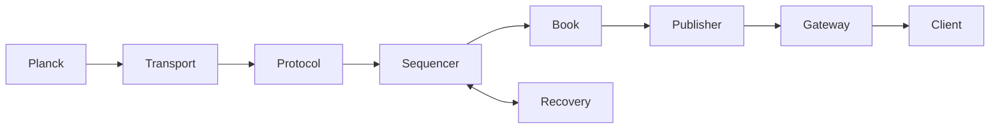

# Maxwell

A high-performance, low-latency market data platform written
in Rust, designed to complement the Planck C++23 matching
engine.

Maxwell provides market data ingestion, deterministic order
book reconstruction, sequence validation, recovery, and
subscriber distribution.

## Architecture



For a detailed system design, see the
[Architecture](docs/architecture.md).

## Design Principles

- Deterministic event processing.
- Single-owner concurrency.
- Fixed-point financial arithmetic.
- Bounded memory consumption.
- Explicit backpressure and recovery.
- Minimal external dependencies.
- Safe Rust.
- Comprehensive unit and integration testing.

## Components

| Crate | Responsibility |
|-------|----------------|
| `maxwell-core` | Domain types and financial primitives |
| `maxwell-protocol` | Binary message encoding and decoding |
| `maxwell-sequencer` | Sequence validation and gap detection |
| `maxwell-book` | Order book reconstruction |
| `maxwell-transport` | Transport, framing, and buffering |
| `maxwell-recovery` | Retransmission and snapshot recovery |
| `maxwell-publisher` | Subscription filtering and fan-out |
| `maxwell-gateway` | Downstream session management |
| `maxwell-client` | Client-side market data consumption |
| `maxwell-metrics` | Low-overhead instrumentation |

For component responsibilities and invariants, see the
[Crate Reference](docs/crates.md).

## Applications

| Application | Responsibility |
|-------------|----------------|
| `maxwell-server` | Integrated market data server |
| `maxwell-simulator` | Deterministic market data generation |
| `maxwell-replay` | Historical market data replay |
| `maxwell-cli` | Command-line client and diagnostics |

## Build and Test

```bash
cargo build --workspace --release
cargo test --workspace
cargo fmt --all -- --check
cargo clippy --workspace --all-targets -- -D warnings
```

See the [Quick Start](docs/quick_start.md) for developer
onboarding and environment setup.

## Documentation

| Document | Description |
|----------|-------------|
| [Quick Start](docs/quick_start.md) | Developer onboarding |
| [Architecture](docs/architecture.md) | System design and component interactions |
| [Architectural Decisions](docs/decisions.md) | Design rationale and tradeoffs |
| [Crate Reference](docs/crates.md) | Component responsibilities and invariants |
| [Protocol](docs/protocol.md) | Binary protocol and Planck interoperability |
| [Concurrency](docs/concurrency.md) | Ownership, synchronization, and memory model |
| [Performance](docs/performance.md) | Benchmarking and optimization |
| [Testing](docs/testing.md) | Testing and validation strategy |
| [Operations](docs/operations.md) | Deployment, monitoring, and diagnostics |
| [Roadmap](docs/roadmap.md) | Development milestones and technical debt |

## Development Status

Maxwell is under active development. Initial implementations
of all ten foundational library crates have been drafted.

Application integration, live Planck interoperability, and
performance benchmarking are forthcoming.

See the [Roadmap](docs/roadmap.md) for current development
priorities.
