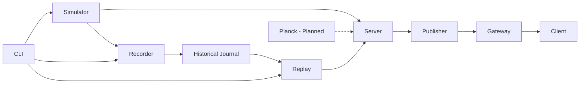

# Maxwell

A low-latency market data processing, distribution, and historical
replay platform written in Rust, designed to complement the
[Planck](https://github.com/tembolo1284/planck) C++23 matching engine.

Maxwell provides deterministic market data processing, order book
reconstruction, sequence validation, recovery coordination,
subscriber distribution, synthetic market simulation, and
historical event persistence.

## Architecture



See [Architecture](docs/architecture.md) for the complete system design.

## Capabilities

- Fixed-point financial primitives and binary protocol encoding.
- Sequence validation, gap detection, and recovery coordination.
- Deterministic order book reconstruction.
- Subscription filtering and bounded publication queues.
- Downstream session management and client synchronization.
- Seeded market simulation with configurable delivery faults.
- Checksummed binary journals and historical replay.
- Sparse journal indexing, seeking, filtering, and playback pacing.
- Unified operational CLI and simulator throughput benchmarking.
- Operational counters, gauges, and latency histograms.

## Design Principles

- Safe Rust and minimal external dependencies.
- Deterministic logical event processing.
- Single-owner mutable market state.
- Explicit sequencing and synchronization boundaries.
- Bounded resources and explicit backpressure.
- Fixed-point financial arithmetic.
- Independently testable components.

## Workspace

The workspace contains ten foundational library crates and four
applications.

| Application | Responsibility |
|-------------|----------------|
| `maxwell-server` | Integrated market data processing |
| `maxwell-simulator` | Deterministic synthetic market generation |
| `maxwell-replay` | Historical recording and playback |
| `maxwell-cli` | Operational commands and diagnostics |

See the [Crate Reference](docs/crates.md) for all workspace packages.

## Quick Start

Build and validate the workspace:

```bash
cargo build --workspace --release
cargo test --workspace
cargo fmt --all -- --check
cargo clippy --workspace --all-targets -- -D warnings
```

Install the CLI:

```bash
cargo install --path apps/maxwell-cli
```

Generate, record, validate, and replay market data:

```bash
maxwell simulate --scenario smoke --events 10000 --seed 42

mkdir -p data

maxwell record \
    --scenario smoke \
    --events 10000 \
    --seed 42 \
    --output data/market.mxj

maxwell inspect data/market.mxj
maxwell validate data/market.mxj
maxwell replay data/market.mxj --authoritative
```

See [Quick Start](docs/quick_start.md) for additional examples.

## Documentation

| Document | Description |
|----------|-------------|
| [Quick Start](docs/quick_start.md) | Installation and operational examples |
| [Architecture](docs/architecture.md) | System design and application topology |
| [Crate Reference](docs/crates.md) | Component responsibilities and invariants |
| [Protocol](docs/protocol.md) | Binary messages and historical journal format |
| [Concurrency](docs/concurrency.md) | Ownership, sequencing, and synchronization |
| [Operations](docs/operations.md) | Configuration, diagnostics, and deployment |
| [Testing](docs/testing.md) | Correctness and integration testing |
| [Performance](docs/performance.md) | Benchmark methodology and optimization |
| [Design Decisions](docs/decisions.md) | Architectural rationale and tradeoffs |
| [Roadmap](docs/roadmap.md) | Development milestones and technical debt |

## Development Status

The foundational crates and initial application implementations
are available.

The next development phase introduces distributed socket
orchestration, containerized deployment, AWS infrastructure,
and live Planck interoperability.

See the [Roadmap](docs/roadmap.md) for implementation priorities.

## License

MIT
