# Maxwell Architecture

## 1. Introduction

Maxwell is a low-latency market data processing, distribution,
simulation, and historical replay platform written in Rust.

It is designed to complement Planck, a C++23 matching engine,
while maintaining independent responsibilities, deployment
boundaries, and development lifecycles.

Maxwell separates financial domain logic, binary communication,
state reconstruction, recovery, publication, and operational
orchestration into independently testable workspace packages.

The initial implementation consists of ten foundational
library crates and four applications.

## 2. System Context

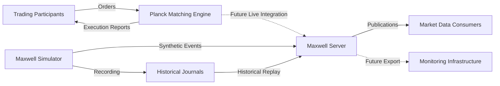

The diagram includes both implemented logical interfaces and
planned deployment integrations.

### 2.1 Planck Responsibilities

- Order acceptance and validation.
- Order matching and execution priority.
- Trade generation.
- Authoritative exchange state.
- Market data event generation.
- Provision of recovery data through agreed interfaces.

### 2.2 Maxwell Responsibilities

- Market data ingestion and validation.
- Sequence tracking and gap detection.
- Deterministic order book reconstruction.
- Recovery coordination.
- Market data publication.
- Subscriber and session management.
- Client synchronization.
- Synthetic market generation.
- Historical event persistence and replay.
- Operational instrumentation.

### 2.3 Non-Responsibilities

Maxwell does not perform:

- Order execution.
- Pre-trade risk management.
- Position management.
- Portfolio valuation.
- Order routing.
- Clearing or settlement.

These responsibilities belong to separate systems.

## 3. Architectural Requirements

### 3.1 Functional Requirements

| ID | Requirement |
|----|-------------|
| FR-01 | Decode and validate market data messages |
| FR-02 | Detect missing, duplicate, and reordered events |
| FR-03 | Reconstruct deterministic order book state |
| FR-04 | Coordinate retransmission-based recovery |
| FR-05 | Support snapshot-based synchronization |
| FR-06 | Distribute filtered market data |
| FR-07 | Maintain bounded subscriber queues |
| FR-08 | Coordinate downstream synchronization |
| FR-09 | Expose operational statistics |
| FR-10 | Generate reproducible synthetic workloads |
| FR-11 | Persist market events in versioned journals |
| FR-12 | Validate and replay historical market events |
| FR-13 | Provide operational command-line tooling |

Production transport orchestration and complete remote recovery
remain integration objectives.

### 3.2 Non-Functional Requirements

- Predictable resource consumption.
- Low processing latency.
- High sustained throughput.
- Predictable tail latency.
- Explicit state ownership.
- Minimal critical-path synchronization.
- Deterministic logical processing.
- Memory-safe implementation.
- Independently testable components.
- Explicit failure and recovery semantics.

Quantitative performance targets must be established through
reproducible benchmarks rather than assumed from the design.

## 4. Architectural Layers

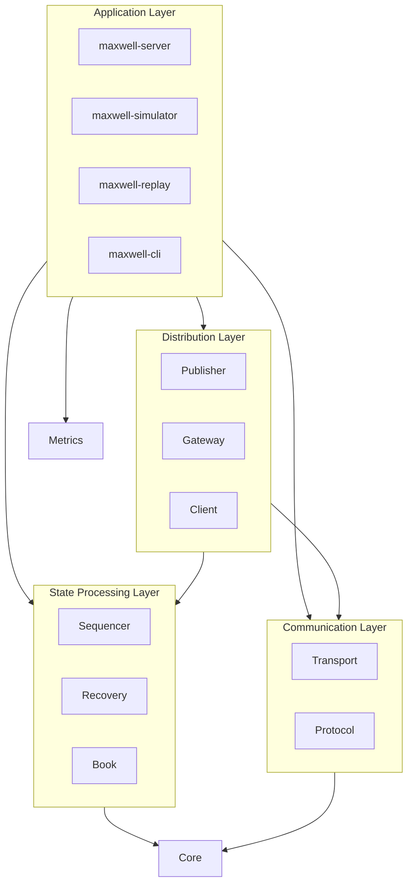

This diagram represents conceptual layering rather than the
exact Cargo dependency graph.

The workspace manifests define the actual compile-time
dependencies.

## 5. Component Boundaries

| Component | Responsibility | Owned State |
|-----------|----------------|-------------|
| Core | Domain primitives | Financial values and event representations |
| Protocol | Binary encoding | Message representations |
| Transport | Communication | Framing and transport buffers |
| Sequencer | Sequence validation | Expected sequence and gap state |
| Recovery | Synchronization | Recovery state and buffered events |
| Book | Market reconstruction | Instruments, orders, and price levels |
| Publisher | Filtering and fan-out | Subscribers and publication queues |
| Gateway | Session coordination | Downstream session state |
| Client | Market consumption | Local synchronized market state |
| Metrics | Instrumentation | Counters, gauges, and histograms |
| Server | Application orchestration | Integrated processing lifecycle |
| Simulator | Synthetic market generation | Authoritative synthetic market |
| Replay | Historical persistence | Journal and playback state |
| CLI | Operational orchestration | Command-specific configuration |

Components expose narrowly scoped interfaces.

Applications coordinate operations spanning multiple
component boundaries.

See [Crate Reference](crates.md) for additional details.

## 6. Market Data Processing Pipeline

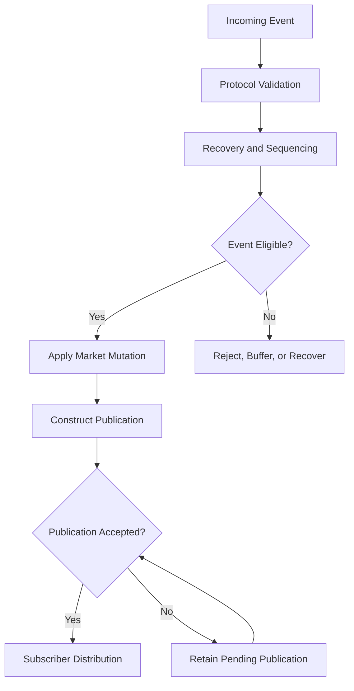

### 6.1 Ingestion

The system distinguishes between:

- Transport frames.
- Binary protocol messages.
- Logical market data events.

A network read is not necessarily equivalent to one complete
protocol message.

Stream transports may produce partial or combined messages.
Datagram transports may lose, duplicate, or reorder messages.

The current integrated server supports in-process event
ingestion. Production socket orchestration is a separate
development workstream.

### 6.2 Validation

Validation includes:

- Frame boundaries and message lengths.
- Protocol version and message type.
- Financial domain constraints.
- Feed and instrument identity.
- Sequence validity.
- Event-specific requirements.

Invalid input must not partially mutate market state.

### 6.3 Market Mutation

Eligible events are applied by the owner of the relevant
market state.

The mutation path must preserve:

- Order identity.
- Price and quantity validity.
- Price-level consistency.
- Instrument boundaries.
- Applicable sequence invariants.

### 6.4 Publication

Market mutation and downstream publication are distinct
operations.

A market event may already have been applied when downstream
publication encounters backpressure.

The server retains pending publication state rather than
applying the original event again.

A retry must not duplicate a successful market mutation.

## 7. Sequence Domains

Maxwell distinguishes three independent sequence domains.

| Domain | Purpose |
|--------|---------|
| Upstream sequence | Ordering authoritative market events |
| Publication sequence | Ordering generated downstream publications |
| Connection sequence | Ordering messages within a downstream session |

These domains must not be treated as interchangeable.

A filtered subscriber may observe gaps in publication
sequences without experiencing upstream data loss.

A reconnect may establish a new connection sequence without
resetting authoritative market state.

The recovery manager owns the upstream sequence cursor.

The journal preserves the original upstream sequence rather
than assigning a replacement sequence.

## 8. Order Book Architecture

The order book reconstructs market state from validated
market events.

Each instrument maintains its own logical book state.

The implementation uses fixed-point financial values and
bounded logical capacities.

### 8.1 Core Invariants

- An active order identifier must be unique within its scope.
- Resting quantities must remain valid.
- Price levels must reconcile with resting orders.
- Instrument-specific price constraints must be respected.
- Order counts must reconcile with registry contents.
- Failed mutations must preserve consistency.

### 8.2 Storage

The book uses dense price-level structures and an order
registry.

Dense ladder capacity must accommodate the complete
configured instrument price band.

The logical maximum number of orders is distinct from the
internal capacity of the underlying hash table.

A logical capacity limit does not imply allocation-free
operation.

Replacing the current order registry with a fixed-capacity
structure remains a potential optimization.

### 8.3 Deterministic Comparison

Canonical market comparisons should include:

- Instrument identifiers and definitions.
- Upstream sequence cursor.
- Per-instrument sequence state.
- Resting order identifiers.
- Order sides, prices, and quantities.
- Order counts and price-level consistency.

FIFO priority requires additional explicit verification.

## 9. Recovery Architecture

Recovery coordinates the transition between synchronized
and unsynchronized market state.

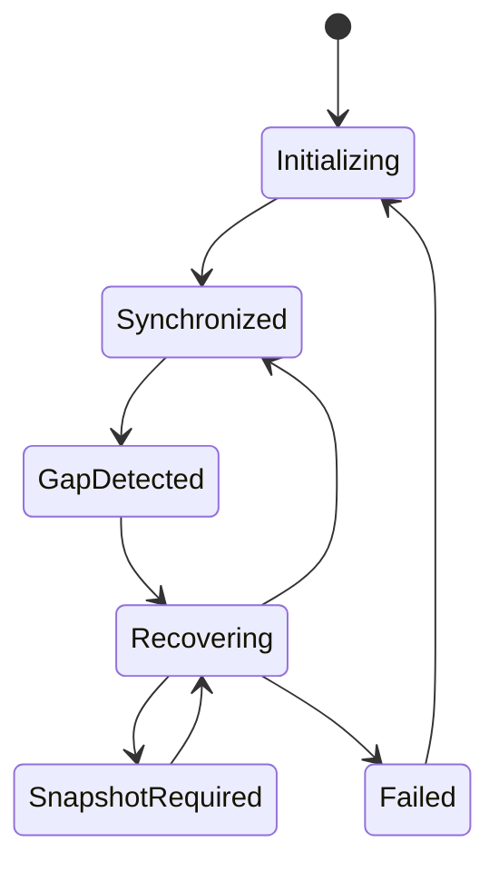

This is a conceptual lifecycle rather than an exact
enumeration of Rust implementation variants.

### 9.1 Retransmission

Retransmission-based recovery requires:

- Identification of missing sequence ranges.
- Bounded buffering of later events.
- Validation of recovered events.
- Ordered application of recovered and buffered events.
- Explicit synchronization restoration.

The simulator provides retained history for controlled
retransmission testing.

Production request-response correlation and transport
orchestration remain future work.

### 9.2 Snapshot Recovery

A snapshot must identify the market scope and sequence
watermark it represents.

Buffered events already included in the snapshot must not
be applied again.

Eligible subsequent events must be applied in order.

Complete upstream snapshot installation and remote snapshot
exchange remain integration workstreams.

### 9.3 Synchronization

A market must not be advertised as synchronized merely
because some valid events have been received.

Synchronization requires satisfaction of the complete
initialization or recovery contract.

## 10. Publication Architecture

The publisher separates market processing from subscriber
delivery.

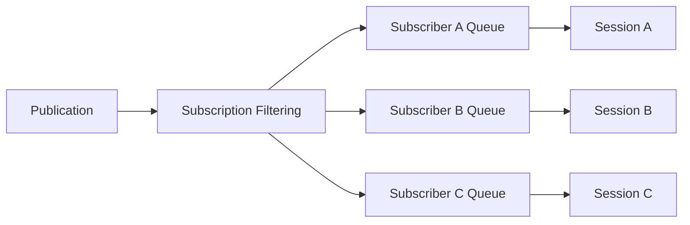

Subscriber queues have configured capacity limits.

Supported backpressure policies distinguish between:

- Rejecting a publication when capacity is unavailable.
- Invalidating an overloaded subscriber and requiring
  resynchronization.

A rejected publication must not produce partial fan-out
under an atomic rejection policy.

An invalidated subscriber must not resume ordinary
incremental delivery until synchronization is restored.

## 11. Gateway and Client Architecture

The gateway coordinates downstream sessions and subscription
activation.

The client maintains consumer-side market state.

A conceptual downstream lifecycle is:

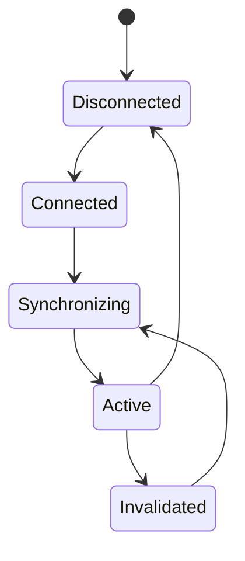

A consistent snapshot watermark establishes the boundary
between initialization data and subsequent increments.

A client must not advertise synchronized market state
before satisfying that boundary.

Complete downstream socket framing, session orchestration,
and remote integration remain Phase III objectives.

## 12. Application Architecture

### 12.1 maxwell-server

The server integrates the foundational processing components.

Responsibilities include:

- Server configuration and lifecycle management.
- Instrument registration.
- Upstream event ingestion.
- Recovery coordination.
- Order book mutation.
- Publication generation.
- Subscriber coordination.
- Operational status and metrics.

The initial server uses a single-owner processing model.

The application exposes in-process ingestion and downstream
interfaces suitable for deterministic integration testing.

### 12.2 maxwell-simulator

The simulator generates reproducible synthetic market data.

It maintains an independent authoritative market rather than
using the server's order book as its source of truth.

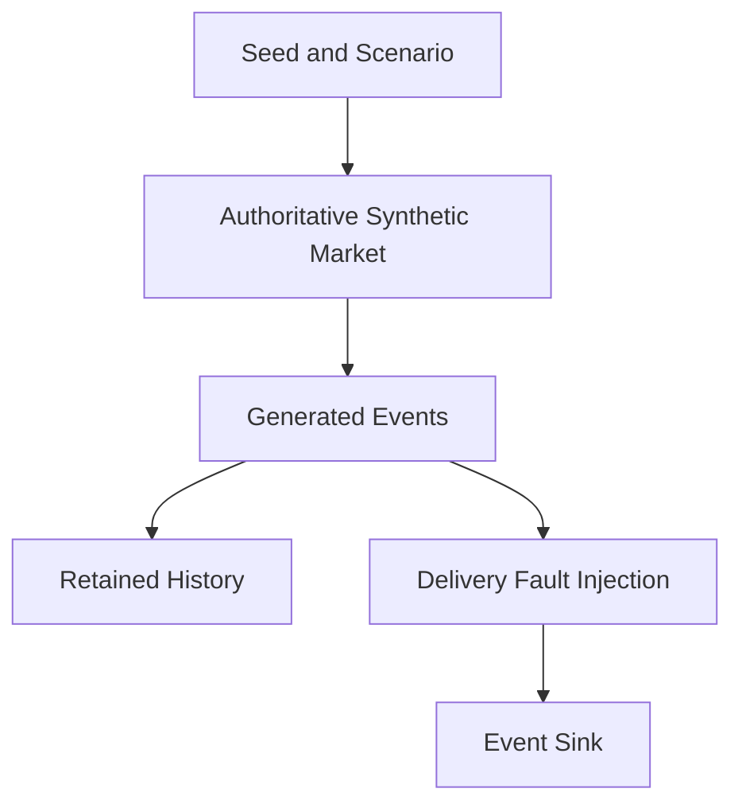

Capabilities include:

- Seeded deterministic generation.
- Multiple instruments.
- Order addition, modification, cancellation, deletion,
  and execution.
- Independent market and fault randomness.
- Configurable event loss, duplication, and reordering.
- Bounded delivery queues.
- Retained event history.
- Snapshot generation.
- Virtual, unbounded, and real-time pacing.
- Workload statistics.

The independent market enables comparison against the
server's reconstructed state.

### 12.3 maxwell-replay

The replay application provides historical persistence and
playback.

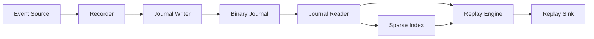

Two journal modes are supported.

| Mode | Semantics |
|------|-----------|
| Authoritative | Contiguous upstream event sequence |
| RawCapture | Original arrival order, including delivery faults |

The journal is append-only during a recording session.

Records contain:

- Original upstream sequence.
- Relative recording timestamp.
- Encoded Maxwell protocol message.
- CRC32C integrity checksum.

Replay supports:

- Sequential validation.
- Sparse indexing.
- Sequence and timestamp seeking.
- Instrument and event filtering.
- Unbounded playback.
- Virtual playback.
- Real-time and scaled playback.
- Explicit sink backpressure.
- Replay statistics.

A filtered or seeked stream is not automatically suitable
for authoritative market reconstruction.

Reconstruction requires an appropriate initial state and
complete subsequent events.

### 12.4 maxwell-cli

The CLI provides a unified local operational interface.

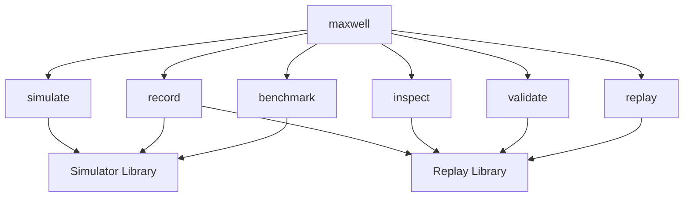

The CLI delegates domain processing to existing libraries.

It is responsible for:

- Argument parsing.
- Configuration construction.
- Command dispatch.
- Local application orchestration.
- Human-readable operational reporting.
- Process exit codes.

Remote server administration is not part of the initial CLI.

## 13. Historical Reconstruction

Historical reconstruction connects the simulator, server,
recorder, and replay engine.

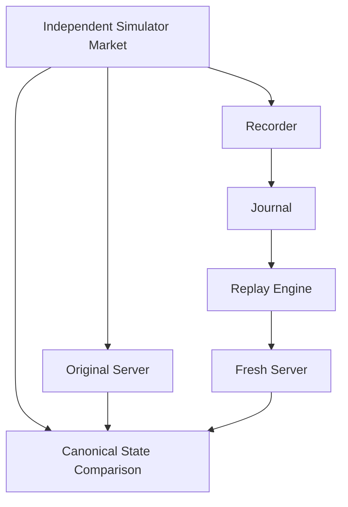

The reconstruction contract requires:

1. Equivalent initial instrument definitions.
2. Equivalent initial market state.
3. Complete authoritative event recording.
4. Preserved upstream sequence ordering.
5. Exactly-once logical event application.
6. Equivalent final canonical market state.

Replay pacing and processing batch size must not change
the resulting logical market state.

The reconstruction test suite is intended to verify these
properties across independent server instances.

Production transactional coordination between journal
persistence and market mutation is a separate concern.

## 14. Deployment Topologies

### 14.1 Current Local Topology

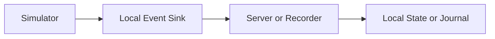

The current implementation supports local application
execution and in-process integration.

### 14.2 Planned Distributed Topology

The first distributed implementation will establish
producer-to-server communication before introducing more
complex recovery and deployment requirements.

### 14.3 Planned AWS Topology

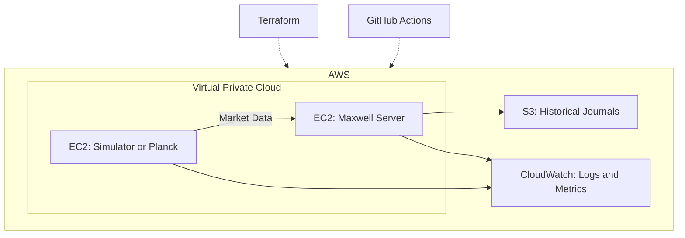

The initial AWS environment is expected to use:

- Terraform for infrastructure provisioning.
- Docker for application packaging.
- EC2 for application execution.
- S3 for completed journal storage.
- CloudWatch for operational monitoring.
- GitHub Actions for automated validation and deployment.

This topology is planned and has not yet been deployed.

## 15. Observability Architecture

Operational instrumentation should distinguish:

- Generated and received events.
- Accepted and rejected events.
- Sequence gaps and duplicates.
- Recovery transitions.
- Market mutations.
- Pending publications.
- Subscriber queue occupancy.
- Subscriber invalidations.
- Journal records and bytes.
- Replay delivery and filtering.
- Processing latency.

Metrics should be collected without unnecessarily
synchronizing the critical processing path.

The metrics crate provides foundational instrumentation.

Production monitoring exporters and dashboards remain
deployment workstreams.

## 16. Security and Trust Boundaries

External market data must be treated as untrusted input.

Validation must occur before market mutation.

Deployment boundaries must address:

- Network access control.
- Authentication and authorization.
- Resource exhaustion.
- Malformed protocol input.
- Journal corruption.
- Secret management.
- Operational auditability.

CRC32C provides accidental corruption detection, not
cryptographic authentication.

Cloud deployments should use least-privilege IAM roles
and restricted network access.

## 17. Architectural Invariants

The following invariants apply across the system:

1. Market state has an explicit mutable owner.
2. Financial arithmetic uses fixed-point representations.
3. Sequence domains remain independent.
4. Invalid events must not partially mutate market state.
5. Publication retries must not duplicate market mutations.
6. Backpressure must have explicit semantics.
7. Unsynchronized state must not be advertised as valid.
8. Subscriber invalidation requires resynchronization.
9. Journal replay preserves original event identity.
10. Filtered replay is not implicitly authoritative.
11. Resource exhaustion must not trigger unrestricted growth.
12. Performance claims require reproducible measurements.

## 18. Engineering Handover

Before modifying a component:

- Review its public interfaces and invariants.
- Identify the owner of affected mutable state.
- Identify affected sequence domains.
- Review failure and retry semantics.
- Preserve resource limits.
- Add relevant regression tests.
- Update affected documentation.

## 19. Related Documentation

- [Crate Reference](crates.md)
- [Protocol](protocol.md)
- [Concurrency](concurrency.md)
- [Design Decisions](decisions.md)
- [Testing](testing.md)
- [Performance](performance.md)
- [Operations](operations.md)
- [Roadmap](roadmap.md)
