# Maxwell Architecture

## 1. Introduction

Maxwell is a low-latency market data processing and distribution
platform written in Rust.

It is designed to operate alongside Planck, a C++23 matching
engine, while maintaining independent responsibilities,
deployment boundaries, and development lifecycles.

This document describes the logical architecture, component
responsibilities, state ownership, data flow, synchronization
requirements, and intended application topology.

The foundational library crates have an initial implementation.
Application-level integration remains under development.

## 2. System Context

Planck is responsible for order execution and matching.

Maxwell is responsible for consuming exchange-generated events,
reconstructing market data state, and distributing that state
to downstream consumers.

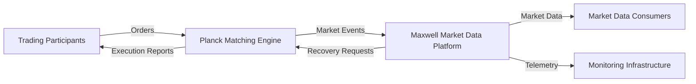

### 2.1 Planck Responsibilities

- Order acceptance and validation.
- Order matching.
- Execution priority.
- Trade generation.
- Authoritative exchange state.
- Generation of market data events.
- Provision of recovery data through agreed interfaces.

### 2.2 Maxwell Responsibilities

- Market data ingestion.
- Binary protocol validation.
- Sequence tracking.
- Duplicate and gap detection.
- Order book reconstruction.
- Recovery coordination.
- Market data publication.
- Subscriber and session management.
- Client synchronization.
- Operational instrumentation.

### 2.3 Non-Responsibilities

Maxwell does not perform:

- Order execution.
- Pre-trade risk management.
- Position management.
- Portfolio valuation.
- Order routing.
- Clearing or settlement.

These responsibilities belong to separate systems.

## 3. Architectural Requirements

### 3.1 Functional Requirements

| ID | Requirement |
|----|-------------|
| FR-01 | Decode and validate incoming market data |
| FR-02 | Detect missing, duplicate, and out-of-order events |
| FR-03 | Reconstruct deterministic order book state |
| FR-04 | Support retransmission-based recovery |
| FR-05 | Support snapshot-based recovery |
| FR-06 | Distribute filtered market data |
| FR-07 | Maintain bounded subscriber queues |
| FR-08 | Coordinate downstream synchronization |
| FR-09 | Expose operational statistics |
| FR-10 | Support reproducible simulation and replay |

### 3.2 Non-Functional Requirements

| ID | Requirement |
|----|-------------|
| NFR-01 | Predictable memory consumption |
| NFR-02 | Low processing latency |
| NFR-03 | High sustained throughput |
| NFR-04 | Predictable tail latency |
| NFR-05 | Explicit state ownership |
| NFR-06 | Minimal critical-path synchronization |
| NFR-07 | Deterministic logical processing |
| NFR-08 | Memory-safe implementation |
| NFR-09 | Independently testable components |
| NFR-10 | Explicit failure and recovery semantics |

Quantitative performance requirements will be established
through reproducible system benchmarks.

## 4. Architectural Layers

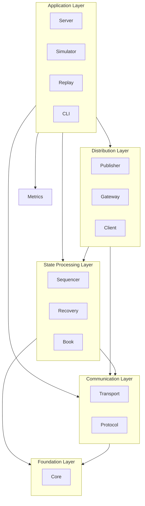

This diagram represents conceptual layering rather than the
exact Cargo dependency graph.

Actual crate dependencies are defined by the workspace manifests.

## 5. Component Boundaries

| Component | Primary Responsibility | Owned State |
|-----------|------------------------|-------------|
| Core | Domain primitives | Domain values |
| Protocol | Wire encoding and decoding | Message representations |
| Transport | Communication and buffering | Transport state |
| Sequencer | Sequence validation | Expected sequence |
| Recovery | Synchronization restoration | Recovery state and buffers |
| Book | Market state reconstruction | Order book state |
| Publisher | Filtering and fan-out | Subscribers and publication queues |
| Gateway | Downstream session coordination | Session state |
| Client | Consumer synchronization | Local market data state |
| Metrics | Instrumentation | Counters, gauges, histograms |

Components should expose narrowly scoped interfaces.

The application layer coordinates interactions that span
multiple component boundaries.

## 6. Market Data Processing Pipeline

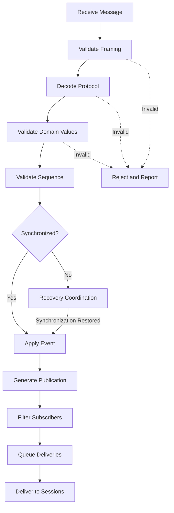

### 6.1 Ingestion

The transport component receives upstream data.

The application must distinguish between:

- Transport-level frames.
- Protocol-level messages.
- Logical market data events.

A network read is not necessarily equivalent to one complete
protocol message.

Stream transports may produce partial or combined messages.
Datagram transports may lose, duplicate, or reorder messages.

### 6.2 Validation

Validation should occur before an event mutates market state.

Validation includes:

- Frame boundaries.
- Message length.
- Supported message type.
- Supported protocol version where applicable.
- Domain value validity.
- Sequence validity.
- Instrument identity.
- Event-specific constraints.

Malformed input must not partially mutate the order book.

If a malformed message prevents sequence continuity from being
established, the affected feed must not continue to advertise
synchronized state.

### 6.3 State Mutation

Validated and appropriately ordered events are applied to the
relevant market data state.

A failed mutation must have documented semantics.

Where transactional mutation is required, failure must leave
the original state unchanged or explicitly invalidate it.

### 6.4 Publication

A successful market state transition may produce one or more
downstream publications.

The application must preserve the relationship between:

- The applied upstream event.
- The resulting market state.
- The corresponding publication.
- The publication watermark.

Publication retries must not cause duplicate book mutations.

## 7. Sequence Domains

Maxwell must distinguish independent ordering domains.

| Domain | Scope | Purpose |
|--------|-------|---------|
| Upstream sequence | Feed or stream | Exchange event continuity |
| Recovery watermark | Recovery scope | Restored state boundary |
| Publication sequence | Publisher instance | Publication ordering |
| Session sequence | Downstream session | Delivery continuity where supported |

Sequence numbers from different domains must not be compared
without an explicitly defined mapping.

### 7.1 Upstream Sequencing

The upstream sequence identifies the order in which exchange
events must be processed.

A sequencing scope must be defined by the upstream protocol.

For example, two independent feeds may both contain an event
with sequence number 100 without representing the same event.

### 7.2 Publication Sequencing

Publication sequence numbers identify accepted publications
within a publisher instance.

A filtered subscriber may receive publication sequences:

```text
100, 103, 107, 108
```

The missing values do not necessarily indicate packet loss.

They may correspond to publications excluded by the
subscriber's filter.

### 7.3 Session Sequencing

If the downstream protocol provides session-local delivery
sequences, those sequences can establish delivery continuity
independently of publication filtering.

Session sequencing and reconnect semantics must be explicitly
defined before network interoperability is considered complete.

### 7.4 Sequence Exhaustion

Sequence counters must not silently wrap.

Exhaustion requires an explicit error or a documented stream
reset procedure.

Stream restarts must distinguish a new sequence epoch from
duplicate or delayed events belonging to an earlier epoch.

## 8. Order Book Architecture

The order book represents market state derived from
authoritative upstream events.

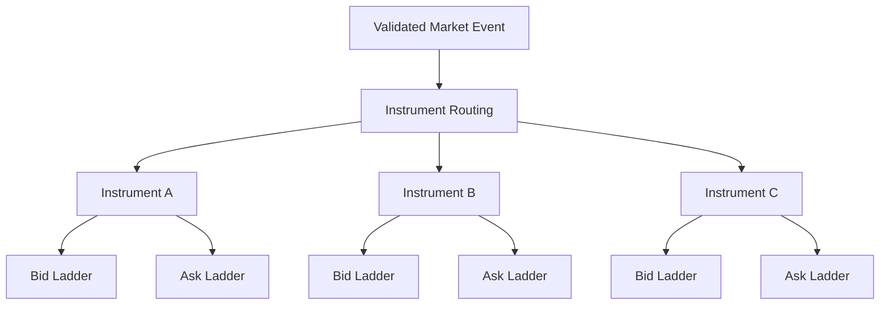

The exact book representation is defined by maxwell-book.

### 8.1 Book Invariants

Applicable invariants include:

- Prices and quantities use validated domain representations.
- Price levels maintain their required ordering.
- Bid and ask state remain logically distinct.
- Quantities do not silently overflow or underflow.
- Best-price calculations reflect current book state.
- Duplicate upstream events do not cause duplicate mutations.
- Invalid events do not silently corrupt state.
- Snapshots correspond to a defined synchronization boundary.

Crossed or locked markets must be interpreted according to
the upstream market data contract rather than universally
treated as invalid.

### 8.2 State Ownership

A mutable order book must have one logical processing owner.

Partitioning by instrument is possible only when the
application preserves upstream sequencing, recovery, and
cross-instrument consistency requirements.

### 8.3 Snapshot Consistency

A snapshot must represent a consistent state boundary.

The snapshot producer must establish:

- The relevant instrument or feed scope.
- The state represented by the snapshot.
- The corresponding watermark.
- The ordering of subsequent incremental updates.

A snapshot must not combine unrelated state versions while
advertising a single consistent watermark.

## 9. Recovery Architecture

Recovery restores synchronization after upstream continuity
has been lost.

The following state machine is conceptual. Actual state
variants and transition APIs are defined by maxwell-recovery.

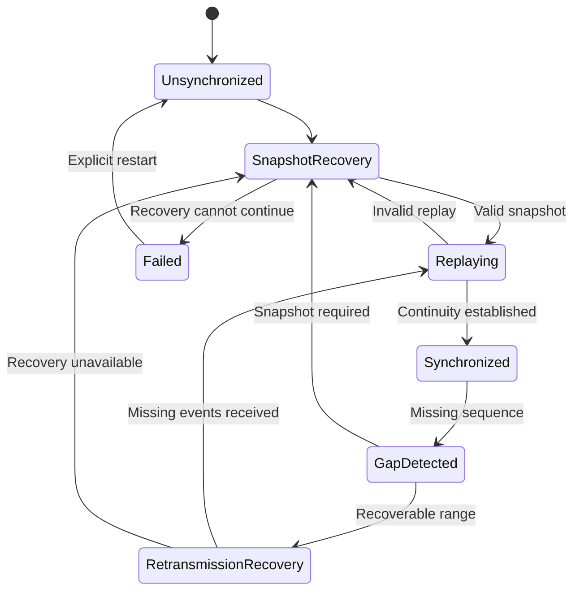

### 9.1 Gap Detection

When a sequence gap is detected:

1. Identify the affected sequencing scope.
2. Record the expected and observed sequence.
3. Mark the affected state as unsynchronized.
4. Buffer eligible subsequent events within configured limits.
5. Initiate the configured recovery procedure.
6. Validate recovered data.
7. Restore continuity.
8. Resume synchronized processing.

Unaffected independent feeds may continue processing if their
state and consistency guarantees are genuinely independent.

### 9.2 Retransmission

Retransmission restores missing events from an authoritative
recovery source.

Recovered events must be validated against:

- The requested sequence range.
- The affected feed.
- The current recovery state.
- Existing buffered events.
- Duplicate and ordering constraints.

### 9.3 Snapshot Recovery

Snapshot recovery establishes a new valid state boundary.

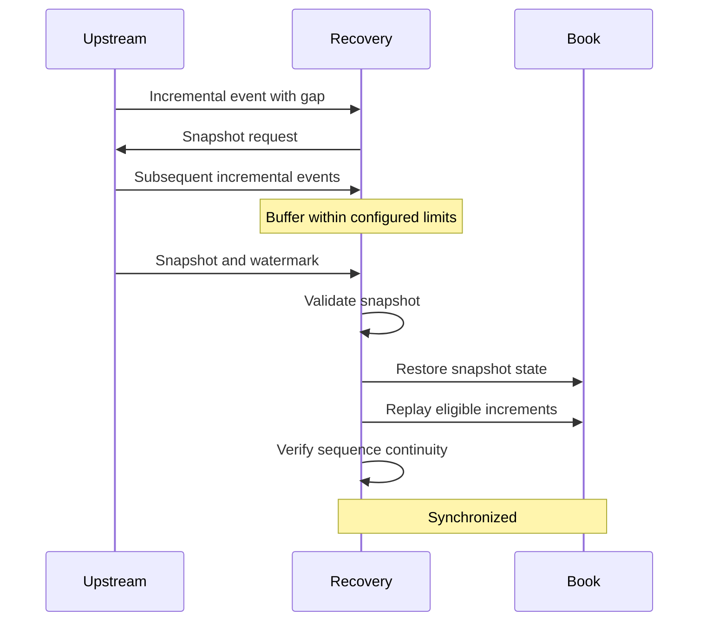

Events already represented by the snapshot must not be
applied again.

### 9.4 Recovery Buffer Exhaustion

Recovery buffers must remain bounded.

When capacity is exhausted, the system must explicitly
invalidate or restart recovery according to its policy.

Silently discarding an event and later declaring the feed
synchronized is prohibited.

### 9.5 Recovery Completion

Recovery completion requires more than receipt of a snapshot
or retransmission response.

The application must establish that the resulting state is
consistent with the accepted recovery watermark and all
required subsequent events.

## 10. Publication Architecture

The publisher distributes market data to registered
subscribers.

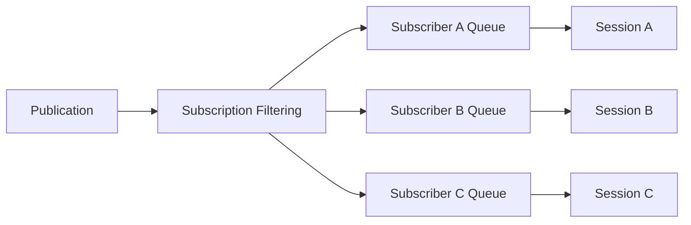

### 10.1 Subscription Filtering

Subscriptions may select:

- All instruments.
- A bounded set of instruments.
- Selected event types.
- Global events where applicable.

Filtering must preserve the relative order of publications
delivered to each subscriber.

### 10.2 Subscriber Lifecycle

The publisher defines the following subscriber states:

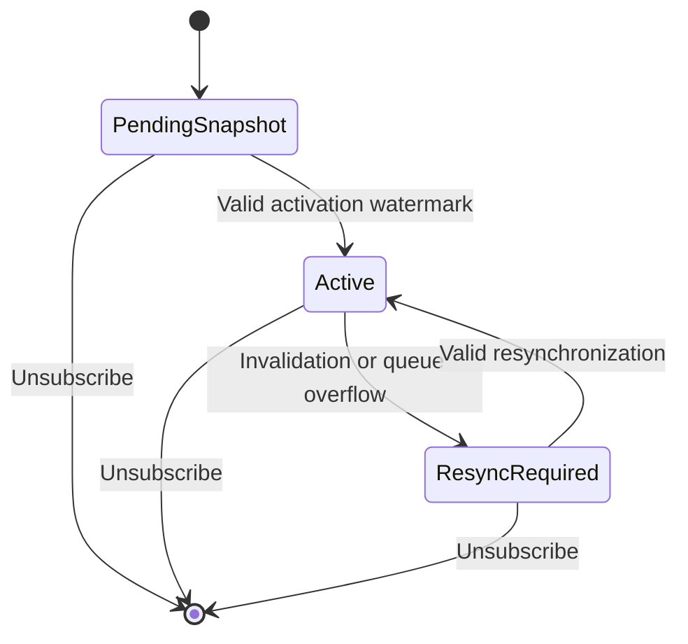

Pending and invalidated subscribers do not receive ordinary
incremental publications until correctly activated.

### 10.3 Backpressure Policies

The publisher supports two principal policies.

#### RejectPublication

Reject a publication when a matching active subscriber
cannot accept it.

Rejection must occur before partial fan-out or advancement
of the publication sequence.

The application must retain the rejected publication and
retry it without repeating the underlying book mutation.

#### RequireResync

Invalidate an overloaded subscriber and continue publishing
to healthy subscribers.

The invalidated subscriber's pending queue is discarded.

The application must ensure that the subscriber receives an
invalidation notification or is disconnected, even if no
subsequent market event arrives.

### 10.4 Snapshot Activation

Subscriber activation requires a consistent publication
watermark.

The publisher does not maintain an unrestricted historical
publication replay log.

Snapshot creation, delivery ordering, and activation must
therefore be coordinated by the application and gateway.

A subscriber must receive its snapshot before incremental
updates belonging to the activated state.

## 11. Gateway and Client Architecture

The gateway manages downstream session coordination.

The client maintains the consumer-side synchronization state.

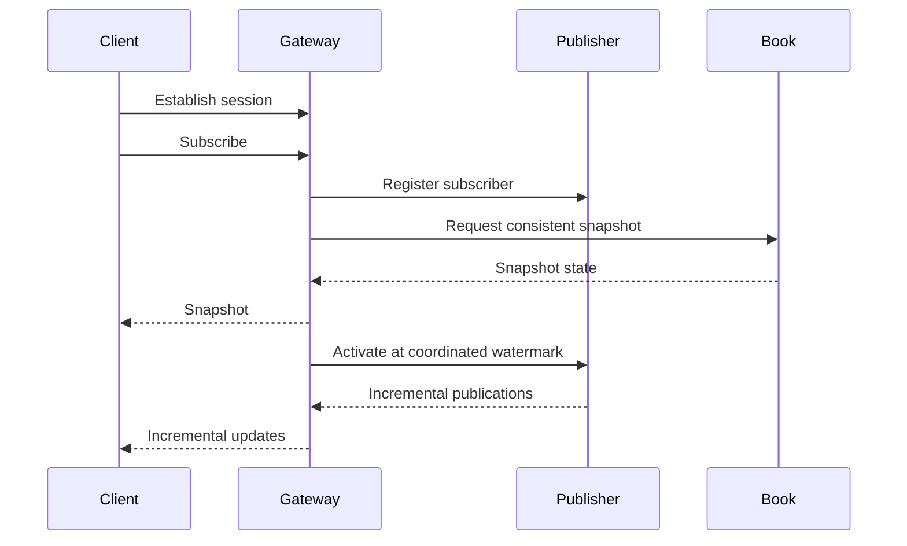

This sequence illustrates the intended logical interaction.

The exact implementation must account for nonblocking
delivery, partial writes, queue capacity, and the atomicity
of the snapshot-to-incremental transition.

### 11.1 Session Isolation

A downstream session must not mutate unrelated session state.

A slow or disconnected consumer must not silently invalidate
healthy consumers.

### 11.2 Delivery Semantics

Successful acceptance by a publication sink does not
necessarily mean that a remote client has received the data.

The transport contract must distinguish:

- Accepted for local delivery.
- Buffered for transmission.
- Written to the transport.
- Received by the remote endpoint.
- Acknowledged by the remote application, if supported.

Exactly-once network delivery is not assumed.

### 11.3 Client Synchronization

Clients must not advertise their local state as synchronized
until the required initial snapshot and continuity checks
have completed.

On invalidation, the client must either discard affected
state or explicitly mark it stale until recovery completes.

## 12. Application Architecture

### 12.1 Server

The server is the composition root of the system.

It is responsible for:

- Constructing and configuring components.
- Establishing transport connections.
- Defining processing ownership.
- Coordinating event processing.
- Managing recovery requests.
- Coordinating publication retries.
- Managing downstream sessions.
- Collecting operational telemetry.
- Handling shutdown and fatal errors.

Business logic should remain in reusable library crates
where practical.

### 12.2 Simulator

The simulator generates controlled market data workloads.

It should support deterministic seeds, configurable event
rates, bursts, and explicit failure scenarios.

The simulator should use the same protocol representations
as the production ingestion path.

### 12.3 Replay

The replay application reconstructs historical processing
behavior from recorded inputs.

It should support:

- Original event ordering.
- Configurable pacing.
- Maximum-throughput replay.
- State reconciliation.
- Deterministic regression validation.

### 12.4 CLI

The CLI provides a human-facing interface for market data
inspection, subscription management, and diagnostics.

Human-readable formatting belongs outside the critical
market data processing path.

## 13. Deployment Topologies

### 13.1 Single-Threaded Baseline

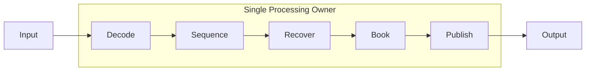

A single-threaded baseline simplifies correctness validation
and provides a useful performance reference.

### 13.2 Partitioned Processing

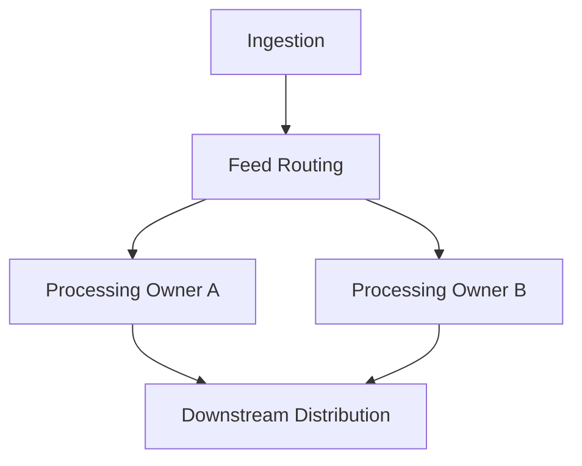

Partitioned processing may improve throughput when feed
scopes can be processed independently.

Partitioning must not introduce nondeterministic ordering
into a publication domain that requires a total order.

### 13.3 Topology Selection

The initial server should favor the simplest topology that
satisfies correctness and operational requirements.

Additional threads, partitions, and communication channels
should be introduced based on profiling and measured needs.

## 14. Observability Architecture

Processing owners maintain local instrumentation.

Telemetry collection should occur outside the critical path
where practical.

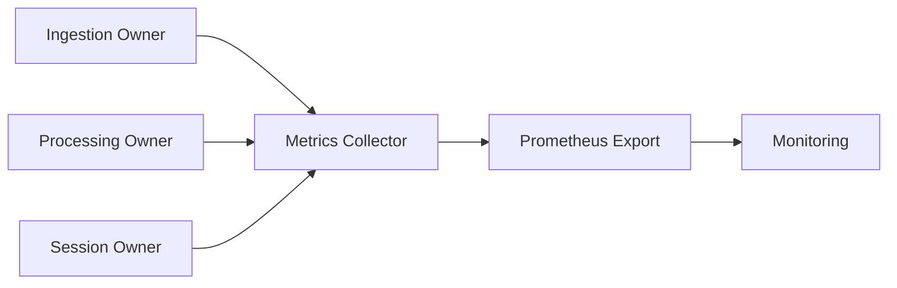

Telemetry collection must not introduce data races or
unbounded queues.

Timing measurements must not influence deterministic
market state transitions.

## 15. Security and Trust Boundaries

All network input must be treated as untrusted.

Required considerations include:

- Frame length validation.
- Message type validation.
- Bounded resource allocation.
- Session and subscription limits.
- Malformed message handling.
- Connection lifecycle management.
- Authentication and authorization where required.
- Network isolation.
- Protection against resource exhaustion.

Authentication, encryption, and production network security
policies remain application-level design requirements.

Memory safety alone does not establish system security.

## 16. Architectural Invariants

The following invariants must be preserved across components:

1. Authoritative market state originates from upstream events.
2. Invalid messages cannot silently corrupt synchronized state.
3. An upstream event cannot be applied twice due to retry.
4. Sequence domains remain distinct.
5. Recovery must establish continuity before synchronization.
6. Snapshot watermarks must correspond to represented state.
7. Filtered publication gaps are not automatically data loss.
8. Subscriber overflow must produce an explicit policy outcome.
9. Mutable state must have a defined owner.
10. Resource growth must remain bounded.
11. Delivery acceptance must not be confused with remote receipt.
12. Performance optimization must preserve correctness.

## 17. Engineering Handover

A developer changing a component should identify:

- Its upstream and downstream contracts.
- Its owned state.
- Its ordering guarantees.
- Its capacity constraints.
- Its error semantics.
- Its recovery behavior.
- Its concurrency assumptions.
- Its associated tests.
- Its performance-sensitive operations.

Changes spanning multiple components require integration
tests that exercise the affected boundaries.

## 18. Related Documentation

- [Crate Reference](crates.md)
- [Protocol](protocol.md)
- [Concurrency](concurrency.md)
- [Architectural Decisions](decisions.md)
- [Performance](performance.md)
- [Testing](testing.md)
- [Operations](operations.md)
- [Roadmap](roadmap.md)
