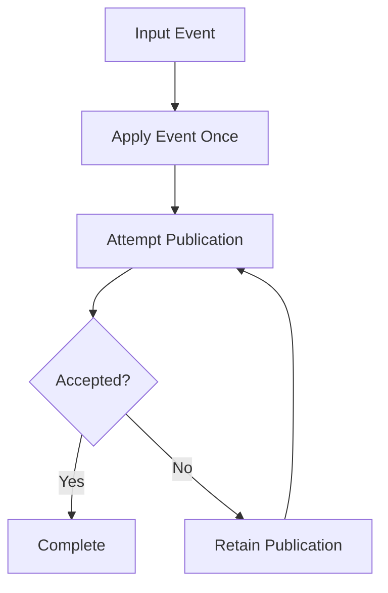
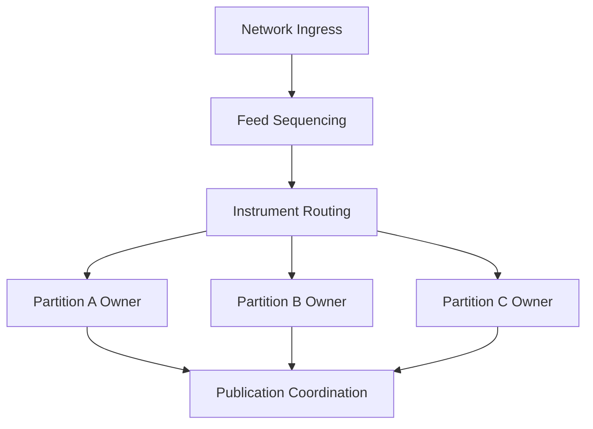

# Maxwell Concurrency Model

## 1. Purpose

This document defines Maxwell's concurrency principles,
state ownership model, synchronization boundaries,
backpressure semantics, and future parallel execution
strategy.

The initial application architecture prioritizes
deterministic correctness before introducing additional
parallelism.

## 2. Core Principle

Mutable market state should have one explicit owner.

Other components interact with that owner through defined
interfaces, immutable values, snapshots, or bounded
communication channels.

Shared mutable state should not be introduced merely to
increase the number of executing threads.

## 3. Why Single Ownership

Single-owner processing provides:

- Explicit mutation ordering.
- Reduced synchronization requirements.
- Simpler reasoning about state transitions.
- Reproducible logical behavior.
- Clearer recovery boundaries.
- Easier failure diagnosis.
- Reduced lock contention.

Single ownership does not imply that the complete
application must execute on one thread.

Networking, persistence, monitoring, and independent
market partitions may eventually execute concurrently.

## 4. State Ownership

| State | Owner |
|-------|-------|
| Upstream sequence cursor | Recovery manager |
| Order book state | Book owner |
| Recovery buffers | Recovery manager |
| Publication sequence | Publisher |
| Subscriber queues | Publisher |
| Connection sequence | Gateway session |
| Consumer market state | Client |
| Synthetic market | Simulator |
| Simulation random state | Simulator |
| Journal output | Journal writer |
| Journal read position | Journal reader |
| Pending replay record | Replay engine |

The integrated server coordinates these owners through
its processing lifecycle.

Ownership transfer must be explicit.

## 5. Current Server Topology

The current server supports deterministic in-process
event ingestion.

The processing owner coordinates:

1. Event eligibility and sequencing.
2. Recovery state transitions.
3. Market mutation.
4. Publication construction.
5. Publication acceptance or retention.

The initial implementation does not require a dedicated
thread for every foundational crate.

## 6. Mutation and Publication Boundaries

A market mutation and its downstream publication are
separate operations.

Once the event has been successfully applied, retrying
publication must not apply the event again.

The server distinguishes between:

- Input not yet consumed.
- Input consumed with publication pending.
- Input consumed and publication accepted.

An adapter must preserve these distinctions.

Treating all forms of backpressure as an instruction to
resubmit the original event can corrupt market state.

## 7. Queue Selection

Future concurrent components should use the simplest
queue compatible with their producer-consumer topology.

| Queue | Producers | Consumers |
|-------|-----------|-----------|
| SPSC | One | One |
| MPSC | Multiple | One |
| SPMC | One | Multiple |
| MPMC | Multiple | Multiple |

Prefer SPSC when ownership naturally permits it.

Do not select MPMC merely because it is more general.

Queue selection must consider:

- Ordering requirements.
- Capacity.
- Ownership transfer.
- Allocation behavior.
- Backpressure.
- Shutdown behavior.
- Memory ordering.

## 8. Queue Contracts

A bounded queue should define:

- Maximum logical capacity.
- Successful insertion semantics.
- Full-queue behavior.
- Empty-queue behavior.
- Ownership of rejected items.
- FIFO guarantees.
- Shutdown and cleanup behavior.

Queue capacity must not silently expand under load.

A failed enqueue must not imply successful ownership
transfer.

## 9. Backpressure

Backpressure is an explicit operational condition.

It must not be treated as an unspecified error or
silently ignored.

### 9.1 Server Backpressure

If an input has not been consumed, the caller may retry
that input according to the ingestion contract.

If the input has already mutated market state, only the
pending publication should be retried.

### 9.2 Publisher Backpressure

Supported policies distinguish between:

- Rejecting publication when capacity is unavailable.
- Invalidating overloaded subscribers and requiring
  resynchronization.

Healthy subscribers should not inherit invalidated
subscriber state.

### 9.3 Simulator Backpressure

The simulator retains pending delivery when its sink
reports that an event was not accepted.

It must not generate unrestricted additional work while
bounded delivery resources remain exhausted.

### 9.4 Replay Backpressure

The replay engine retains the current record until its
sink accepts delivery.

A rejected delivery attempt must not advance the
accepted-record statistics.

The engine exposes a bounded backpressure-attempt budget.

Exhausting that budget requires an explicit caller
decision rather than indefinite busy spinning.

### 9.5 Persistence Backpressure

The current recorder uses synchronous buffered file I/O.

Disk latency can therefore delay the calling execution
path.

A future asynchronous persistence worker must use bounded
queues and define the durability and failure semantics
of ownership transfer.

## 10. Atomic Operations

Atomic operations should be introduced only when state
must be shared across concurrent execution contexts.

Appropriate examples include:

- Independent metric counters.
- Shutdown flags.
- Queue ownership coordination.
- Explicit synchronization state.

Relaxed ordering may be sufficient for independent
statistics that do not publish associated state.

Acquire and release ordering may be required when an
operation publishes or consumes associated memory.

Sequential consistency should be selected when its
stronger ordering guarantees are required.

Memory ordering must follow a documented synchronization
contract rather than a blanket optimization rule.

## 11. Rust Send and Sync

Rust's type system provides important concurrency
constraints.

Send permits ownership transfer between threads.

Sync permits shared references across threads when the
underlying type satisfies the required safety contract.

These traits do not establish application-level
determinism, ordering, or transactional correctness.

A thread-safe data structure can still be used incorrectly
within a market processing pipeline.

## 12. Locking

Avoid unnecessary locks on the market mutation path.

Locks may be appropriate for:

- Infrequent configuration changes.
- Administrative operations.
- Shared noncritical resources.
- Explicit coordination boundaries.

When multiple locks are necessary, define acquisition
ordering and avoid holding locks across blocking I/O.

The absence of explicit mutexes does not prove that an
application is lock-free.

## 13. Memory Allocation

Maxwell uses bounded logical resources where practical.

Important limits include:

- Registered instruments.
- Resting orders.
- Price levels.
- Recovery buffers.
- Subscriber queues.
- Simulator history.
- Simulator delivery queues.
- Journal payload buffers.
- Sparse journal index entries.

Logical resource limits are not equivalent to
allocation-free execution.

The current order registry may allocate while remaining
within its configured logical order limit.

A fixed-capacity registry is a future optimization.

## 14. Cache Locality

Future optimization should evaluate:

- Contiguous price-level storage.
- Hot and cold field separation.
- Compact event representations.
- Predictable traversal.
- Reduced pointer chasing.
- Reuse of encoding buffers.
- Batching of communication operations.

Changes must be supported by profiling and preserve
logical correctness.

## 15. False Sharing

Independent mutable counters or queue indexes may occupy
the same cache line.

Concurrent updates can therefore produce unnecessary
cache-coherence traffic.

Potential mitigations include:

- Owner-local metrics.
- Per-thread counters.
- Appropriate alignment.
- Separation of frequently updated producer and consumer
  state.

Padding should be introduced based on measured contention.

## 16. Deterministic Simulation

The simulator maintains independent market and fault
randomness.

A change in delivery fault configuration should not
implicitly redefine the authoritative market generation
algorithm.

Virtual pacing allows deterministic workloads without
depending on operating-system scheduling.

Wall-clock measurements remain observational rather than
part of the logical market state.

## 17. Deterministic Replay

The replay engine separates:

- Reading a record.
- Filtering a record.
- Waiting for playback timing.
- Attempting delivery.
- Committing accepted delivery.

A pending record remains owned by the engine until
acceptance.

Playback speed and processing batch size must not change
the final reconstructed market when the same complete
authoritative stream and baseline are used.

## 18. Snapshot Coordination

A snapshot must represent a consistent logical state.

Snapshot coordination requires:

- Defined market scope.
- Defined sequence watermark.
- Complete state capture.
- Correct subsequent incremental boundary.

A snapshot must not combine inconsistent states from
different processing positions.

Future parallel snapshots may require barriers, ownership
handoff, immutable copies, or coordinated checkpoints.

## 19. Future Partitioned Topology

A possible future architecture partitions instruments
across independent processing owners.

Partitioning introduces additional requirements:

- Feed-wide sequencing before routing.
- Deterministic partition assignment.
- Instrument ownership.
- Cross-partition snapshot consistency.
- Publication ordering.
- Partition-specific recovery.
- Coordinated shutdown.

This topology is a future design option rather than
the current server implementation.

## 20. Metrics Collection

Prefer owner-local metrics where practical.

Cross-thread collection should avoid unnecessarily
synchronizing the critical processing path.

Metric aggregation must distinguish exact counters from
sampled or eventually consistent observations.

Metrics must not become a second owner of financial
market state.

## 21. Scheduling and Affinity

Future dedicated processing threads may benefit from:

- CPU affinity.
- NUMA-aware allocation.
- Reduced context switching.
- Controlled thread placement.
- Predictable scheduling.

These are performance engineering techniques, not
correctness requirements.

Their benefits must be established experimentally.

## 22. Shutdown

A coordinated shutdown should:

1. Stop accepting new input.
2. Resolve or explicitly abandon pending work.
3. Drain required publication queues.
4. Finalize journal output.
5. Synchronize persistent data where required.
6. Close communication resources.
7. Publish final operational statistics.

Shutdown must not imply successful persistence when a
flush or synchronization operation has failed.

Production signal handling and distributed shutdown
orchestration remain Phase III work.

## 23. Concurrency Review Checklist

- Is mutable ownership explicit?
- Are sequence domains independent?
- Are queue limits enforced?
- Is rejected ownership transfer unambiguous?
- Can retry duplicate a successful mutation?
- Can an invalidated consumer resume prematurely?
- Are snapshots logically consistent?
- Are atomic memory-ordering choices documented?
- Can blocking I/O stall a critical processing owner?
- Is shutdown behavior defined?
- Are allocation claims supported by measurement?
- Does parallelism preserve deterministic results?

## 24. Related Documentation

- [Architecture](architecture.md)
- [Design Decisions](decisions.md)
- [Testing](testing.md)
- [Performance](performance.md)
