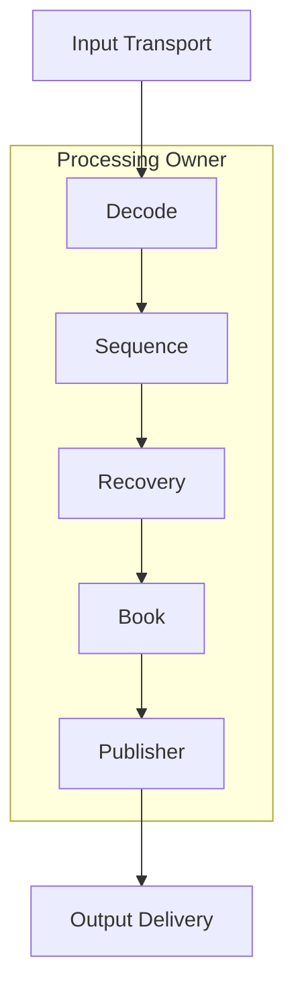
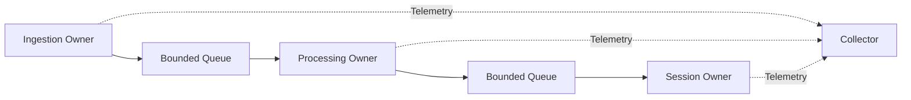
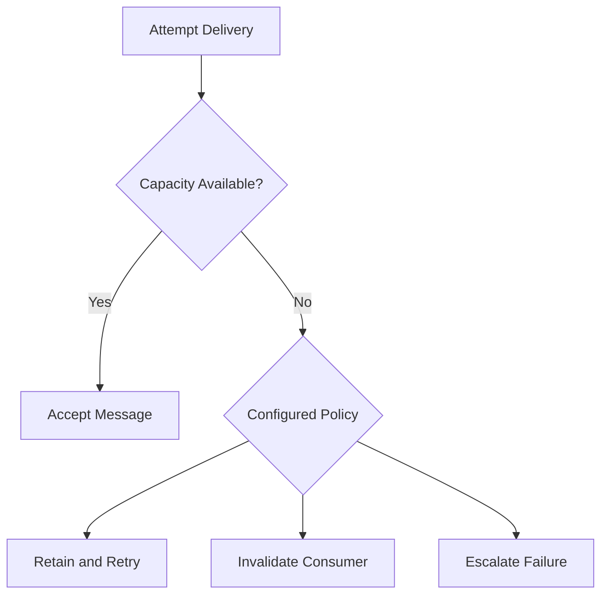

# Maxwell Concurrency and Memory Model

## 1. Purpose

This document defines Maxwell's concurrency philosophy,
state ownership requirements, communication boundaries,
memory ordering rules, and backpressure semantics.

Concurrency design must preserve deterministic market
data processing and synchronization correctness.

The final server thread topology remains subject to
application integration and benchmarking.

## 2. Core Principle

Every mutable processing state has one logical owner.

The owner may be:

- A dedicated operating system thread.
- A single-threaded event loop.
- A processing partition.
- An application component executing synchronously.

Single ownership does not require one thread per crate.


Cross-owner communication should occur through explicit
message passing or other carefully defined synchronization
mechanisms.

## 3. Why Single Ownership

Shared mutable state can introduce:

- Lock contention.
- Cache-line bouncing.
- Priority inversion.
- Nondeterministic processing order.
- Complex recovery interactions.
- Difficult-to-reproduce race conditions.

Single ownership reduces these risks by serializing
mutations within a defined processing scope.

It does not eliminate all concurrency problems.

Communication boundaries, shutdown, recovery coordination,
and cross-owner state transfer still require careful design.

## 4. Ownership Model

| Component State | Preferred Ownership |
|-----------------|---------------------|
| Transport receive buffer | I/O owner |
| Decoder scratch buffer | Decoder owner |
| Expected feed sequence | Feed processing owner |
| Recovery buffer | Feed processing owner |
| Order book | Instrument or feed owner |
| Publisher sequence | Publisher owner |
| Subscriber queues | Publisher owner |
| Downstream sessions | Gateway owner |
| Client market state | Client owner |
| Local metrics | Instrumented owner |

Related components may share one logical owner to avoid
unnecessary synchronization.

In particular, sequencing, recovery, book mutation, and
publication coordination have closely related consistency
requirements.

## 5. Initial Server Topology

The recommended starting point is a simple processing
topology with minimal ownership boundaries.



This provides a baseline for:

- Correctness validation.
- Deterministic replay.
- Recovery integration.
- Latency measurement.
- Throughput measurement.

Additional threads should be introduced only when justified
by measured bottlenecks or operational requirements.

## 6. Partitioned Topology

A possible future topology separates ingestion,
processing, downstream delivery, and telemetry.



Each additional boundary introduces potential costs:

- Queue insertion and removal.
- Cache ownership transfer.
- Synchronization.
- Queueing latency.
- Scheduling delay.
- Additional backpressure handling.

Thread count should not be treated as a direct measure
of system performance.

## 7. Queue Selection

### 7.1 Queue Categories

| Queue | Producers | Consumers |
|-------|-----------|-----------|
| SPSC | One | One |
| MPSC | Multiple | One |
| SPMC | One | Multiple |
| MPMC | Multiple | Multiple |

Use the simplest queue category that satisfies the
actual ownership relationship.

### 7.2 SPSC

A single-producer single-consumer queue is appropriate
for dedicated communication between two owners.

It can provide efficient synchronization because producer
and consumer responsibilities are distinct.

### 7.3 MPSC

A multiple-producer single-consumer queue may be appropriate
when several independent sources send work to one owner.

Arrival order across producers may depend on scheduling.

If deterministic total ordering is required, an explicit
ordering mechanism is necessary.

### 7.4 MPMC

Multiple-producer multiple-consumer queues provide flexible
work distribution but generally introduce greater
coordination complexity.

They should not be introduced merely because multiple
threads exist.

### 7.5 Current Publisher Queue

The publisher's bounded subscriber queue is an owner-local
FIFO structure.

It is not a concurrent lock-free queue.

It must not be used as though it supports simultaneous
mutation by unrelated threads.

## 8. Queue Contracts

Every communication queue must define:

- Producer ownership.
- Consumer ownership.
- Capacity.
- Ordering guarantee.
- Allocation policy.
- Full-queue behavior.
- Empty-queue behavior.
- Shutdown behavior.
- Ownership of rejected messages.
- Retry semantics.

A bounded queue is not a complete backpressure policy.

The application must decide what happens when insertion
fails.

## 9. Backpressure

Backpressure occurs when an upstream producer generates
work faster than a downstream consumer can accept it.



### 9.1 Upstream Processing Backpressure

When a processing queue is full, the application must
consider the transport semantics.

A reliable stream may allow temporary read suspension.

A datagram feed may continue delivering data regardless
of application readiness.

In the latter case, overflow can create a sequence gap
requiring recovery.

### 9.2 Publisher Rejection

Under RejectPublication:

1. Check capacity of all matching active subscribers.
2. Reject before partial publication acceptance.
3. Preserve the pending publication.
4. Retry when capacity becomes available.
5. Do not repeat the corresponding book mutation.

The application must prevent subsequent events from
overtaking a rejected publication where ordering requires
strict continuity.

### 9.3 Subscriber Resynchronization

Under RequireResync:

1. Identify the overloaded subscriber.
2. Invalidate its incremental state.
3. Discard its pending publication queue.
4. Continue delivering to healthy subscribers.
5. Notify or disconnect the invalidated subscriber.
6. Coordinate a fresh snapshot before activation.

Invalidation must be observable even if no new market
data arrives.

### 9.4 Control Messages

Recovery, shutdown, and invalidation messages must not
be indefinitely starved by ordinary data traffic.

The application may require separate control capacity or
another explicitly prioritized control mechanism.

## 10. Atomic Operations

Atomic operations should be introduced only when state
must genuinely be shared between owners.

An atomic variable prevents data races on that variable.

It does not automatically establish correctness for a
larger multi-field state transition.

### 10.1 Memory Ordering

| Ordering | Typical Purpose |
|----------|-----------------|
| Relaxed | Atomicity without cross-variable synchronization |
| Acquire | Observe data published by a matching release |
| Release | Publish preceding writes |
| AcqRel | Acquire and release on a read-modify-write operation |
| SeqCst | Sequentially consistent atomic ordering |

The correct ordering depends on the synchronization
protocol, not simply on the variable's type.

### 10.2 Relaxed Ordering

Relaxed ordering is appropriate for independent telemetry
counters when their values do not establish visibility
of unrelated application state.

```rust
use std::sync::atomic::{AtomicU64, Ordering};

let counter = AtomicU64::new(0);

counter.fetch_add(1, Ordering::Relaxed);

let observed = counter.load(Ordering::Relaxed);
```

This example demonstrates atomic ordering only.

fetch_add wraps on overflow; Maxwell's AtomicCounter
provides saturating addition instead.

### 10.3 Acquire and Release

Acquire and release operations can establish a
synchronizes-with relationship when the acquire observes
the appropriate released value.

They are commonly used in ownership transfer and
producer-consumer communication.

A queue implementation must document which operations
publish initialized data and which operations permit
safe reuse of storage.

### 10.4 Sequential Consistency

Sequential consistency provides a stronger global
ordering guarantee for sequentially consistent atomic
operations.

It may simplify reasoning in some synchronization
protocols.

It does not replace the need for a correct ownership
and state-transition design.

### 10.5 Compare-and-Exchange

Compare-and-exchange operations may fail because another
thread changed the observed value.

Weak compare-and-exchange may also fail spuriously.

Retry loops must account for:

- Contention.
- Progress guarantees.
- Overflow.
- Cancellation or shutdown where applicable.

A CAS retry loop is not necessarily wait-free.

## 11. Rust Send and Sync

Rust's Send trait permits ownership transfer between
threads.

Rust's Sync trait permits shared references to be used
across threads under the applicable safety requirements.

These traits establish memory-safety properties.

They do not guarantee:

- Deterministic ordering.
- Transactional consistency.
- Absence of deadlocks.
- Bounded latency.
- Correct market data recovery.

A component being Send does not imply that it should
have multiple concurrent processing owners.

## 12. Locking

Locks are acceptable when they are appropriate for the
actual workload and ownership requirements.

Examples include:

- Configuration management.
- Administrative operations.
- Infrequent diagnostics.
- Off-critical-path reporting.

Locks in latency-sensitive paths require justification
and measurement.

### 12.1 Locking Rules

- Avoid holding locks during network I/O.
- Avoid holding locks during blocking callbacks.
- Establish a consistent lock acquisition order.
- Keep critical sections small.
- Avoid unnecessary nested locking.
- Document lock poisoning and failure behavior.

### 12.2 Lock-Free Terminology

Lock-free, wait-free, and obstruction-free describe
different progress guarantees.

Do not label a component lock-free solely because it
contains no explicit mutex.

Allocation, operating system calls, and underlying
libraries may still block.

## 13. Memory Allocation

### 13.1 Initialization

Allocate predictable runtime resources during
initialization where practical.

Examples include:

- Receive buffers.
- Decode scratch buffers.
- Recovery buffers.
- Subscriber queues.
- Metric registries.
- Session storage.

### 13.2 Steady-State Processing

Avoid unnecessary allocation in frequently executed
processing operations.

Allocation-free claims must be verified against actual
implementation behavior and representative workloads.

Book insertion, subscription registration, snapshot
creation, and configuration changes may have different
allocation characteristics from steady-state updates.

### 13.3 Capacity Exhaustion

Allocation or capacity failure must have an explicit
outcome.

Possible outcomes include:

- Reject operation.
- Retain work for retry.
- Invalidate state.
- Restart recovery.
- Terminate the affected component.

Unbounded fallback allocation must not undermine a
documented resource limit.

## 14. Cache Locality

Frequently accessed processing state should remain close
to its logical owner.

Performance considerations include:

- Contiguous storage.
- Compact domain representations.
- Reduced pointer chasing.
- Reduced shared cache-line writes.
- Predictable access patterns.
- Separation of hot and cold fields.

Data layout changes should be guided by profiling rather
than assumptions about a particular processor.

## 15. False Sharing

False sharing occurs when independent frequently modified
variables occupy the same cache line.

```text
Potential false sharing:

| Counter A | Counter B | Other fields |
|           One cache line             |

Separated counters:

| Counter A | Padding                  |
| Counter B | Padding                  |
```

Maxwell's AtomicCounter uses 64-byte alignment.

This is intended to reduce false sharing on processors
with compatible cache-line characteristics.

It does not guarantee optimal placement on every
architecture.

Owner-local non-atomic counters remain preferable where
shared updates are unnecessary.

## 16. Deterministic Parallelism

Parallel processing is acceptable when independent
processing scopes can be established.

Potential partition keys include:

- Feed identifier.
- Instrument identifier.
- Explicit exchange partition.

Partitioning must preserve:

- Upstream sequence scope.
- Recovery scope.
- Required cross-instrument ordering.
- Publication ordering.
- Snapshot consistency.

If multiple partitions contribute to a global publication
sequence, the merge policy must define how that sequence
is assigned.

Thread completion order alone is not a deterministic
merge policy.

## 17. Snapshot Coordination

Snapshot generation must not race with mutable state
updates in a way that produces inconsistent results.

Possible strategies include:

- Generate snapshots within the state owner.
- Transfer an owned immutable snapshot.
- Coordinate an explicit processing boundary.
- Use a carefully designed versioned representation.

The initial architecture favors owner-generated snapshots
and explicit publication watermarks.

Copying state does not automatically establish consistency
if the source changes during the copy.

## 18. Metrics Collection

Each processing owner should maintain local telemetry.

The reporting component may receive:

- Owned metric snapshots.
- Completed interval histograms.
- Explicitly transferred metrics state.
- Independent atomic counters.

Histogram aggregation requires compatible bucket bounds.

Cumulative and interval metrics must not be mixed without
a defined collection policy.

Telemetry transfer queues must remain bounded.

A delayed metrics consumer should not stall market data
processing indefinitely.

## 19. Scheduling and Affinity

Potential performance improvements include:

- Dedicated processing threads.
- CPU affinity.
- NUMA-aware allocation.
- Reduced thread migration.
- Interrupt affinity.
- Controlled polling.
- Appropriate batching.

These are future tuning options, not mandatory baseline
requirements.

Busy polling can reduce wake-up latency while increasing
CPU consumption and power usage.

Affinity may improve cache locality but can reduce
scheduling flexibility.

Evaluate these tradeoffs using representative workloads.

## 20. Shutdown

Shutdown must preserve ownership and delivery semantics.

A recommended application shutdown sequence is:

1. Stop accepting new sessions and subscriptions.
2. Signal ingestion to stop.
3. Complete or explicitly invalidate pending processing.
4. Resolve pending publications according to policy.
5. Drain or terminate downstream sessions.
6. Collect final operational telemetry.
7. Join processing threads.
8. Release owned resources.

Shutdown must have a bounded completion policy.

An indefinitely blocked consumer must not prevent the
entire application from terminating.

## 21. Concurrency Review Checklist

- [ ] Every mutable state has a defined owner.
- [ ] Cross-owner communication is explicit.
- [ ] Queue capacities are bounded.
- [ ] Full-queue behavior is documented.
- [ ] Retry behavior preserves ownership.
- [ ] Atomic memory ordering is justified.
- [ ] Lock acquisition order is consistent.
- [ ] Blocking operations are identified.
- [ ] Snapshot consistency is preserved.
- [ ] Publication ordering is preserved.
- [ ] Recovery transitions remain correct.
- [ ] Shutdown behavior is bounded.
- [ ] Concurrent behavior is tested.
- [ ] Performance claims are measured.

## 22. References

- The Rust Book: Fearless Concurrency
  https://doc.rust-lang.org/book/ch16-00-concurrency.html

- Rust Atomic Ordering
  https://doc.rust-lang.org/std/sync/atomic/enum.Ordering.html

- Rust Send and Sync
  https://doc.rust-lang.org/nomicon/send-and-sync.html
