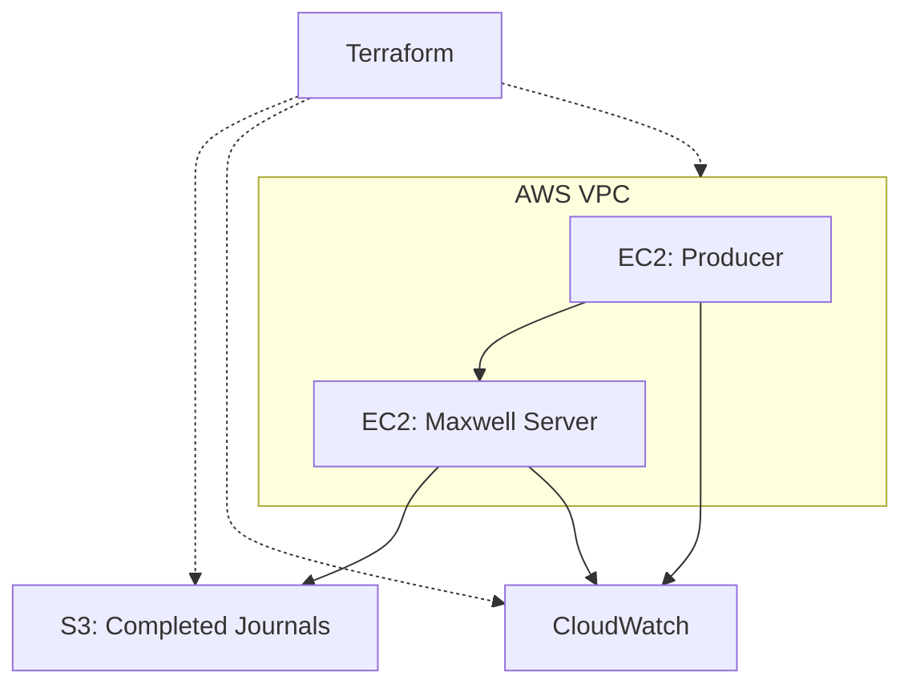

# Maxwell Operations

## 1. Purpose

This document describes Maxwell's operational workflows,
configuration, capacity planning, diagnostics, monitoring,
failure handling, and deployment requirements.

The current operational environment is local.

Distributed networking, container deployment, and AWS
infrastructure are planned development workstreams.

## 2. Operational Objectives

- Preserve market data correctness.
- Detect synchronization failures.
- Maintain bounded resource consumption.
- Make backpressure observable.
- Preserve historical data integrity.
- Support reproducible workload execution.
- Provide actionable diagnostics.
- Support controlled startup and shutdown.

## 3. Operational Interface

The maxwell-cli package provides the maxwell executable.

```bash
cargo install --path apps/maxwell-cli
```

| Command | Operational Purpose |
|---------|---------------------|
| scenarios | Discover supported workloads |
| simulate | Exercise market generation |
| record | Persist synthetic market data |
| inspect | Inspect journal metadata |
| validate | Validate historical records |
| replay | Execute historical playback |
| benchmark | Measure local simulator throughput |

See [Quick Start](quick_start.md) for complete command
examples.

## 4. Configuration

### 4.1 Server Configuration

Server configuration controls application lifecycle,
market capacity, recovery, publication, and downstream
session resources.

Important configuration categories include:

- Maximum registered instruments.
- Maximum resting orders.
- Price-level capacity.
- Recovery buffer limits.
- Subscriber limits.
- Subscriber queue capacity.
- Publication backpressure policy.
- Downstream session resources.

Dense price-level capacity must accommodate the complete
instrument price band.

The current server configuration is constructed through
Rust application interfaces.

A unified external production configuration file remains
future work.

### 4.2 Simulator Configuration

The simulator exposes predefined scenarios and configurable
workload parameters.

Common CLI options:

| Option | Purpose |
|--------|---------|
| --scenario | Select predefined workload |
| --events | Override event count |
| --seed | Override deterministic seed |
| --stream-id | Select upstream stream |
| --session-id | Select upstream session |

The underlying simulator configuration additionally
controls market structure, event distribution, pacing,
fault injection, and resource limits.

### 4.3 Journal Configuration

Recording options include:

| Option | Purpose |
|--------|---------|
| --output | Journal destination |
| --raw | Select raw-capture mode |
| --recording-id | Identify recording |
| --flush-every | Periodic buffered flush |
| --sync-every | Periodic file-data synchronization |
| --durable | Synchronize at completion |

Existing files are not overwritten.

The journal writer exposes additional buffer and payload
configuration through its Rust interfaces.

### 4.4 Replay Configuration

Replay options include:

| Option | Purpose |
|--------|---------|
| --speed | Playback pacing |
| --instrument | Instrument filter |
| --from-sequence | Inclusive lower sequence filter |
| --to-sequence | Inclusive upper sequence filter |
| --from-time | Inclusive lower timestamp filter |
| --to-time | Inclusive upper timestamp filter |
| --seek-sequence | Exact sequence seek |
| --seek-time | Timestamp seek |
| --batch-size | Processing budget |
| --print-events | Display delivered records |
| --authoritative | Require authoritative stream |
| --no-index | Disable sparse indexing |
| --allow-incomplete-tail | Permit valid journal prefix |

The replay engine additionally exposes a configurable
backpressure-attempt budget.

## 5. Capacity Planning

Resource limits should be selected according to workload
requirements.

Important dimensions include:

- Instrument count.
- Resting orders per instrument.
- Price levels per instrument.
- Event rate.
- Subscriber count.
- Subscriber queue capacity.
- Recovery history length.
- Recovery buffer capacity.
- Journal retention.
- Disk throughput.
- Sparse index capacity.

Approximate subscriber queue memory:

    Subscriber count
    x Queue capacity
    x Stored publication size

Approximate dense ladder memory:

    Instrument count
    x Price levels per instrument
    x Stored price-level size

These estimates exclude allocator overhead, metadata,
and additional component state.

Actual memory usage must be measured.

### 5.1 Journal Storage Estimation

For an average encoded message size of P bytes and
N recorded events:

    Journal bytes = 64 + N x (P + 24)

For example, assuming an average encoded message size
of 65 bytes:

    One million events = 89,000,064 bytes

At a sustained recording rate of 100,000 events per second:

    Approximately 8.9 MB per second
    Approximately 32.04 GB per hour

These are illustrative uncompressed storage estimates,
not measured Maxwell throughput results.

## 6. Local Startup Procedure

Validate the workspace:

```bash
cargo test --workspace
cargo clippy --workspace --all-targets -- -D warnings
```

Build release binaries:

```bash
cargo build --workspace --release
```

Execute a smoke workload:

```bash
./target/release/maxwell simulate \
    --scenario smoke \
    --events 1000 \
    --seed 42
```

Verify:

- Successful process exit.
- Completed simulation status.
- Consistent event accounting.
- No unexpected backpressure.
- No unexpected operational errors.

## 7. Historical Recording Runbook

Create a dedicated recording directory:

```bash
mkdir -p data
```

Record a clean stream:

```bash
maxwell record \
    --scenario clean \
    --events 100000 \
    --seed 42 \
    --output data/session-001.mxj \
    --flush-every 1024 \
    --durable
```

Inspect the completed journal:

```bash
maxwell inspect data/session-001.mxj
```

Validate all records:

```bash
maxwell validate data/session-001.mxj
```

Record the following operational metadata:

- Application version.
- Scenario.
- Seed.
- Feed identity.
- Recording identifier.
- Event count.
- Journal size.
- Durability policy.
- Validation result.

A journal should not be treated as successfully finalized
until the recording command has completed successfully.

## 8. Historical Replay Runbook

Validate the source journal:

```bash
maxwell validate data/session-001.mxj
```

Replay the authoritative stream:

```bash
maxwell replay data/session-001.mxj \
    --authoritative \
    --speed unbounded
```

Verify:

- Successful completion.
- Expected delivered record count.
- No unexpected filtered records.
- No unexpected backpressure.
- Expected final sequence.
- No incomplete tail.

The current CLI sink does not reconstruct a remote market.

Server reconstruction is exercised through library
integration and reconstruction tests.

## 9. Health and Readiness

Process liveness is not equivalent to market readiness.

A running market data process may be:

- Initializing.
- Unsynchronized.
- Recovering.
- Backpressured.
- Operationally degraded.
- Ready.

A future readiness endpoint should consider:

- Valid configuration.
- Completed initialization.
- Required instrument registration.
- Upstream synchronization.
- Resource availability.
- Absence of fatal processing errors.

Health and readiness endpoints are planned rather than
currently exposed production services.

## 10. Observability

Operational measurements should distinguish:

| Area | Measurements |
|------|--------------|
| Ingestion | Received and accepted events |
| Sequencing | Gaps, duplicates, and expected sequence |
| Recovery | Attempts, failures, and duration |
| Book | Instruments, orders, and consistency failures |
| Publisher | Publications, queue occupancy, rejection |
| Gateway | Active and invalidated sessions |
| Simulator | Generated, delivered, and faulted events |
| Recorder | Records, bytes, flushes, synchronizations |
| Replay | Read, delivered, filtered, and blocked records |
| System | CPU, memory, disk, and network utilization |

These are operational measurement categories.

Exact metric names depend on the instrumentation and
exporter implementation.

## 11. Monitoring Integration

The metrics crate provides counters, gauges, histograms,
registries, and Prometheus-compatible text formatting.

Future monitoring infrastructure may include:

- CloudWatch logs.
- CloudWatch custom metrics.
- Prometheus collection.
- Grafana dashboards.
- Alerting and operational notifications.

An HTTP metrics endpoint and production cloud exporter
are not implied by the existing metrics primitives.

## 12. Proposed Operational Dashboard

A future dashboard should include:

### Market Data

- Upstream event rate.
- Accepted event rate.
- Expected upstream sequence.
- Synchronization status.
- Recovery activity.

### Distribution

- Publication rate.
- Subscriber count.
- Queue occupancy.
- Backpressure.
- Subscriber invalidation.

### Persistence

- Journal write rate.
- Journal size.
- Flush and synchronization activity.
- Journal validation failures.
- Available disk capacity.

### System Resources

- CPU utilization.
- Resident memory.
- Disk throughput.
- Network throughput.
- Process availability.

## 13. Logging

Operational logs should provide enough context to diagnose
failures without unnecessarily increasing critical-path
latency.

Useful fields include:

- Timestamp.
- Application version.
- Component.
- Feed identity.
- Instrument identifier where applicable.
- Sequence number.
- Lifecycle state.
- Error category.
- Recovery or retry outcome.

Avoid logging every event during normal high-throughput
execution.

Detailed event output should be enabled explicitly for
diagnostics.

Structured production logging remains a future extension.

## 14. Alerting

Potential alert conditions include:

- Loss of upstream synchronization.
- Repeated recovery failures.
- Sustained publication backpressure.
- Subscriber invalidation.
- Journal write failures.
- Journal corruption.
- Disk capacity exhaustion.
- Unexpected process termination.
- Sustained latency degradation.

Alert thresholds should be established from measured
workloads and operational objectives.

No production alert thresholds are currently assumed.

## 15. Incident Response

### 15.1 Sequence Gap

1. Identify the affected feed.
2. Record the expected and received sequences.
3. Determine whether recovery is active.
4. Inspect retained history and recovery capacity.
5. Confirm that unsynchronized state is not advertised
   as valid.
6. Restore synchronization through the appropriate
   recovery mechanism.

### 15.2 Subscriber Backpressure

1. Identify the affected subscriber.
2. Inspect queue occupancy.
3. Determine the configured backpressure policy.
4. Verify whether the subscriber was invalidated.
5. Restore downstream synchronization before resuming
   ordinary incremental delivery.

### 15.3 Journal Write Failure

1. Stop treating the recording as successfully finalized.
2. Preserve the partial journal.
3. Record the I/O error and available disk capacity.
4. Validate the journal using strict reading.
5. If necessary, inspect the valid prefix using the
   incomplete-tail policy.
6. Start a new recording rather than overwriting the
   original evidence.

### 15.4 Journal Corruption

1. Preserve the original file.
2. Record the validation error and affected offset.
3. Determine whether the failure is an incomplete tail
   or corruption of a complete record.
4. Restore from a known valid copy where available.
5. Do not silently bypass checksum validation.

### 15.5 Replay Failure

1. Record the journal identity and replay configuration.
2. Validate the journal independently.
3. Inspect the final accepted sequence.
4. Determine whether a record remains pending.
5. Identify the sink or processing failure.
6. Restart from a valid baseline if reconstruction
   correctness cannot otherwise be guaranteed.

## 16. Linux Diagnostics

Inspect CPU and memory usage:

```bash
top
free -h
ps aux
```

Inspect disk capacity:

```bash
df -h
du -sh data
```

Inspect process resources:

```bash
ps -o pid,pcpu,pmem,rss,vsz,comm -p <pid>
```

Inspect open file descriptors:

```bash
ls -l /proc/<pid>/fd
```

Inspect network sockets during future network integration:

```bash
ss -tulnp
```

Profile execution:

```bash
perf stat ./target/release/maxwell benchmark \
    --scenario high-throughput \
    --events 1000000 \
    --iterations 3
```

Some diagnostic tools require installation or additional
operating-system permissions.

## 17. Security Requirements

Operational deployments should enforce:

- Least-privilege process execution.
- Restricted network access.
- Validated external input.
- Bounded resource consumption.
- Controlled access to journal files.
- Secure credential storage.
- Dependency and toolchain review.
- Appropriate audit logging.

Secrets must not be committed to the repository.

Journal checksums do not provide cryptographic security.

## 18. Shutdown and Finalization

The local CLI finalizes recording output before reporting
successful completion.

A future long-running server shutdown should:

1. Stop accepting new input.
2. Resolve pending market processing.
3. Drain required publication queues.
4. Finalize journal output.
5. Synchronize persistent data according to policy.
6. Close communication resources.
7. Report final metrics.

Distributed shutdown and signal handling remain future
integration requirements.

## 19. Planned Container Deployment

The first containerized environment should include:

- A market producer container.
- A Maxwell consumer container.
- Explicit network configuration.
- Mounted journal storage.
- Defined configuration inputs.
- Resource limits.
- Controlled startup and shutdown.

Docker images should use reproducible release builds and
minimal runtime dependencies.

The current repository does not require Docker for
local execution.

## 20. Planned AWS Deployment

The initial cloud environment will establish a small
distributed baseline.



Proposed infrastructure:

- VPC and subnets.
- Restricted security groups.
- EC2 application instances.
- IAM instance roles.
- S3 journal bucket.
- CloudWatch log groups.
- Cost monitoring.
- Automated infrastructure teardown.

Completed journal files should be uploaded rather than
treating object storage as a directly appendable local
filesystem.

AWS credentials should be supplied through IAM roles
or approved short-lived credential mechanisms.

## 21. Deployment and Rollback

Future deployments should identify:

- Source commit.
- Application version.
- Container image digest.
- Configuration version.
- Infrastructure revision.
- Protocol compatibility.
- Journal compatibility.

Rollback must consider both executable compatibility
and persisted data compatibility.

A previous binary must not be assumed capable of reading
a newer journal or protocol format.

## 22. Operational Readiness Checklist

- [ ] Configuration validated.
- [ ] Workspace tests passed.
- [ ] Strict Clippy passed.
- [ ] Release build generated.
- [ ] Smoke workload completed.
- [ ] Resource limits reviewed.
- [ ] Journal validation completed where applicable.
- [ ] Synchronization requirements satisfied.
- [ ] Monitoring available where applicable.
- [ ] Shutdown behavior verified.
- [ ] Deployment and rollback procedures documented.

## 23. Incident Report Template

    Incident:
    Date and time:
    Application version:
    Source commit:
    Affected component:
    Feed identity:
    Expected sequence:
    Observed sequence:
    Initial state:
    Observed failure:
    Operational impact:
    Recovery actions:
    Final state:
    Root cause:
    Regression test:
    Follow-up work:

## 24. Related Documentation

- [Quick Start](quick_start.md)
- [Architecture](architecture.md)
- [Testing](testing.md)
- [Performance](performance.md)
- [Roadmap](roadmap.md)
