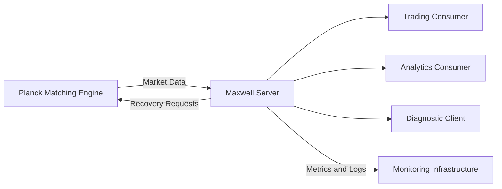
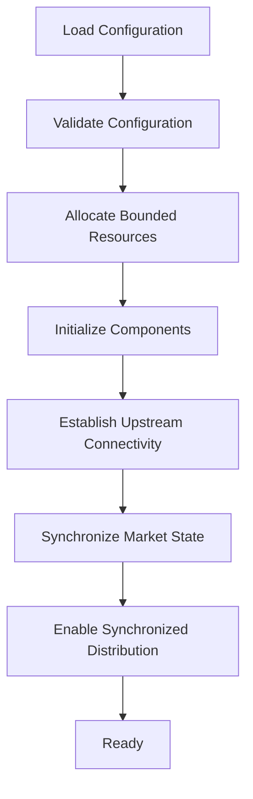
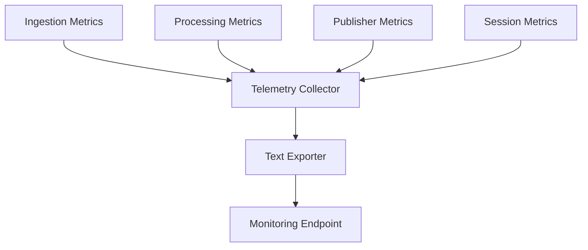

# Maxwell Operations and Observability

## 1. Purpose

This document defines Maxwell's intended operational model,
configuration requirements, monitoring strategy, deployment
considerations, and incident response procedures.

The foundational library crates are implemented in initial
form.

The integrated server, runtime configuration, network
listeners, deployment automation, and monitoring endpoints
remain application-level development work.

Operational procedures in this document describe the
intended production model unless explicitly identified
as currently available.

## 2. Operational Objectives

Maxwell should provide:

- Predictable startup and shutdown.
- Explicit configuration validation.
- Bounded runtime resource consumption.
- Observable synchronization state.
- Observable overload behavior.
- Reliable recovery procedures.
- Clear diagnostic information.
- Independent failure isolation where possible.
- Reproducible deployment configuration.

The primary operational requirement is market data
correctness.

An unavailable or explicitly stale feed is preferable
to silently distributing inconsistent market state.

## 3. Deployment Architecture



Deployment may initially use a single Maxwell process.

Additional processes or partitions should be introduced
according to measured capacity and operational requirements.

## 4. Configuration

Runtime configuration should be validated before network
connections and processing loops are started.

Configuration should be explicit, reproducible, and
version-controlled where appropriate.

Secrets must not be committed to the repository.

### 4.1 Configuration Categories

| Category | Examples |
|----------|----------|
| Application | Instance identity, environment |
| Upstream | Feed identity, transport endpoints |
| Protocol | Supported version, message size limits |
| Book | Instrument and state capacity |
| Sequencing | Initial state and stream scope |
| Recovery | Buffer capacity, retry policy |
| Publisher | Subscriber limits, queue capacity |
| Gateway | Session capacity, delivery limits |
| Metrics | Collection interval, export configuration |
| Logging | Severity, destination |
| Runtime | Thread topology, affinity |
| Shutdown | Drain deadline, termination policy |

### 4.2 Proposed Configuration Format

The following TOML is an illustrative configuration
proposal.

The server configuration parser has not yet established
these field names as a supported interface.

```toml
[application]
instance_id = "maxwell-local"
environment = "development"

[upstream]
transport = "tcp"
address = "127.0.0.1:9000"
feed_id = 1

[protocol]
max_message_bytes = 65536

[recovery]
buffer_capacity = 65536
max_retries = 3
request_timeout_ms = 1000

[publisher]
max_subscribers = 64
queue_capacity = 4096
max_instruments_per_subscription = 256
backpressure_policy = "require_resync"

[gateway]
listen_address = "127.0.0.1:9100"
max_sessions = 64

[metrics]
enabled = true
listen_address = "127.0.0.1:9200"
collection_interval_ms = 1000

[logging]
level = "info"

[runtime]
processing_threads = 1

[shutdown]
drain_timeout_ms = 5000
```

Addresses, ports, timeout values, and application
configuration keys are proposed examples.

Publisher capacity values reflect the initial publisher
defaults.

### 4.3 Configuration Validation

Validate:

- Required fields.
- Supported transport types.
- Valid endpoint representations.
- Positive capacities.
- Compatible session and subscriber limits.
- Valid timeout values.
- Supported backpressure policies.
- Arithmetic overflow in capacity calculations.
- Compatible protocol configuration.
- Resource requirements.

Reject invalid configuration before accepting market data.

### 4.4 Configuration Changes

Configuration changes should be classified as:

- Safe runtime changes.
- Changes requiring component reinitialization.
- Changes requiring process restart.
- Changes requiring protocol coordination.

Capacity, sequencing, financial representation, and
recovery configuration changes may affect correctness.

Hot configuration reload must not be introduced without
explicit state-transition semantics.

## 5. Capacity Planning

Resource requirements depend on:

- Instrument count.
- Order book depth.
- Subscriber count.
- Publication payload size.
- Subscriber queue capacity.
- Recovery buffer capacity.
- Session capacity.
- Transport buffer sizes.
- Snapshot size.
- Telemetry storage.

### 5.1 Subscriber Queue Memory

A first-order estimate is:

```text
queue_memory =
    subscriber_count
    * queue_capacity
    * publication_entry_size
```

For illustration:

```text
Subscribers:          64
Entries per queue:    4,096
Entry size:           64 bytes

Estimated payload storage:
64 * 4,096 * 64 = 16,777,216 bytes

Approximately 16 MiB
```

This excludes allocator overhead, queue metadata,
subscription filters, transport buffers, and other state.

The actual entry size depends on the instantiated Rust
publication types.

### 5.2 Recovery Buffer Memory

```text
recovery_memory =
    feed_count
    * recovery_buffer_capacity
    * buffered_event_size
```

Recovery buffers must be included in peak memory estimates.

Multiple feeds may enter recovery simultaneously.

### 5.3 Queue Sizing

A simplified burst capacity estimate is:

```text
required_entries =
    max(0, arrival_rate - service_rate)
    * burst_duration
```

For example:

```text
Arrival rate:    200,000 events/s
Service rate:    150,000 events/s
Burst duration:  0.1 seconds

Required temporary capacity:
5,000 entries
```

This estimate assumes constant rates during the burst.

Real workloads require measured arrival distributions
and an appropriate safety margin.

Larger queues may reduce immediate rejection while
increasing queueing latency.

Queue capacity must not be treated as a substitute for
adequate processing capacity.

## 6. Startup Procedure

The intended startup sequence is:



A running process is not necessarily a ready market
data service.

The application must distinguish successful process
initialization from successful feed synchronization.

### 6.1 Startup Checks

- Configuration is valid.
- Required resources are available.
- Transport endpoints are accessible.
- Protocol configuration is compatible.
- Feed identity is correct.
- Initial synchronization completes.
- Required monitoring is available.
- Downstream readiness is correctly advertised.

## 7. Health and Readiness

The application should distinguish the following
operational concepts.

| State | Meaning |
|-------|---------|
| Starting | Initialization is in progress |
| Unsynchronized | Market state is not yet valid |
| Ready | Required synchronization is established |
| Degraded | Some functionality is unavailable |
| Recovering | Synchronization restoration is active |
| Stopping | Controlled shutdown is in progress |
| Failed | Required functionality cannot continue |

These are proposed operational categories rather than
exact existing application state variants.

### 7.1 Liveness

Liveness indicates whether the process is functioning.

### 7.2 Readiness

Readiness indicates whether the service can perform
its required market data responsibilities.

A live process may be unready during recovery.

### 7.3 Feed-Level Health

When multiple independent feeds are supported, health
should be available at feed scope.

A process-wide ready flag may be insufficient to describe
partial feed failure.

## 8. Observability

Maxwell's metrics crate provides:

- Saturating counters.
- Signed gauges.
- Fixed-capacity latency histograms.
- Atomic counters.
- Bounded metric registration.
- Owned metric snapshots.
- Prometheus-compatible text exposition.

The application is responsible for collecting component
statistics and exposing them through operational interfaces.

## 9. Proposed Operational Metrics

Metric names below are recommended application-level
names.

They must be reconciled with the final server
instrumentation.

### 9.1 Ingestion

| Metric | Type |
|--------|------|
| maxwell_messages_received_total | Counter |
| maxwell_bytes_received_total | Counter |
| maxwell_messages_decoded_total | Counter |
| maxwell_decode_errors_total | Counter |
| maxwell_transport_errors_total | Counter |

### 9.2 Sequencing

| Metric | Type |
|--------|------|
| maxwell_sequence_gaps_total | Counter |
| maxwell_duplicate_events_total | Counter |
| maxwell_out_of_order_events_total | Counter |
| maxwell_events_processed_total | Counter |
| maxwell_events_rejected_total | Counter |

### 9.3 Recovery

| Metric | Type |
|--------|------|
| maxwell_recovery_requests_total | Counter |
| maxwell_recovery_completed_total | Counter |
| maxwell_recovery_failures_total | Counter |
| maxwell_recovery_buffer_depth | Gauge |
| maxwell_recovering_feeds | Gauge |
| maxwell_recovery_duration_seconds | Histogram |

### 9.4 Publication

| Metric | Type |
|--------|------|
| maxwell_publications_accepted_total | Counter |
| maxwell_publications_rejected_total | Counter |
| maxwell_deliveries_enqueued_total | Counter |
| maxwell_deliveries_dequeued_total | Counter |
| maxwell_deliveries_discarded_total | Counter |
| maxwell_deliveries_missed_total | Counter |
| maxwell_subscriber_invalidations_total | Counter |
| maxwell_subscriber_queue_high_watermark | Gauge |

### 9.5 Sessions

| Metric | Type |
|--------|------|
| maxwell_active_sessions | Gauge |
| maxwell_active_subscribers | Gauge |
| maxwell_sessions_created_total | Counter |
| maxwell_sessions_closed_total | Counter |
| maxwell_session_errors_total | Counter |

### 9.6 Latency

| Metric | Type |
|--------|------|
| maxwell_decode_latency_nanoseconds | Histogram |
| maxwell_book_latency_nanoseconds | Histogram |
| maxwell_processing_latency_nanoseconds | Histogram |
| maxwell_publication_latency_nanoseconds | Histogram |

The current histogram implementation records integer
observations and exports their original units.

For metrics named with a seconds suffix, the application
must provide a correctly defined conversion or exporter
representation. It must not export nanosecond values
under a seconds metric name.

Prometheus generally recommends base units such as seconds.
The initial Maxwell implementation retains integer
nanoseconds for precision and simplicity.

## 10. Metrics Collection Policy

Prefer owner-local recording.



The collector must obtain metrics through safe,
explicit ownership or synchronization mechanisms.

Do not read concurrently mutated non-atomic metrics
through unsynchronized shared memory.

### 10.1 Cumulative Counters

Counters intended for Prometheus should normally remain
cumulative for the process lifetime.

Counter resets must be interpreted correctly by the
monitoring system.

### 10.2 Interval Metrics

Interval collection may use explicit reset or take
operations.

Interval values must not be exposed as cumulative counters
without an appropriate accumulation mechanism.

### 10.3 Histogram Aggregation

Aggregate compatible histogram observations before
calculating combined percentiles.

Do not average percentiles across threads.

### 10.4 Cardinality

Avoid unrestricted metric creation per instrument,
subscriber, or event.

The initial registry uses bounded registration and
static metric names.

Any future label support must include a cardinality
policy.

## 11. Prometheus Integration

The current metrics crate provides text exposition.

An HTTP endpoint remains to be implemented by the server
or a dedicated reporting component.

An illustrative future Prometheus configuration:

```yaml
global:
  scrape_interval: 5s

scrape_configs:
  - job_name: maxwell
    static_configs:
      - targets:
          - "127.0.0.1:9200"
```

The endpoint address is a proposed example.

The metrics endpoint should not be publicly exposed
without an appropriate network security policy.

## 12. Example Monitoring Queries

The following PromQL queries assume the proposed metric
names have been implemented.

### 12.1 Ingestion Rate

```promql
rate(maxwell_messages_received_total[1m])
```

### 12.2 Processing Rate

```promql
rate(maxwell_events_processed_total[1m])
```

### 12.3 Sequence Gaps

```promql
increase(maxwell_sequence_gaps_total[5m])
```

### 12.4 Publication Rejections

```promql
rate(maxwell_publications_rejected_total[1m])
```

### 12.5 Subscriber Invalidations

```promql
increase(maxwell_subscriber_invalidations_total[5m])
```

### 12.6 Estimated P99 Processing Latency

```promql
histogram_quantile(
  0.99,
  sum by (le) (
    rate(
      maxwell_processing_latency_nanoseconds_bucket[5m]
    )
  )
)
```

This query returns an estimated value in nanoseconds.

It uses Prometheus histogram interpolation, which differs
from Maxwell's local nearest-rank bucket-upper-bound
estimation.

## 13. Monitoring Dashboard

A recommended dashboard should contain:

### Market Data Health

- Feed synchronization status.
- Sequence gap rate.
- Recovery state.
- Recovery failures.
- Last observed market event.

### Processing

- Ingestion rate.
- Processing rate.
- Publication rate.
- Subscriber delivery rate.
- Rejection rate.

### Latency

- P50 processing latency.
- P99 processing latency.
- P99.9 processing latency.
- Recovery duration.
- Queueing latency where instrumented.

### Capacity

- Active sessions.
- Active subscribers.
- Queue occupancy.
- Recovery buffer occupancy.
- Resident memory.
- CPU utilization.

### Reliability

- Transport errors.
- Subscriber invalidations.
- Reconnect rate.
- Process restarts.
- Unexpected shutdowns.

## 14. Logging

Logging should provide sufficient diagnostic information
without overwhelming the critical processing path.

Recommended severity categories:

| Level | Intended Use |
|-------|--------------|
| TRACE | Detailed development diagnostics |
| DEBUG | Component and state-transition diagnostics |
| INFO | Startup, shutdown, lifecycle events |
| WARN | Recoverable operational abnormalities |
| ERROR | Failed operations requiring investigation |

Structured logs should include relevant context:

- Instance identifier.
- Feed identifier.
- Instrument identifier where relevant.
- Session identifier where relevant.
- Expected sequence.
- Observed sequence.
- Recovery state.
- Error category.
- Timestamp.

Do not synchronously log every market event in a
production-oriented processing loop.

High-frequency errors should use bounded logging or
aggregation policies.

Logging suppression must not conceal operationally
important state transitions.

## 15. Alerting

Alert thresholds should be established from measured
baselines and operational requirements.

Recommended alert categories:

| Condition | Operational Concern |
|-----------|---------------------|
| Feed unsynchronized | Market data unavailable or stale |
| Repeated recovery failures | Persistent synchronization problem |
| Sustained queue growth | Processing capacity shortage |
| Frequent subscriber invalidation | Downstream overload |
| Increasing decode errors | Protocol incompatibility or malformed input |
| Elevated tail latency | Processing degradation |
| Unexpected process restart | Stability problem |
| Sustained memory growth | Resource leak or capacity issue |

Alerts should identify the affected feed, instance, or
session where practical.

Avoid alerting on every individual recoverable event
when aggregate behavior is more meaningful.

## 16. Incident Response

### 16.1 Sequence Gap

Symptoms:

- Increasing sequence gap counter.
- Feed enters recovery.
- Buffered events accumulate.

Investigation:

1. Identify the affected feed.
2. Record expected and observed sequences.
3. Inspect upstream transport errors.
4. Inspect recovery requests.
5. Verify recovery buffer capacity.
6. Verify recovery response scope.
7. Confirm synchronization restoration.

Do not manually advance expected sequence values merely
to suppress gap detection.

### 16.2 Recovery Failure

Symptoms:

- Repeated recovery requests.
- Invalid snapshot or retransmission responses.
- Recovery buffer exhaustion.
- Feed remains unsynchronized.

Investigation:

1. Verify upstream recovery availability.
2. Verify protocol compatibility.
3. Verify snapshot watermark semantics.
4. Inspect buffered event continuity.
5. Determine whether a fresh snapshot is required.
6. Apply the documented recovery restart procedure.

Do not advertise synchronized state before recovery
validation succeeds.

### 16.3 Slow Subscriber

Symptoms:

- Increasing subscriber queue occupancy.
- Publication rejection.
- Subscriber invalidation.
- Increasing discarded deliveries.

Investigation:

1. Identify the affected subscriber.
2. Inspect its delivery rate.
3. Inspect transport write failures.
4. Verify the configured backpressure policy.
5. Determine whether resynchronization is required.
6. Evaluate subscriber workload and capacity.

Increasing queue capacity may delay failure without
resolving the underlying service-rate problem.

### 16.4 High Processing Latency

Investigation:

1. Confirm the measurement boundary.
2. Compare current and baseline workload.
3. Inspect queue occupancy.
4. Inspect CPU utilization.
5. Inspect context switches.
6. Inspect allocation behavior.
7. Inspect recovery activity.
8. Collect a CPU profile.
9. Identify the limiting component.

Do not optimize an assumed bottleneck without evidence.

### 16.5 Protocol Decode Failures

Investigation:

1. Identify the message type.
2. Inspect declared and actual message lengths.
3. Verify protocol version.
4. Verify byte ordering.
5. Compare against golden vectors.
6. Verify Planck and Maxwell deployment versions.
7. Determine whether synchronization was affected.

Malformed message payloads should be retained only under
an appropriate diagnostic and data-retention policy.

### 16.6 Memory Growth

Investigation:

1. Inspect subscriber and session counts.
2. Inspect queue capacities and occupancy.
3. Inspect recovery buffer occupancy.
4. Inspect snapshot retention.
5. Inspect telemetry cardinality.
6. Inspect allocation profiles.
7. Verify disconnected session cleanup.

Distinguish retained allocator capacity from genuinely
unbounded application state.

## 17. Linux Diagnostics

Inspect a running process:

```bash
pgrep -af maxwell

ps -eo pid,ppid,%cpu,%mem,rss,comm
```

Inspect listening sockets:

```bash
ss -lntup
```

Inspect network statistics:

```bash
ss -s

ip -s link
```

Inspect process threads:

```bash
top -H -p <PID>
```

Inspect process status:

```bash
cat /proc/<PID>/status
```

Replace PID with the actual process identifier.

Some diagnostics require elevated permissions.

Profiling and tracing can affect latency-sensitive
processes and should be performed deliberately.

## 18. Security Requirements

Production deployment should include:

- Network isolation.
- Least-privilege process execution.
- Validated external input.
- Explicit resource limits.
- Controlled administrative access.
- Session authentication where required.
- Subscription authorization where required.
- Appropriate transport protection.
- Restricted metrics and diagnostic endpoints.
- Dependency security review.
- Controlled secret management.

The current library architecture does not by itself
establish production authentication or encryption.

Do not expose an experimental server directly to
untrusted networks.

## 19. Shutdown Procedure

The intended graceful shutdown sequence is:

1. Stop accepting new downstream sessions.
2. Stop accepting new subscriptions.
3. Stop or disconnect upstream ingestion.
4. Complete or invalidate pending processing.
5. Resolve pending publications.
6. Drain or terminate downstream sessions.
7. Collect final telemetry.
8. Join processing threads.
9. Release owned resources.

A configured shutdown deadline should prevent indefinite
blocking.

The system must document whether pending deliveries are
drained, discarded, or invalidated when the deadline
expires.

## 20. Deployment and Rollback

Before deployment:

- Record the Git commit.
- Record the build configuration.
- Record the runtime configuration.
- Verify protocol compatibility.
- Run workspace validation.
- Run integration tests.
- Verify monitoring availability.
- Establish rollback artifacts.

A rollback must consider:

- Wire-format compatibility.
- Configuration compatibility.
- Stream restart semantics.
- Snapshot compatibility.
- Recovery requirements.

Restarting an earlier binary does not automatically
restore synchronized market state.

## 21. Operational Readiness Checklist

- [ ] Server application implemented.
- [ ] Configuration validation implemented.
- [ ] Upstream connectivity verified.
- [ ] Downstream connectivity verified.
- [ ] Planck protocol compatibility verified.
- [ ] Initial synchronization verified.
- [ ] Retransmission recovery verified.
- [ ] Snapshot recovery verified.
- [ ] Subscriber invalidation verified.
- [ ] Resource limits validated.
- [ ] Monitoring endpoint implemented.
- [ ] Operational metrics verified.
- [ ] Alert thresholds established.
- [ ] Failure injection completed.
- [ ] Soak testing completed.
- [ ] Security review completed.
- [ ] Deployment procedure documented.
- [ ] Rollback procedure verified.
- [ ] Graceful shutdown verified.

## 22. Incident Report Template

```text
Incident:
Start time:
End time:
Affected instances:
Affected feeds:
Affected consumers:

Observed symptoms:
Initial detection:
Relevant metrics:
Relevant logs:

Root cause:
Contributing factors:
Market data correctness impact:

Recovery actions:
Final synchronization status:

Corrective actions:
Regression tests:
Documentation updates:
```

## 23. Related Documentation

- [Architecture](architecture.md)
- [Concurrency](concurrency.md)
- [Performance](performance.md)
- [Testing](testing.md)
- [Roadmap](roadmap.md)
