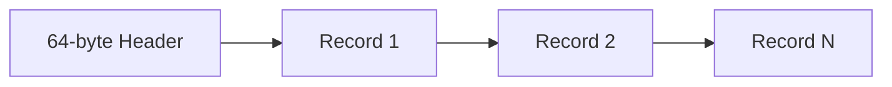

# Maxwell Protocol

## 1. Purpose

This document describes Maxwell's native binary protocol,
sequence semantics, timestamp conventions, recovery
boundaries, and historical journal representation.

The implementation in maxwell-protocol and maxwell-replay
is authoritative for exact encoding and decoding behavior.

Maxwell's native protocol must not be assumed to match
Planck's existing wire format without interoperability
validation.

## 2. Communication Boundaries

Maxwell distinguishes between:

- Upstream market data messages.
- Recovery requests and responses.
- Downstream publications.
- Session-level communication.
- Historical journal records.

These boundaries may share domain values without sharing
identical framing or sequence semantics.

## 3. Design Requirements

- Explicit binary representation.
- Versioned message formats.
- Fixed-width financial values.
- Deterministic encoding.
- Bounded message sizes.
- Strict validation.
- Transport independence.
- Explicit sequence and timestamp semantics.
- No dependence on compiler-specific structure layout.

## 4. Transport Independence

The native protocol represents logical binary messages.

TCP and other stream transports may require additional
framing and buffering.

UDP and other datagram transports may lose, duplicate,
or reorder messages.

A transport adapter must preserve complete logical
message boundaries.

The native protocol must not depend on a particular
socket implementation.

## 5. Native Protocol Header

The Maxwell V1 header occupies 40 bytes.

All multibyte fields use little-endian encoding.

| Offset | Size | Field |
|--------|------|-------|
| 0 | 2 | Magic: MX |
| 2 | 1 | Major version |
| 3 | 1 | Minor version |
| 4 | 1 | Message kind |
| 5 | 1 | Flags |
| 6 | 2 | Payload length |
| 8 | 4 | Stream identifier |
| 12 | 8 | Session identifier |
| 20 | 8 | Sequence number |
| 28 | 4 | Instrument identifier |
| 32 | 8 | Exchange timestamp |

Current native protocol version:

    Major: 1
    Minor: 0

Maximum representable payload length:

    65,535 bytes

Maximum complete native message length:

    65,575 bytes

A conservative UDP application payload target is 1,200
bytes. This is a deployment recommendation rather than
a native protocol limit.

## 6. Message Flags

The exchange-timestamp-present flag indicates whether
the exchange timestamp is present.

Unsupported flag combinations must be handled according
to the decoder's compatibility rules.

Reserved bits must not acquire undocumented semantics.

## 7. Market Event Payloads

The V1 event payload sizes are:

| Event | Payload Bytes |
|-------|---------------|
| OrderAdded | 25 |
| OrderModified | 24 |
| OrderCancelled | 16 |
| OrderDeleted | 8 |
| OrderExecuted | 32 |
| Trade | 25 |
| PriceLevelUpdated | 22 |
| BookCleared | 1 |
| TradingStatusChanged | 1 |

The encoder and decoder define the exact field order,
representation, and event-kind discriminants.

Changes to these representations require compatibility
review and corresponding protocol tests.

## 8. Financial Values

Prices and quantities use fixed-point domain types.

Floating-point representations must not be substituted
for authoritative financial values.

Instrument definitions establish applicable price and
quantity constraints.

Encoding must preserve the underlying financial value
without unintended rounding or conversion.

## 9. Sequence Semantics

Three independent sequence domains exist.

### 9.1 Upstream Sequence

Identifies authoritative market event ordering within
a feed.

A feed is identified by its stream and session identifiers.

Missing upstream sequences may require recovery.

Duplicate upstream events must not be applied twice.

### 9.2 Publication Sequence

Identifies downstream publication ordering.

Subscription filtering may introduce visible publication
sequence gaps without implying upstream data loss.

### 9.3 Connection Sequence

Identifies ordering within a downstream session.

A connection sequence is not an authoritative market
sequence.

### 9.4 Historical Sequence

Historical journals preserve the original upstream
sequence.

Replay does not renumber events.

## 10. Timestamp Semantics

Maxwell distinguishes several time domains.

| Timestamp | Meaning |
|-----------|---------|
| Exchange timestamp | Time associated with the upstream event |
| Monotonic timestamp | Local processing or reception time |
| Journal creation time | Wall-clock Unix timestamp |
| Recording timestamp | Relative journal playback time |
| Playback elapsed time | Time within a replay execution |

Wall-clock timestamps must not be used directly for
monotonic latency measurements.

Timestamps from different hosts are not automatically
comparable.

Cross-host latency measurement requires an appropriate
clock synchronization strategy.

## 11. Decoding Requirements

A decoder must validate:

- Message magic.
- Supported version.
- Message kind.
- Flags.
- Declared payload length.
- Available bytes.
- Event-specific payload structure.
- Financial domain values.

Malformed input must not cause out-of-bounds access or
partial market mutation.

The exact-message decoder must reject unexpected trailing
bytes.

Transport framing is responsible for isolating individual
messages from stream input.

## 12. Recovery Protocol

Recovery coordination requires sufficient information to
identify:

- Feed identity.
- Missing sequence range.
- Recovery scope.
- Recovered event identity.
- Snapshot watermark where applicable.

A recovered event must satisfy the same logical validation
requirements as a live event.

Production recovery request correlation, timeout policy,
and remote transport representation remain Phase III
design work.

## 13. Snapshot Semantics

A snapshot represents market state at a defined logical
watermark.

A snapshot contract must identify:

- Feed identity.
- Instrument scope.
- Snapshot completeness.
- Applicable sequence watermark.
- Subsequent incremental event boundary.

Events already represented by the snapshot must not be
applied again.

A snapshot must not be advertised as complete before
all required validation has succeeded.

The exact remote snapshot exchange protocol remains
an integration workstream.

## 14. Downstream Session Semantics

Downstream communication must preserve:

- Session identity.
- Subscription scope.
- Synchronization status.
- Snapshot activation boundary.
- Connection ordering.
- Publication identity.

Slow-consumer invalidation must be explicit.

An invalidated subscriber requires resynchronization
before ordinary incremental delivery resumes.

Complete remote session framing remains future work.

## 15. Historical Journal Format

The replay application introduces a versioned binary
journal format.

A journal contains:

1. A fixed-size journal header.
2. Zero or more variable-length event records.

Journal records embed native Maxwell protocol messages.

The journal format version is independent of the native
wire protocol version.

All multibyte journal fields use little-endian encoding.

## 16. Journal Header V1

The journal header occupies 64 bytes.

| Offset | Size | Field |
|--------|------|-------|
| 0 | 8 | Magic: MXWJRNL followed by NUL |
| 8 | 2 | Journal format version |
| 10 | 1 | Journal mode |
| 11 | 1 | Reserved |
| 12 | 4 | Header length |
| 16 | 8 | Creation timestamp in nanoseconds |
| 24 | 4 | Maximum payload bytes |
| 28 | 4 | Stream identifier |
| 32 | 8 | Session identifier |
| 40 | 8 | Recording identifier |
| 48 | 12 | Reserved |
| 60 | 4 | CRC32C checksum |

Current journal format version:

    1

Journal mode values:

| Value | Mode |
|-------|------|
| 0 | Authoritative |
| 1 | RawCapture |

The header checksum covers the first 60 bytes.

Reserved fields must be handled according to the format
validation contract.

Each journal represents one feed identity.

## 17. Journal Record V1

Each record contains a length prefix, metadata, encoded
protocol message, and checksum.

| Field | Size |
|-------|------|
| Record length | 4 bytes |
| Upstream sequence | 8 bytes |
| Recording timestamp | 8 bytes |
| Encoded protocol message | Variable |
| CRC32C checksum | 4 bytes |

The record length excludes the four-byte length prefix.

For an encoded protocol message of P bytes:

    Record length = P + 20
    Total stored bytes = P + 24

The checksum covers:

- Record length prefix.
- Upstream sequence.
- Recording timestamp.
- Encoded protocol message.

The stored sequence must agree with the sequence in the
decoded event envelope.

The decoded feed must agree with the journal header.

## 18. Journal Modes

### 18.1 Authoritative

An authoritative journal requires contiguous upstream
sequence ordering.

The first record establishes the journal's initial
sequence context.

Subsequent records must preserve sequence continuity.

A contiguous journal beginning after the start of a
market session may still require an external baseline.

### 18.2 RawCapture

A raw capture preserves the order in which events were
received.

It may contain:

- Missing upstream sequences.
- Duplicate upstream sequences.
- Reordered upstream sequences.

Raw capture does not renumber events.

Both modes require nondecreasing recording timestamps
and consistent feed identity.

## 19. Journal Integrity

CRC32C detects accidental corruption.

It does not provide:

- Cryptographic authentication.
- Tamper resistance.
- Encryption.
- Authorization.

A journal reader validates:

- Header structure and checksum.
- Record length and configured payload bounds.
- Record checksum.
- Embedded protocol message.
- Feed identity.
- Sequence metadata consistency.
- Timestamp ordering.
- Authoritative sequence continuity where applicable.

## 20. Incomplete Journal Tails

Strict reading rejects incomplete records.

The optional incomplete-tail policy permits a valid
journal prefix followed by an incomplete final record.

It must not silently accept:

- Invalid checksums.
- Invalid complete record lengths.
- Unsupported versions.
- Malformed complete messages.
- Sequence violations in authoritative records.

A valid prefix is not equivalent to a complete journal.

## 21. Indexing and Seeking

The replay application builds a sparse in-memory index.

Index entries identify:

- Record ordinal.
- File offset.
- Upstream sequence.
- Recording timestamp.

Sequence seeking identifies an exact sequence.

Timestamp seeking identifies the first applicable record
at or after the requested timestamp.

Raw captures cannot assume monotonic upstream sequence
ordering.

Seeking does not modify event identity.

The current index is not persisted as a separate file.

## 22. Playback Semantics

Supported playback modes include:

- Unbounded.
- Virtual.
- Real-time.
- Rationally scaled playback.

Playback timing is derived from recording timestamps.

The replay engine retains a pending record until its
sink accepts delivery.

Backpressure must not silently discard the pending record.

Filtered or seeked playback is not automatically suitable
for authoritative market reconstruction.

## 23. Compatibility Policy

Protocol and journal format changes must be reviewed
independently.

Compatibility review should address:

- Version changes.
- Header layout changes.
- Message-kind additions.
- Payload representation changes.
- Reserved fields.
- Checksum coverage.
- Sequence semantics.
- Timestamp semantics.
- Existing journal readability.

Maintain binary golden vectors for compatibility-sensitive
formats.

Do not infer compatibility merely because both systems
use the same programming-language primitive types.

## 24. Planck Interoperability

Live Planck interoperability requires an explicit mapping
between Planck's event representation and Maxwell's
native domain model.

The integration must reconcile:

- Byte order.
- Message framing.
- Event-kind mappings.
- Identifier widths.
- Price and quantity scales.
- Sequence ownership.
- Feed identity.
- Timestamp units.
- Recovery contracts.

Cross-language golden-vector tests should verify C++ and
Rust encoding and decoding behavior.

This integration is planned rather than complete.

## 25. Related Documentation

- [Architecture](architecture.md)
- [Crate Reference](crates.md)
- [Concurrency](concurrency.md)
- [Testing](testing.md)
- [Design Decisions](decisions.md)
