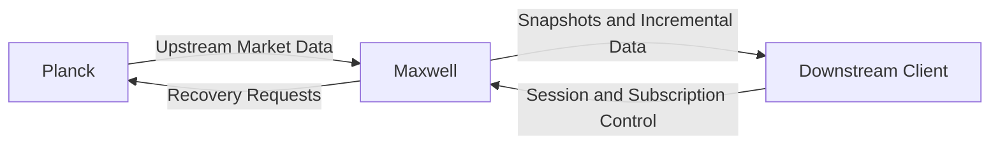
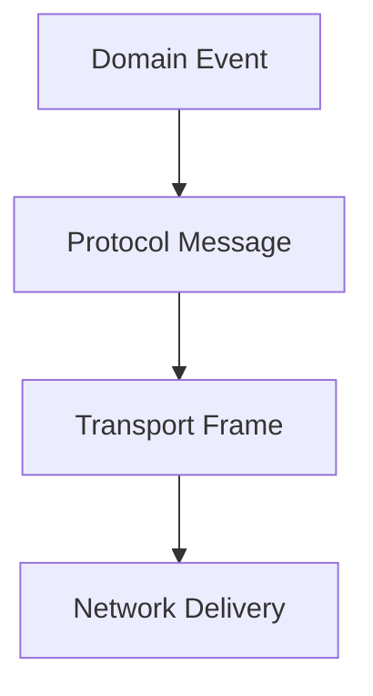
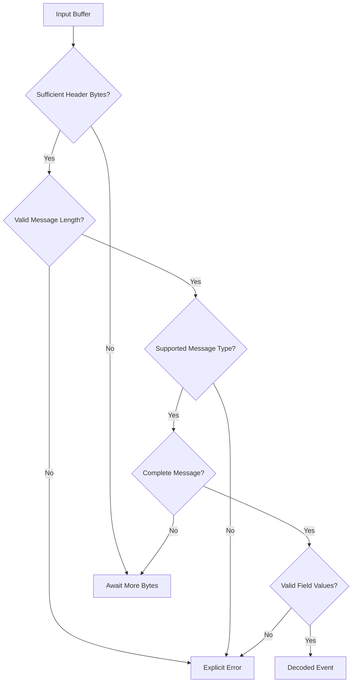
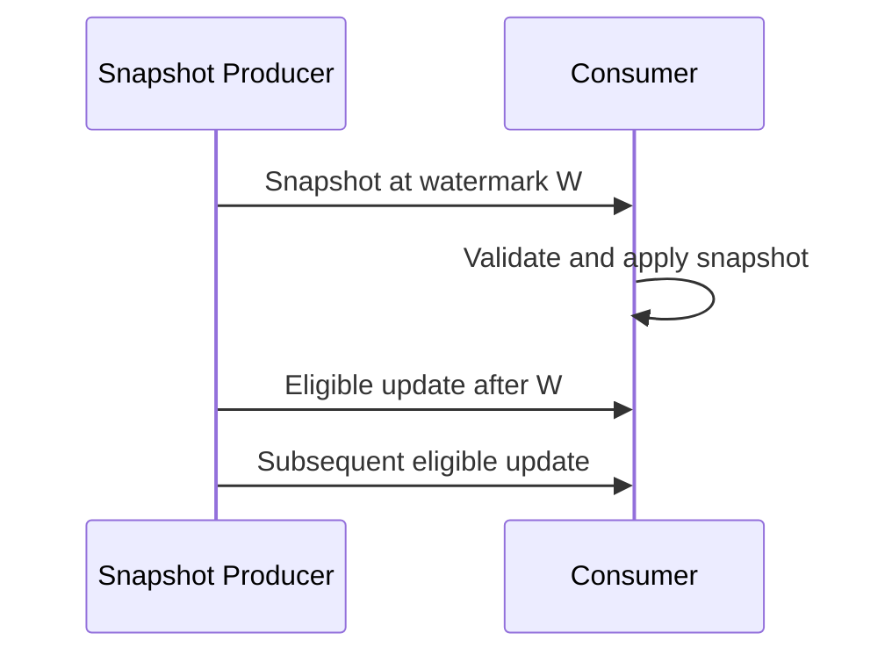

# Maxwell Protocol and Interoperability

## 1. Purpose

This document defines the architectural requirements for
Maxwell's binary market data protocol and its interoperability
with Planck and downstream consumers.

The current Rust protocol implementation resides in:

```text
crates/maxwell-protocol/
```

Foundational domain representations reside in:

```text
crates/maxwell-core/
```

Exact binary layouts, numeric message identifiers, field
widths, byte ordering, and financial scales must be reconciled
with the current source before this document is treated as
a normative wire-format specification.

Live Planck interoperability remains pending validation.

## 2. Communication Boundaries

Maxwell distinguishes two principal protocol boundaries.



The upstream protocol describes authoritative exchange
events.

The downstream protocol describes market data distribution,
subscription control, and client synchronization.

These protocols may share domain representations without
requiring identical message formats.

## 3. Protocol Design Requirements

The protocol should provide:

- Explicit message boundaries.
- Explicit numeric field representations.
- Validated message lengths.
- Stable message identifiers.
- Explicit sequence scope.
- Explicit timestamp semantics.
- Predictable decoding behavior.
- Bounded resource consumption.
- Documented compatibility rules.
- Cross-language interoperability.

Protocol messages must not depend on compiler-specific
structure padding or native object layout.

## 4. Transport Independence

Protocol messages and transport frames are distinct concepts.



A protocol message represents logical market data or
control information.

A transport frame provides the boundaries required by
the selected communication mechanism.

A TCP read may contain:

- Part of a frame.
- One complete frame.
- Multiple complete frames.
- Complete frames followed by a partial frame.

A UDP datagram preserves datagram boundaries but does not
guarantee delivery, uniqueness, or ordering.

Framing rules must be defined for each supported transport.

## 5. Message Categories

The following table describes logical message categories
required or anticipated by the integrated platform.

It does not assign wire identifiers or imply that every
category currently has a complete codec.

| Category | Purpose |
|----------|---------|
| Instrument definition | Describe an instrument |
| Book update | Modify market book state |
| Trade | Represent an execution |
| Quote | Represent published quote information |
| Snapshot | Establish market state |
| Instrument status | Describe instrument availability |
| Feed status | Describe upstream synchronization |
| Heartbeat | Provide liveness information |
| Recovery request | Request missing market data |
| Recovery response | Return requested recovery data |
| Subscription request | Select downstream market data |
| Subscription response | Confirm or reject a subscription |
| Session control | Coordinate downstream session state |
| Invalidation | Notify a consumer of stale state |
| Error | Communicate supported protocol failures |

The publisher's EventKind enumeration defines publication
categories. Its discriminants must not automatically be
treated as wire message identifiers.

## 6. Message Header Contract

A binary protocol header may contain the following
information, depending on the message family:

| Field Concept | Purpose |
|---------------|---------|
| Message type | Select the decoding schema |
| Message length | Establish message boundaries |
| Protocol version | Identify compatible representation |
| Feed identifier | Identify upstream sequencing scope |
| Sequence | Establish ordering within a scope |
| Timestamp | Represent a documented event time |
| Flags | Represent explicitly defined optional behavior |

This table is a conceptual schema, not an exact header
layout.

The actual implementation must document:

- Field order.
- Field width.
- Signedness.
- Byte ordering.
- Valid ranges.
- Required and optional fields.
- Reserved values.
- Maximum supported message length.

## 7. Binary Representation

### 7.1 Integer Encoding

Integer fields must use explicitly documented widths.

Rust and C++ implementations must agree on:

- Signed or unsigned interpretation.
- Field width.
- Byte ordering.
- Valid range.
- Overflow behavior.

Rust encoding should use explicit conversions such as
to_be_bytes or to_le_bytes according to the selected
wire contract.

C++ encoding should use corresponding explicit
byte-order conversion.

Native byte order must not be assumed.

### 7.2 Structure Layout

The following is not a sufficient interoperability
contract:

```text
Serialize the bytes of a native C++ or Rust structure.
```

Native structures may contain:

- Alignment padding.
- Compiler-specific layout.
- Platform-dependent representations.
- Uninitialized padding bytes.

Prefer explicit field-by-field serialization.

Even when a representation attribute or packed structure
is used, byte ordering and validation remain necessary.

### 7.3 Variable-Length Fields

Variable-length fields must define:

- Length representation.
- Maximum allowed length.
- Encoding.
- Empty-value semantics.
- Truncation behavior.
- Validation requirements.

An untrusted length must not directly trigger unrestricted
memory allocation.

### 7.4 Reserved Fields

Reserved fields and flags must have documented behavior.

Unknown reserved values should be rejected or ignored only
according to an explicit compatibility policy.

## 8. Financial Values

Prices and quantities use validated fixed-point domain
representations.

Conceptually:

```text
represented_value = raw_integer / scale
```

For illustration only, a scale of 10,000 and a raw integer
of 1,234,567 would represent 123.4567.

This example does not establish Maxwell's actual scale.

The protocol specification must define:

- Price scale.
- Quantity scale.
- Signedness.
- Minimum and maximum values.
- Tick-size constraints.
- Lot-size constraints.
- Zero-value semantics.
- Conversion and rounding rules.

Rust and C++ implementations must agree on these properties.

### 8.1 Arithmetic

Intermediate calculations may require a wider integer type
than the final wire representation.

Overflow must be detected before narrowing conversions.

### 8.2 Human-Readable Formatting

Decimal formatting belongs primarily at application
boundaries.

The internal market data processing path should retain
the validated fixed-point representation.

## 9. Sequence Semantics

### 9.1 Upstream Feed Sequence

The upstream sequence establishes event ordering within
a defined feed or stream.

The protocol must define:

- Initial sequence.
- Increment behavior.
- Sequence scope.
- Duplicate semantics.
- Reset semantics.
- Exhaustion behavior.
- Stream restart or epoch identification.

### 9.2 Publication Sequence

The publication sequence establishes accepted publication
ordering within a publisher instance.

Filtered subscriptions may receive nonconsecutive values.

A global publication sequence must not be interpreted
as a session-local delivery sequence.

### 9.3 Session Sequence

If supported, a session-local sequence should establish
continuity across messages delivered to one session.

Its relationship to control messages, snapshots, and
incremental publications must be documented.

### 9.4 Watermarks

A watermark identifies a state boundary.

The protocol must specify whether a watermark represents:

- The last event included in state.
- The next event expected after state.
- Another explicitly defined boundary.

These interpretations are not interchangeable.

## 10. Timestamp Semantics

Timestamp fields must define:

- Unit.
- Epoch or clock origin.
- Clock domain.
- Signedness.
- Valid range.
- Meaning of zero.
- Event represented by the timestamp.

Possible timestamp categories include:

| Category | Meaning |
|----------|---------|
| Exchange event time | Time assigned by Planck |
| Receive time | Time observed at Maxwell ingestion |
| Processing time | Local processing measurement |
| Publication time | Time associated with publication |
| Client receive time | Time observed by a consumer |

Monotonic clocks are appropriate for local elapsed-time
measurement.

Wall-clock timestamps may be appropriate for externally
meaningful event times.

Timestamps from independent hosts cannot be subtracted
meaningfully for precise latency measurement without
appropriate clock synchronization.

## 11. Decoding Requirements

A decoder should validate input before producing a
trusted domain event.



The distinction between incomplete input and invalid input
is particularly important for stream transports.

### 11.1 Required Validation

- Buffer length.
- Header length.
- Declared message length.
- Supported message type.
- Supported protocol version where applicable.
- Field boundaries.
- Domain values.
- Reserved values.
- Event-specific constraints.

### 11.2 Error Handling

Malformed messages must not cause:

- Out-of-bounds reads.
- Unbounded allocation.
- Partial market state mutation.
- Silent sequence advancement.
- Undocumented connection state changes.

The application must decide whether a protocol error
requires message rejection, feed invalidation, or
connection termination.

## 12. Snapshot Protocol

A snapshot must establish a consistent state boundary.

Its logical contents should identify:

- Snapshot scope.
- Relevant instruments.
- Represented market state.
- Recovery or publication watermark.
- Completeness information.
- Snapshot identity where fragmentation is supported.

### 12.1 Fragmented Snapshots

If snapshots are transmitted across multiple messages,
the protocol must define:

- Snapshot identifier.
- Fragment ordering.
- Completion detection.
- Duplicate fragment behavior.
- Missing fragment behavior.
- Maximum total size.
- Timeout and invalidation behavior.

A partially received snapshot must not be treated as
complete synchronized state.

### 12.2 Snapshot and Incremental Ordering



The exact sequence domain represented by W must be
specified.

Snapshot consistency must be established before
incremental delivery is considered synchronized.

## 13. Recovery Protocol

### 13.1 Retransmission Request

A recovery request should identify:

- Feed or stream scope.
- Missing sequence range.
- Recovery request identity where needed.
- Relevant stream epoch.

The range convention must be explicit.

For example, inclusive start and end values differ from
a half-open range.

### 13.2 Recovery Response

Recovery responses must provide sufficient information to
validate:

- The affected feed.
- The requested range.
- Returned event ordering.
- Completeness.
- Availability or rejection.

### 13.3 Snapshot Fallback

When retransmission is unavailable or exceeds configured
limits, the recovery policy may request a snapshot.

The protocol must distinguish unavailable recovery data
from temporary transport failure.

## 14. Downstream Session Protocol

The intended downstream protocol should define:

- Session establishment.
- Subscription requests.
- Subscription responses.
- Snapshot delivery.
- Incremental delivery.
- Heartbeats.
- Invalidation.
- Resynchronization.
- Session termination.

Authentication and authorization requirements remain
application-level design work.

### 14.1 Filtering

Subscription filtering changes the set of delivered
publications.

It does not change the meaning of the publisher's global
sequence.

### 14.2 Backpressure

When downstream state becomes invalid, the session
protocol must provide an explicit outcome.

Possible outcomes include:

- Resynchronization notification.
- Session invalidation.
- Connection termination.

Silent incremental loss is not an acceptable
synchronization strategy.

## 15. Protocol Compatibility

Changes should be classified before implementation.

| Change | Compatibility Concern |
|--------|-----------------------|
| New message type | Older decoder behavior |
| New optional field | Length and extension rules |
| Field width change | Breaking binary layout |
| Byte-order change | Breaking numeric interpretation |
| Message ID reuse | Ambiguous decoding |
| Fixed-point scale change | Breaking financial semantics |
| Sequence reset change | Recovery incompatibility |
| Timestamp unit change | Incorrect time interpretation |

A version field alone does not guarantee compatibility.

Compatibility behavior must be tested explicitly.

## 16. Planck Interoperability

The Rust and C++ implementations must agree on the
following contract.

| Item | Verification Required |
|------|-----------------------|
| Message identifiers | Exact numeric agreement |
| Header layout | Exact byte agreement |
| Field widths | Exact representation |
| Byte ordering | Exact encoding |
| Financial scales | Exact numerical semantics |
| Sequence scope | Identical ordering interpretation |
| Snapshot watermark | Identical state boundary |
| Recovery ranges | Identical range convention |
| Timestamp units | Identical clock interpretation |
| Framing | Identical message boundaries |
| Maximum message size | Compatible limits |

### 16.1 Golden Test Vectors

Golden vectors should be shared between the projects.

Each vector should include:

- Protocol version.
- Message type.
- Logical field values.
- Expected encoded bytes.
- Expected decoded values.
- Expected error for invalid vectors.

Recommended tests:

1. Encode in Planck and decode in Maxwell.
2. Encode in Maxwell and decode in Planck.
3. Compare encoded bytes against golden vectors.
4. Verify boundary values.
5. Verify malformed input rejection.

### 16.2 Golden Vector Governance

Golden vectors should be version-controlled.

Changes to existing vectors require a documented protocol
change or correction.

Generated vectors should not be regenerated automatically
during ordinary tests in a way that conceals regressions.

## 17. Normative Wire Specification Checklist

Before live interoperability is declared complete:

- [ ] Enumerate all supported wire message identifiers.
- [ ] Document exact header layout.
- [ ] Document every supported message layout.
- [ ] Document byte ordering.
- [ ] Document financial scales.
- [ ] Document sequence scope and initial values.
- [ ] Document stream restart behavior.
- [ ] Document timestamp semantics.
- [ ] Document maximum frame and message lengths.
- [ ] Document snapshot representation.
- [ ] Document recovery request and response formats.
- [ ] Document downstream session semantics.
- [ ] Establish cross-language golden vectors.
- [ ] Verify Planck-to-Maxwell integration.
- [ ] Verify malformed message handling.
- [ ] Verify compatibility and versioning behavior.

## 18. Related Documentation

- [Architecture](architecture.md)
- [Crate Reference](crates.md)
- [Architectural Decisions](decisions.md)
- [Testing](testing.md)
