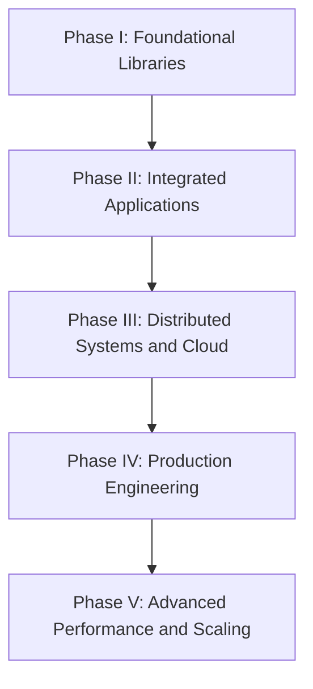
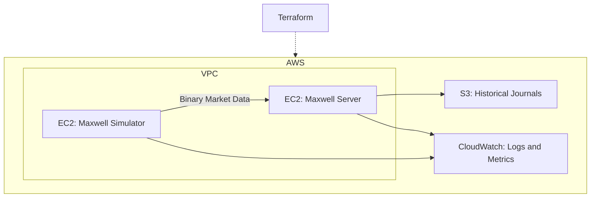

# Maxwell Roadmap

## 1. Purpose

This document records Maxwell's development milestones,
implementation status, technical debt, integration risks,
and future engineering priorities.

The roadmap should distinguish implemented functionality
from validated behavior and planned capabilities.

## 2. Project Vision

Maxwell is intended to become a high-performance market
data platform operating alongside the Planck C++23
matching engine.

The broader ecosystem will demonstrate:

- Exchange and market data infrastructure.
- Modern C++ and Rust systems programming.
- Binary network communication.
- Deterministic market reconstruction.
- Fault detection and recovery.
- Historical persistence and playback.
- Distributed systems engineering.
- Cloud infrastructure.
- Automated deployment.
- Operational observability.
- Performance engineering.

## 3. Status Definitions

| Status | Meaning |
|--------|---------|
| Implemented | Initial source implementation exists |
| Validated | Relevant tests have been executed successfully |
| In Progress | Active implementation work |
| Planned | Identified future work |
| Deferred | Intentionally postponed |

An implemented component is not automatically production
ready.

Validation status should be supported by actual test
results.

## 4. Current Workspace

| Package | Initial Implementation |
|---------|------------------------|
| maxwell-core | Implemented |
| maxwell-protocol | Implemented |
| maxwell-sequencer | Implemented |
| maxwell-book | Implemented |
| maxwell-transport | Implemented |
| maxwell-recovery | Implemented |
| maxwell-publisher | Implemented |
| maxwell-gateway | Implemented |
| maxwell-client | Implemented |
| maxwell-metrics | Implemented |
| maxwell-server | Implemented |
| maxwell-simulator | Implemented |
| maxwell-replay | Implemented |
| maxwell-cli | Implemented |

The workspace contains ten foundational libraries and
four applications.

Production networking and cloud deployment remain
future integration workstreams.

## 5. Development Phases

| Phase | Status |
|-------|--------|
| I | Initial implementation complete |
| II | Initial implementation complete; milestone validation |
| III | Planned next |
| IV | Planned |
| V | Deferred |

## 6. Phase I: Foundational Libraries

### Deliverables

- Financial domain types.
- Native binary protocol.
- Sequence validation.
- Order book reconstruction.
- Transport primitives.
- Recovery coordination.
- Subscriber publication.
- Downstream gateway.
- Consumer-side market processing.
- Operational instrumentation.

### Completion Criteria

- Foundational packages compile.
- Component interfaces are documented.
- Relevant unit tests pass.
- Workspace formatting passes.
- Strict Clippy passes.

The initial foundational implementation is complete.

## 7. Phase II: Integrated Applications

### 7.1 Integrated Server

Implemented capabilities:

- Server lifecycle management.
- Instrument registration.
- Upstream event ingestion.
- Recovery coordination.
- Deterministic market mutation.
- Publication generation.
- Pending publication handling.
- Subscriber synchronization.
- Operational status reporting.

Remaining production integration:

- Long-running socket orchestration.
- Remote recovery correlation.
- Complete upstream snapshot installation.
- Downstream network session orchestration.

### 7.2 Market Simulator

Implemented capabilities:

- Independent authoritative synthetic market.
- Seeded deterministic generation.
- Multiple instruments.
- Configurable event distribution.
- Packet loss.
- Duplicate delivery.
- Reordered delivery.
- Combined fault scenarios.
- Bounded delivery queues.
- Retained history.
- Snapshot generation.
- Pacing and workload statistics.

Remaining improvements:

- Explicit FIFO-priority verification.
- Additional capacity stress coverage.
- Constant-time resting-order statistics where justified.
- Production network adapters.

### 7.3 Historical Recording and Replay

Implemented capabilities:

- Versioned binary journal.
- Authoritative and raw-capture modes.
- CRC32C integrity checks.
- Buffered recording.
- Configurable durability.
- Sequential validation.
- Incomplete-tail policy.
- Sparse indexing.
- Sequence and timestamp seeking.
- Record filtering.
- Virtual, unbounded, real-time, and scaled playback.
- Pending record retention.
- Replay statistics.

Remaining improvements:

- Persistent index representation.
- Journal rotation.
- Segmented history.
- Snapshot catalogs.
- Transactional persistence boundaries.
- Asynchronous recording.
- Cloud journal archival.

### 7.4 Operational CLI

Implemented commands:

- help
- version
- scenarios
- simulate
- record
- inspect
- validate
- replay
- benchmark

The CLI provides a unified local interface without
duplicating domain logic.

Remaining improvements:

- Structured output.
- Remote server administration.
- Network-connected replay.
- Additional benchmark categories.
- Production configuration loading.

### 7.5 Phase II Milestone Validation

Before tagging the milestone:

- [ ] Run workspace formatting checks.
- [ ] Run workspace compilation checks.
- [ ] Run all workspace tests.
- [ ] Run dedicated historical reconstruction tests.
- [ ] Run strict workspace Clippy.
- [ ] Run release-mode tests.
- [ ] Build the release CLI.
- [ ] Execute the local recording and replay workflow.
- [ ] Generate API documentation.
- [ ] Review updated project documentation.
- [ ] Commit the milestone.
- [ ] Create a version tag.

Proposed milestone version:

    v0.2.0

The version should be confirmed before changing workspace
package metadata or creating the release tag.

## 8. Phase III: Distributed Systems and Cloud

The next phase establishes a real distributed environment
using the existing Maxwell applications.

The initial market producer will be the simulator.

Planck integration will follow after the distributed
market data baseline is operational.

## 9. Phase III-A: Network Integration

### Objective

Connect independently executing market producer and
consumer processes.

### Work Items

- Define the initial transport topology.
- Define producer and server startup configuration.
- Implement simulator network delivery.
- Implement server socket ingestion.
- Handle stream framing or datagram boundaries.
- Validate incoming binary messages.
- Handle partial communication.
- Define connection lifecycle.
- Define bounded buffering.
- Define shutdown behavior.
- Add process-to-process integration tests.

### Initial Design Preference

Establish a simple TCP-based producer-to-server baseline
before expanding to UDP and more complex recovery
topologies.

This is a proposed implementation sequence, not a
restriction on the eventual transport architecture.

### Acceptance Criteria

- Producer and server execute as independent processes.
- Market events cross a real network connection.
- The server reconstructs the expected market state.
- Invalid input is handled explicitly.
- Resource limits remain enforced.
- Shutdown behavior is controlled.
- Local distributed integration tests pass.

## 10. Phase III-B: Containerization

### Objective

Package the producer and consumer as reproducible
deployable applications.

### Work Items

- Create release-oriented Dockerfiles.
- Use multi-stage builds where appropriate.
- Define minimal runtime images.
- Define application configuration inputs.
- Configure container networking.
- Mount journal storage.
- Define process health checks.
- Create a local distributed environment.
- Document startup and teardown.

### Acceptance Criteria

- Producer and consumer images build successfully.
- Containers communicate over an explicit network.
- Market data is processed correctly.
- Journal storage survives container replacement where
  configured.
- Local deployment is reproducible.

## 11. Phase III-C: Infrastructure Repository

### Objective

Create a dedicated infrastructure repository for the
broader Planck and Maxwell ecosystem.

The repository name remains undecided.

### Proposed Repository Structure

    infrastructure/
    ├── README.md
    ├── terraform/
    │   ├── modules/
    │   └── environments/
    │       └── dev/
    ├── docker/
    ├── scripts/
    ├── monitoring/
    ├── docs/
    └── .github/
        └── workflows/

### Responsibilities

- Infrastructure as code.
- Application deployment configuration.
- Environment provisioning.
- Operational scripts.
- Monitoring configuration.
- Automated deployment.
- Infrastructure documentation.

Application-specific domain logic remains in the Planck
and Maxwell repositories.

## 12. Phase III-D: Initial AWS Deployment

### Objective

Deploy a small distributed Maxwell development environment
on AWS.

### Proposed AWS Resources

- VPC.
- Subnets.
- Route tables.
- Restricted security groups.
- EC2 application instances.
- IAM instance roles.
- S3 journal bucket.
- CloudWatch log groups.
- Cost monitoring.

### Work Items

- Establish an AWS development account environment.
- Define infrastructure variables.
- Configure Terraform state management.
- Provision network resources.
- Provision application instances.
- Deploy application containers.
- Configure least-privilege access.
- Validate producer-to-server communication.
- Document infrastructure teardown.

### Acceptance Criteria

- Infrastructure is reproducibly provisioned.
- Producer and consumer execute on separate hosts.
- Market data crosses the AWS network.
- Operational access is restricted.
- Resources can be destroyed reproducibly.
- Deployment costs are understood.

This is a development deployment rather than a claim
of production readiness.

## 13. Phase III-E: Persistence and Observability

### Objective

Extend the distributed environment with historical
storage and operational monitoring.

### Work Items

- Define journal finalization workflow.
- Upload completed journals to S3.
- Configure journal retention.
- Define object naming conventions.
- Validate archived journal integrity.
- Configure CloudWatch logging.
- Export selected operational metrics.
- Create initial monitoring dashboards.
- Establish basic operational alerts.

### Acceptance Criteria

- Completed journals are archived successfully.
- Archived journals can be retrieved and validated.
- Application failures are observable.
- Market synchronization status is observable.
- Resource usage can be monitored.
- Operational procedures are documented.

## 14. Phase III-F: Automated Deployment

### Objective

Automate validation, packaging, and development deployment.

### Work Items

- Configure GitHub Actions validation.
- Build application release artifacts.
- Build container images.
- Publish versioned images.
- Validate Terraform configuration.
- Define deployment approval boundaries.
- Use short-lived cloud credentials.
- Deploy the development environment.
- Record deployed source and image versions.
- Document rollback.

### Acceptance Criteria

- Application changes trigger automated validation.
- Release artifacts are traceable to source commits.
- Infrastructure changes are reviewable.
- Deployment is reproducible.
- Credentials are not stored in source control.

## 15. Phase III-G: Planck Interoperability

### Objective

Replace or supplement the simulator with live market
events generated by Planck.

### Work Items

- Review Planck's event representation.
- Define the cross-language protocol contract.
- Map financial domain values.
- Reconcile identifier widths.
- Reconcile sequence ownership.
- Reconcile timestamp semantics.
- Implement the required adapter.
- Add binary golden-vector tests.
- Validate live event ingestion.
- Compare reconstructed state against Planck state.
- Define remote recovery contracts.

### Acceptance Criteria

- Planck-generated events are decoded correctly.
- Maxwell reconstructs the expected market state.
- Sequence and feed identity are preserved.
- Cross-language compatibility tests pass.
- Integration behavior is documented.

## 16. Phase IV: Production Engineering

### Objectives

Strengthen correctness, resilience, security, and
operability of the distributed environment.

### Workstreams

- Complete remote recovery request correlation.
- Recovery timeout and retry policy.
- Upstream snapshot installation.
- Downstream network session lifecycle.
- Reconnection and resynchronization.
- Journal rotation and retention.
- Persistent historical indexing.
- Controlled shutdown.
- Structured logging.
- Health and readiness endpoints.
- Authentication and authorization.
- Resource exhaustion testing.
- Failure injection.
- Long-running soak testing.
- Deployment rollback.
- Operational alerting.

### Acceptance Criteria

Production-oriented guarantees must be supported by
explicit validation.

A successful cloud deployment alone does not establish
availability, durability, security, or recovery guarantees.

## 17. Phase V: Advanced Performance and Scaling

Potential workstreams:

- Fixed-capacity order registry.
- Reduced critical-path allocation.
- Instrument partitioning.
- Dedicated network threads.
- Bounded inter-thread communication.
- CPU affinity.
- NUMA-aware processing.
- Batched communication.
- Advanced latency instrumentation.
- Persistent journal indexes.
- Asynchronous persistence.
- Multi-feed ingestion.
- Horizontal distribution.
- Advanced recovery coordination.

These optimizations require measured baselines and
correctness-preserving designs.

## 18. Technical Debt Register

Priority definitions:

| Priority | Meaning |
|----------|---------|
| P0 | Correctness or deployment blocker |
| P1 | Important near-term engineering work |
| P2 | Improvement after baseline |
| P3 | Longer-term optimization |

| ID | Priority | Item |
|----|----------|------|
| TD-001 | P0 | Production server socket orchestration |
| TD-002 | P0 | Producer network adapter |
| TD-003 | P0 | Process-to-process integration tests |
| TD-004 | P1 | Correlated remote recovery requests |
| TD-005 | P1 | Complete upstream snapshot installation |
| TD-006 | P1 | Downstream network framing and sessions |
| TD-007 | P1 | Recovery and publication runtime budget review |
| TD-008 | P1 | Explicit snapshot watermark integration review |
| TD-009 | P1 | FIFO-priority reconstruction coverage |
| TD-010 | P1 | Planck protocol adapter |
| TD-011 | P1 | Journal rotation and finalization workflow |
| TD-012 | P1 | Cloud archival and retrieval |
| TD-013 | P1 | Structured operational logging |
| TD-014 | P1 | Health and readiness endpoints |
| TD-015 | P1 | Coordinated shutdown |
| TD-016 | P2 | Fixed-capacity order registry |
| TD-017 | P2 | Consolidation of duplicated resource limits |
| TD-018 | P2 | Constant-time resting-order statistics |
| TD-019 | P2 | Persistent sparse journal index |
| TD-020 | P2 | Historical snapshot catalog |
| TD-021 | P2 | Asynchronous persistence |
| TD-022 | P2 | Structured CLI output |
| TD-023 | P2 | Additional latency benchmarks |
| TD-024 | P2 | Long-running soak tests |
| TD-025 | P3 | Instrument partitioning |
| TD-026 | P3 | NUMA-aware optimization |

Priorities should be revised as integration requirements
and measured bottlenecks become clearer.

## 19. Integration Risks

### Protocol Compatibility

Planck and Maxwell may use different message framing,
financial scales, event kinds, or timestamp conventions.

Mitigation:

- Explicit protocol mapping.
- Binary golden vectors.
- Cross-language integration tests.

### Sequence Ownership

Independent sequence domains may be accidentally conflated.

Mitigation:

- Explicit domain types.
- Ownership documentation.
- Sequence regression tests.

### Publication Retry

An accepted market mutation may be repeated if a caller
misinterprets publication backpressure.

Mitigation:

- Distinct ingestion outcomes.
- Pending publication retention.
- Integration regression tests.

### Snapshot Consistency

Incorrect watermarks may cause missing or duplicate
market events.

Mitigation:

- Explicit snapshot contracts.
- Baseline validation.
- Ordered incremental application.

### Persistence Consistency

A recording failure may occur after market state has
already been mutated.

Mitigation:

- Explicit persistence boundaries.
- Failed-recording diagnostics.
- Future transactional or checkpoint coordination.

### Resource Exhaustion

Logical capacity limits may not eliminate all dynamic
allocation or operating-system resource exhaustion.

Mitigation:

- Capacity testing.
- Memory profiling.
- Fallible allocation.
- Explicit operational limits.

### Cloud Cost

Unmanaged instances, storage, networking, and monitoring
may create unnecessary recurring costs.

Mitigation:

- Small development environments.
- Cost monitoring.
- Explicit teardown.
- Retention policies.
- Review of provisioned resources.

## 20. Immediate Development Sequence

1. Complete Phase II milestone validation.
2. Commit the documentation refresh.
3. Confirm and create the Phase II version tag.
4. Review existing transport and server interfaces.
5. Define the initial network integration contract.
6. Implement producer-to-server socket communication.
7. Validate separate local processes.
8. Introduce Docker packaging.
9. Create the infrastructure repository.
10. Provision the first AWS development environment.
11. Introduce S3 archival and CloudWatch monitoring.
12. Automate deployment.
13. Integrate live Planck market events.

Do not delay the initial cloud deployment until every
advanced production feature is complete.

## 21. Engineering Handover Requirements

Each completed workstream should provide:

- Source implementation.
- Public interface documentation.
- Configuration requirements.
- Ownership boundaries.
- Failure semantics.
- Relevant tests.
- Validation results.
- Known limitations.
- Outstanding technical debt.
- Recommended next steps.

A new developer should be able to identify the relevant
component and its responsibilities without reading the
entire workspace.

## 22. Roadmap Maintenance

Update this document when:

- A milestone is completed.
- A new architectural decision is accepted.
- A correctness defect changes implementation priorities.
- A new integration dependency is discovered.
- A performance baseline is established.
- A deployment environment becomes operational.
- Technical debt is resolved or reprioritized.

Implementation status should reflect observed results
rather than anticipated completion.

## 23. Related Documentation

- [Architecture](architecture.md)
- [Crate Reference](crates.md)
- [Protocol](protocol.md)
- [Concurrency](concurrency.md)
- [Design Decisions](decisions.md)
- [Testing](testing.md)
- [Performance](performance.md)
- [Operations](operations.md)
- [Quick Start](quick_start.md)
