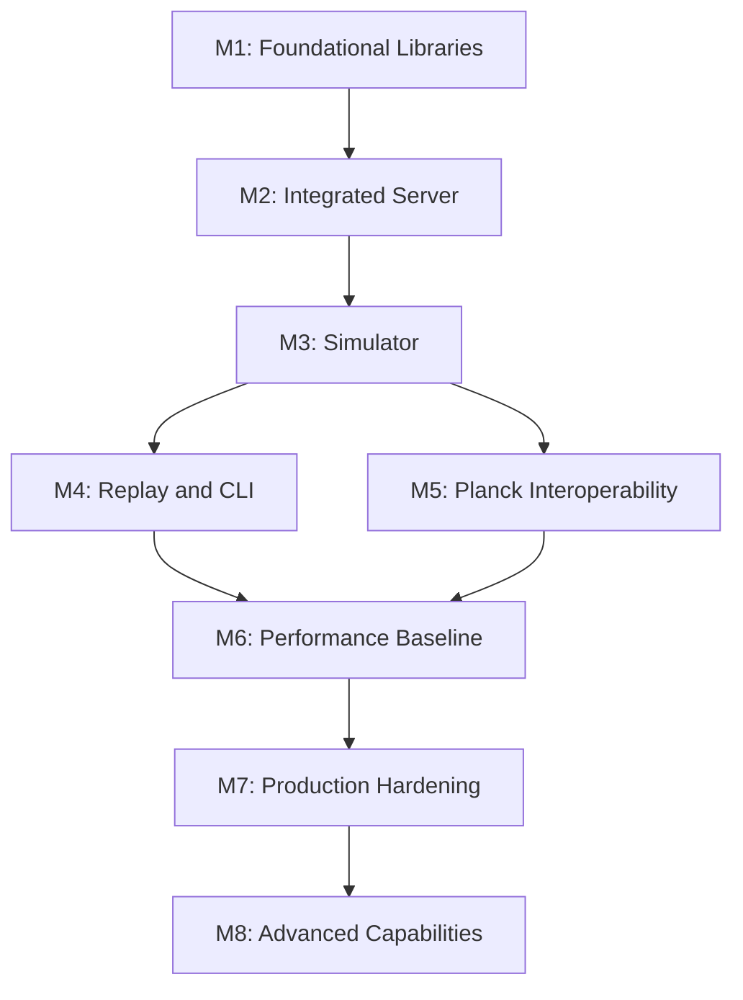

# Maxwell Development Roadmap

## 1. Purpose

This document tracks Maxwell's implementation status,
development priorities, known limitations, technical debt,
and future engineering opportunities.

The roadmap is intended to guide development rather than
establish fixed delivery dates.

Correctness, integration readiness, and measured system
behavior determine progression between milestones.

## 2. Project Vision

Maxwell aims to become a high-performance, low-latency,
deterministic market data platform supporting the Planck
C++23 matching engine.

The long-term objective is an independently deployable
market data infrastructure platform with:

- Reliable market data ingestion.
- Deterministic state reconstruction.
- Explicit synchronization and recovery.
- Efficient subscriber distribution.
- Reusable client interfaces.
- Reproducible simulation and replay.
- Comprehensive operational instrumentation.
- Measured performance characteristics.

## 3. Status Definitions

| Status | Meaning |
|--------|---------|
| Planned | Work has not been completed |
| Initial implementation | Foundational implementation exists |
| Validated | Defined acceptance tests have passed |
| Integrated | Component works within the intended application |
| Production-ready | Operational, correctness, security, and performance requirements have been satisfied |

An initial implementation is not equivalent to a
production-ready component.

## 4. Current Implementation Status

### 4.1 Library Crates

| Component | Status |
|-----------|--------|
| maxwell-core | Initial implementation |
| maxwell-protocol | Initial implementation |
| maxwell-sequencer | Initial implementation |
| maxwell-book | Initial implementation |
| maxwell-transport | Initial implementation |
| maxwell-recovery | Initial implementation |
| maxwell-publisher | Initial implementation |
| maxwell-gateway | Initial implementation |
| maxwell-client | Initial implementation |
| maxwell-metrics | Initial implementation |

All ten foundational library implementations have been
drafted.

The current repository and test results are authoritative
for their exact validation status.

### 4.2 Applications

| Application | Status | Priority |
|-------------|--------|----------|
| maxwell-server | Planned | P0 |
| maxwell-simulator | Planned | P0 |
| maxwell-replay | Planned | P1 |
| maxwell-cli | Planned | P1 |

### 4.3 System Capabilities

| Capability | Status |
|------------|--------|
| Foundational domain representations | Initial implementation |
| Binary protocol primitives | Initial implementation |
| Sequence validation | Initial implementation |
| Market state reconstruction | Initial implementation |
| Recovery primitives | Initial implementation |
| Subscriber fan-out | Initial implementation |
| Session management primitives | Initial implementation |
| Client synchronization primitives | Initial implementation |
| Metrics primitives | Initial implementation |
| Integrated server | Planned |
| Integrated simulator | Planned |
| Historical replay application | Planned |
| Command-line application | Planned |
| Live Planck interoperability | Pending validation |
| Production benchmarks | Planned |
| Production deployment | Planned |

## 5. Priority Definitions

| Priority | Meaning |
|----------|---------|
| P0 | Required for foundational integration or correctness |
| P1 | Required for a usable and operationally credible platform |
| P2 | Performance, maintainability, or operational enhancement |
| P3 | Exploratory or advanced functionality |

## 6. Development Milestones



Some milestones may proceed concurrently when their
dependencies permit.

## 7. Milestone 1: Foundational Libraries

Priority: P0.

Status: Initial implementation drafted.

### Objectives

Establish reusable, independently testable processing
components.

### Tasks

- [x] Draft maxwell-core.
- [x] Draft maxwell-protocol.
- [x] Draft maxwell-sequencer.
- [x] Draft maxwell-book.
- [x] Draft maxwell-transport.
- [x] Draft maxwell-recovery.
- [x] Draft maxwell-publisher.
- [x] Draft maxwell-gateway.
- [x] Draft maxwell-client.
- [x] Draft maxwell-metrics.
- [ ] Verify final workspace compilation.
- [ ] Verify final workspace unit tests.
- [ ] Verify final workspace integration tests.
- [ ] Verify release-mode tests.
- [ ] Resolve remaining Clippy warnings.
- [ ] Review public API consistency.
- [ ] Review resource capacity policies.
- [ ] Review cross-component contracts.
- [ ] Reconcile documentation with current source.

### Acceptance Criteria

- All ten packages compile.
- Workspace tests pass.
- Release-mode tests pass.
- Static analysis passes.
- Component responsibilities are documented.
- Remaining integration assumptions are identified.

## 8. Milestone 2: Integrated Server

Priority: P0.

Status: Planned.

Location:

```text
apps/maxwell-server/
```

### Objective

Compose the foundational library crates into a functioning
market data processing and distribution application.

### 8.1 Application Foundation

- [ ] Establish executable package.
- [ ] Establish configuration representation.
- [ ] Implement configuration validation.
- [ ] Define application error types.
- [ ] Construct required library components.
- [ ] Establish application lifecycle.
- [ ] Establish startup and shutdown behavior.

### 8.2 Processing Pipeline

- [ ] Receive upstream messages.
- [ ] Decode protocol messages.
- [ ] Validate domain values.
- [ ] Validate sequence continuity.
- [ ] Route events to appropriate market state.
- [ ] Apply market events.
- [ ] Generate publications.
- [ ] Coordinate subscriber delivery.

### 8.3 Recovery Integration

- [ ] Connect sequencing results to recovery.
- [ ] Establish recovery request handling.
- [ ] Establish retransmission response handling.
- [ ] Establish snapshot response handling.
- [ ] Coordinate buffered replay.
- [ ] Preserve book consistency during recovery.
- [ ] Restore synchronized processing.

### 8.4 Publication Integration

- [ ] Establish publication payload mapping.
- [ ] Coordinate book mutation and publication.
- [ ] Retain rejected publications for retry.
- [ ] Prevent duplicate book mutation.
- [ ] Coordinate subscriber snapshot activation.
- [ ] Deliver invalidation notifications.
- [ ] Handle slow subscribers.

### 8.5 Session Integration

- [ ] Establish downstream connection handling.
- [ ] Coordinate gateway session state.
- [ ] Implement subscription request handling.
- [ ] Implement snapshot delivery.
- [ ] Implement incremental delivery.
- [ ] Handle partial transport writes.
- [ ] Clean up disconnected sessions.

### 8.6 Observability

- [ ] Register application metrics.
- [ ] Collect component statistics.
- [ ] Record processing latency.
- [ ] Record queue occupancy.
- [ ] Record recovery transitions.
- [ ] Establish telemetry snapshot transfer.
- [ ] Implement metrics exposition endpoint.

### 8.7 Acceptance Criteria

- Server starts with valid configuration.
- Invalid configuration is rejected.
- Synthetic upstream events are processed.
- Order book state is reconstructed correctly.
- Publications reach downstream consumers.
- Recovery restores synchronized state.
- Slow consumers follow explicit backpressure policy.
- Shutdown completes within the defined policy.
- End-to-end integration tests pass.

## 9. Milestone 3: Market Data Simulator

Priority: P0.

Status: Planned.

Location:

```text
apps/maxwell-simulator/
```

### Objective

Provide deterministic and configurable market data
workloads without requiring a live Planck instance.

### Tasks

- [ ] Establish executable package.
- [ ] Define simulator configuration.
- [ ] Generate synthetic instruments.
- [ ] Generate valid market events.
- [ ] Support deterministic random seeds.
- [ ] Support configurable event rates.
- [ ] Support configurable burst behavior.
- [ ] Encode messages using shared protocol components.
- [ ] Support in-memory test delivery.
- [ ] Support selected network transports.
- [ ] Inject sequence gaps.
- [ ] Inject duplicate events.
- [ ] Inject out-of-order events.
- [ ] Inject malformed messages.
- [ ] Simulate transport disconnection.
- [ ] Provide retransmission responses.
- [ ] Provide snapshot responses.
- [ ] Simulate slow downstream consumers.
- [ ] Report generated workload statistics.

### Acceptance Criteria

- Identical seeds and configuration produce identical
  logical event sequences.
- Generated events satisfy the selected domain rules.
- Server consumes generated market data.
- Expected final state can be independently verified.
- Failure scenarios are reproducible.
- Workload rate and burst behavior are measurable.

## 10. Milestone 4: Replay and CLI

Priority: P1.

Status: Planned.

### 10.1 maxwell-replay

Location:

```text
apps/maxwell-replay/
```

#### Objective

Reproduce historical processing behavior from recorded
market data.

#### Tasks

- [ ] Establish recording format.
- [ ] Establish recording metadata.
- [ ] Validate recorded message boundaries.
- [ ] Preserve original logical event ordering.
- [ ] Support configurable replay speed.
- [ ] Support maximum-throughput replay.
- [ ] Support deterministic state reconstruction.
- [ ] Support canonical state comparison.
- [ ] Report replay statistics.
- [ ] Reproduce recorded recovery scenarios.
- [ ] Identify the first divergent event during validation.

#### Acceptance Criteria

- Recorded input can be replayed successfully.
- Repeated replay produces equivalent logical state.
- Invalid recording data is rejected explicitly.
- Replay results can be compared against expected state.

### 10.2 maxwell-cli

Location:

```text
apps/maxwell-cli/
```

#### Objective

Provide an operational and development interface for
interacting with Maxwell.

#### Tasks

- [ ] Establish executable package.
- [ ] Define command-line interface.
- [ ] Connect to a Maxwell server.
- [ ] Establish client session.
- [ ] Submit subscription requests.
- [ ] Display snapshot state.
- [ ] Display incremental updates.
- [ ] Display best bid and offer.
- [ ] Display selected order book depth.
- [ ] Display session synchronization state.
- [ ] Display operational statistics.
- [ ] Handle disconnect and reconnect.
- [ ] Support machine-readable output where useful.

#### Acceptance Criteria

- CLI connects to the integrated server.
- Subscriptions can be established.
- Snapshot and incremental state are displayed correctly.
- Invalidated state is clearly identified.
- Transport errors are reported explicitly.

## 11. Milestone 5: Planck Interoperability

Priority: P0.

Status: Pending implementation and validation.

### Objective

Establish reliable cross-language market data communication
between Planck and Maxwell.

### Tasks

- [ ] Review Planck's market event representation.
- [ ] Review Maxwell's binary protocol representation.
- [ ] Reconcile message identifiers.
- [ ] Reconcile field widths.
- [ ] Reconcile byte ordering.
- [ ] Reconcile fixed-point scales.
- [ ] Reconcile timestamp semantics.
- [ ] Reconcile sequence scope.
- [ ] Define stream restart behavior.
- [ ] Define retransmission request format.
- [ ] Define snapshot format.
- [ ] Define snapshot watermark semantics.
- [ ] Establish shared golden vectors.
- [ ] Implement cross-language codec tests.
- [ ] Establish live upstream connectivity.
- [ ] Validate trade and book event processing.
- [ ] Validate upstream recovery.
- [ ] Reconcile Maxwell state with authoritative state.

### Acceptance Criteria

- Planck-generated messages decode correctly in Maxwell.
- Golden vectors agree across Rust and C++.
- Financial values retain their intended meaning.
- Sequence gaps are detected correctly.
- Retransmission and snapshot recovery restore state.
- Maxwell's reconstructed state agrees with the
  authoritative expected state.

## 12. Milestone 6: Performance Baseline

Priority: P1.

Status: Planned.

### Objective

Establish reproducible performance measurements for the
integrated platform.

### Tasks

- [ ] Establish benchmark hardware configuration.
- [ ] Establish optimized build configuration.
- [ ] Establish reproducible workloads.
- [ ] Benchmark protocol encoding and decoding.
- [ ] Benchmark sequence validation.
- [ ] Benchmark order book mutation.
- [ ] Benchmark publication filtering.
- [ ] Benchmark subscriber fan-out.
- [ ] Benchmark recovery replay.
- [ ] Benchmark metrics overhead.
- [ ] Measure integrated processing latency.
- [ ] Measure end-to-end latency.
- [ ] Measure sustained throughput.
- [ ] Measure burst throughput.
- [ ] Measure tail latency.
- [ ] Measure memory consumption.
- [ ] Measure queue occupancy.
- [ ] Identify limiting components.
- [ ] Establish performance regression criteria.

### Acceptance Criteria

- Benchmark methodology is documented.
- Results are reproducible within characterized variability.
- Workloads preserve correctness.
- Throughput and latency boundaries are explicit.
- Performance limitations are identified.
- No unsupported performance claims are published.

## 13. Milestone 7: Production Hardening

Priority: P1.

Status: Planned.

### Objectives

Improve operational reliability, security, deployment
readiness, and maintainability.

### Tasks

- [ ] Establish automated CI.
- [ ] Establish reproducible builds.
- [ ] Establish runtime configuration validation.
- [ ] Establish structured logging.
- [ ] Establish health and readiness reporting.
- [ ] Establish operational dashboards.
- [ ] Establish alerting.
- [ ] Establish resource limits.
- [ ] Complete failure injection tests.
- [ ] Complete sustained load tests.
- [ ] Complete long-running soak tests.
- [ ] Review session authentication requirements.
- [ ] Review subscription authorization requirements.
- [ ] Review network security.
- [ ] Review dependency security.
- [ ] Establish deployment procedures.
- [ ] Establish rollback procedures.
- [ ] Establish operational recovery procedures.
- [ ] Validate graceful shutdown.
- [ ] Complete engineering handover review.

### Acceptance Criteria

- Required operational states are observable.
- Known failure scenarios have documented responses.
- Resource consumption remains bounded.
- Security requirements are addressed.
- Deployment and rollback procedures are validated.
- Operational requirements are supported by measurements.

## 14. Milestone 8: Advanced Capabilities

Priority: P2 or P3.

Status: Exploratory.

Potential enhancements include:

### Processing

- Independent feed partitions.
- Instrument-level processing partitions.
- Specialized price-ladder structures.
- More efficient subscription indexing.
- Profile-guided batching.
- NUMA-aware processing.
- CPU affinity.

### Transport

- Advanced multicast distribution.
- Shared-memory transport.
- Specialized network event loops.
- Hardware timestamping.
- Additional transport adapters.

### Reliability

- Redundant upstream feeds.
- Feed arbitration.
- Persistent recovery history.
- Persistent snapshot storage.
- Active-passive deployment.
- Additional failover strategies.

### Distribution

- More advanced subscription expressions.
- Shared immutable publication payloads.
- Additional market data representations.
- Additional client language bindings.

### Operations

- Advanced monitoring dashboards.
- Automated performance regression detection.
- Deployment automation.
- Capacity forecasting.
- Distributed telemetry aggregation.

These capabilities should be selected according to
measured bottlenecks and operational requirements.

They are not committed implementation requirements.

## 15. Known Integration Risks

| Risk | Impact | Priority |
|------|--------|----------|
| Planck wire-format mismatch | Incorrect decoding | P0 |
| Sequence domain confusion | Incorrect loss detection | P0 |
| Snapshot activation race | Missing or duplicate updates | P0 |
| Duplicate book mutation during retry | Incorrect market state | P0 |
| Partial transport write handling | Corrupted delivery stream | P0 |
| Recovery buffer exhaustion | Failed synchronization | P0 |
| Unreported subscriber invalidation | Stale client state | P0 |
| Undefined stream restart semantics | Incorrect sequence interpretation | P0 |
| Excessive allocation | Latency and memory degradation | P1 |
| Metrics contention | Processing latency degradation | P1 |
| Unmeasured capacity assumptions | Operational overload | P1 |
| Missing authentication | Unauthorized access | P1 |

Risks should be tracked until their associated contracts
and acceptance tests are established.

## 16. Technical Debt Register

### TD-001: Final Cross-Crate API Review

Priority: P0.

The library crates were developed incrementally.

Review type mappings, error propagation, state-transition
contracts, and integration assumptions before establishing
stable application interfaces.

### TD-002: Normative Wire Specification

Priority: P0.

The exact binary contract must be reconciled with the
current Rust and C++ implementations.

Create a complete field-level specification and shared
golden vectors.

### TD-003: Snapshot and Publication Coordination

Priority: P0.

The server must establish an atomic logical boundary
between snapshot state, publication watermark, and
incremental delivery.

### TD-004: Rejected Publication Retry

Priority: P0.

Under RejectPublication, retain the rejected publication
without repeating the corresponding book mutation.

Define ordering and snapshot behavior while a publication
is pending retry.

### TD-005: Subscriber Invalidation Delivery

Priority: P0.

Ensure subscriber invalidation is communicated even when
no additional market events arrive.

### TD-006: Transport Delivery Semantics

Priority: P0.

Reconcile publisher sink acceptance with partial writes,
transport buffering, disconnect behavior, and session
delivery guarantees.

### TD-007: Runtime Configuration

Priority: P1.

Finalize supported configuration fields, defaults,
validation, and compatibility policies.

### TD-008: Telemetry Collection

Priority: P1.

Implement safe, bounded snapshot transfer between
processing owners and the reporting component.

### TD-009: Metrics Export Units

Priority: P1.

Review integer nanosecond metrics and Prometheus base-unit
conventions.

Ensure metric names accurately describe exported values.

### TD-010: Performance Baseline

Priority: P1.

Establish measured latency, throughput, memory, and
capacity characteristics.

### TD-011: Internal Dead Code Review

Priority: P2.

Review temporarily unused internal methods after
application integration.

Remove redundant functionality rather than retaining
unnecessary lint suppressions indefinitely.

### TD-012: Publisher Scaling

Priority: P2.

Evaluate whether the initial subscriber traversal and
filtering approach becomes a bottleneck at measured
subscriber populations.

Consider indexed fan-out only when justified.

### TD-013: Metrics Registry Storage

Priority: P2.

The initial registry stores metric variants inline.

Counter and gauge entries therefore reserve storage
sufficient for the largest metric variant.

Evaluate separate typed storage if memory or cache
profiling identifies a meaningful cost.

### TD-014: Histogram Resolution

Priority: P2.

Review latency bucket boundaries after obtaining
representative measurements.

Increase resolution where tail estimates are too coarse.

### TD-015: Documentation Reconciliation

Priority: P1.

Review architectural descriptions against the actual
repository after each integration milestone.

Remove outdated assumptions and document finalized
application contracts.

## 17. Immediate Development Sequence

The recommended next implementation sequence is:

1. Complete final workspace validation.
2. Review library public interfaces.
3. Implement server configuration and lifecycle.
4. Implement a minimal single-owner processing pipeline.
5. Integrate synthetic in-memory input.
6. Integrate sequencing and order book mutation.
7. Integrate recovery.
8. Integrate publication and gateway.
9. Integrate downstream client behavior.
10. Implement the simulator.
11. Establish end-to-end correctness tests.
12. Implement replay and CLI.
13. Establish Planck interoperability.
14. Establish performance baselines.
15. Begin measured optimization.

The initial server should favor correctness and simplicity.

Do not introduce a complex multithreaded topology before
the component integration contracts are understood.

## 18. Engineering Workstreams

The following workstreams provide natural ownership
boundaries for multiple developers.

| Workstream | Primary Components |
|------------|--------------------|
| Domain and protocol | Core, protocol, Planck interoperability |
| Market state | Sequencer, book, recovery |
| Distribution | Publisher, gateway, client |
| Runtime integration | Transport, server, configuration |
| Simulation and validation | Simulator, replay, testing |
| Observability | Metrics, monitoring, operations |
| Performance engineering | Benchmarks, profiling, optimization |
| Developer experience | CLI, documentation, CI |

A workstream may be owned by one engineer or a small
team.

Changes crossing workstream boundaries require coordinated
contract review.

## 19. Handover Requirements

Before transferring component ownership, provide:

- Component responsibility.
- Relevant source locations.
- Public interface documentation.
- Dependency information.
- State ownership rules.
- Ordering guarantees.
- Resource capacity policies.
- Error and recovery semantics.
- Relevant tests.
- Known limitations.
- Outstanding work.
- Relevant architectural decisions.
- Available benchmark results.

The receiving engineer should be able to build and test
the component independently.

## 20. Roadmap Maintenance

Update this document when:

- A milestone is completed.
- A new integration risk is discovered.
- A technical debt item is resolved.
- A component's implementation status changes.
- A performance baseline is established.
- An architectural decision changes development priorities.

Do not mark an item complete solely because code has
been drafted.

Completion should be supported by the relevant acceptance
criteria.

## 21. Related Documentation

- [Architecture](architecture.md)
- [Quick Start](quick_start.md)
- [Architectural Decisions](decisions.md)
- [Crate Reference](crates.md)
- [Protocol](protocol.md)
- [Concurrency](concurrency.md)
- [Performance](performance.md)
- [Testing](testing.md)
- [Operations](operations.md)
