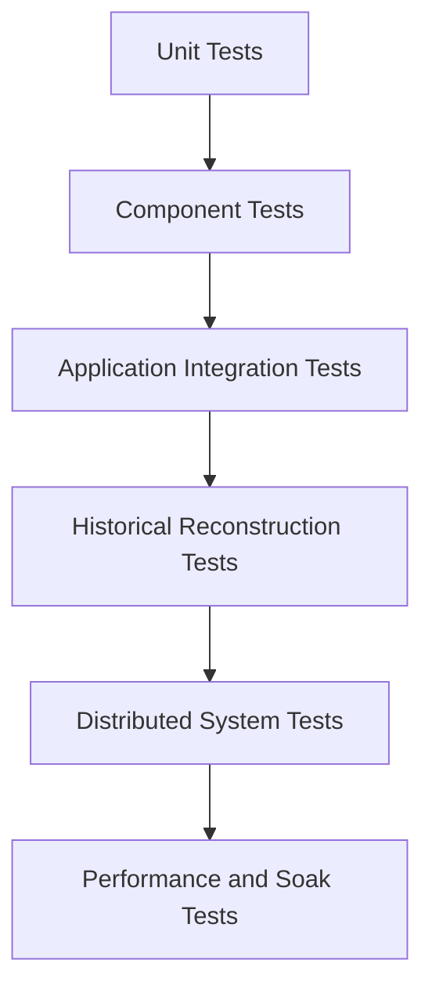
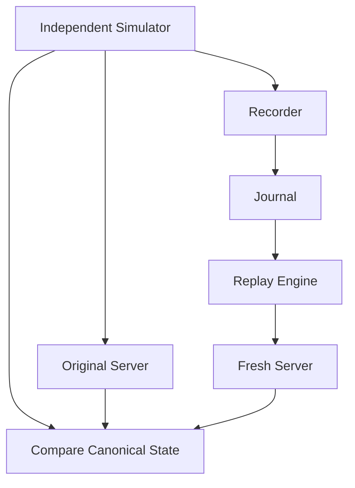

# Maxwell Testing

## 1. Purpose

This document defines Maxwell's correctness validation,
integration testing, deterministic reconstruction,
resource exhaustion testing, and future automated
validation strategy.

Correctness takes priority over performance optimization.

## 2. Testing Layers



The foundational and local application layers have initial
test implementations.

Distributed system testing remains a Phase III objective.

## 3. Test Organization

Rust unit tests are generally located alongside their
implementation modules.

Integration tests are located in package-level tests
directories.

Important application test locations include:

    apps/maxwell-server/tests/
    apps/maxwell-simulator/tests/
    apps/maxwell-replay/tests/
    apps/maxwell-cli/tests/

Replay test categories include:

    journal.rs
    playback.rs
    integration.rs
    reconstruction.rs

The reconstruction suite connects the simulator, recorder,
replay engine, and independent server instances.

## 4. Validation Commands

Complete workspace validation:

```bash
cargo fmt --all -- --check
cargo check --workspace
cargo test --workspace
cargo clippy --workspace --all-targets -- -D warnings
```

Release-mode validation:

```bash
cargo test --workspace --release
```

Generate API documentation:

```bash
cargo doc --workspace --no-deps
```

Run an individual package:

```bash
cargo test -p maxwell-replay
```

Run a dedicated integration suite:

```bash
cargo test -p maxwell-replay --test reconstruction
```

Display test output:

```bash
cargo test -p maxwell-cli -- --nocapture
```

## 5. Component Validation Matrix

| Component | Primary Validation |
|-----------|--------------------|
| Core | Financial arithmetic and domain constraints |
| Protocol | Encoding, decoding, malformed messages |
| Sequencer | Ordering, duplicates, missing ranges |
| Book | Market mutation and consistency |
| Transport | Framing, buffering, resource limits |
| Recovery | Recovery transitions and ordered application |
| Publisher | Filtering, ordering, backpressure |
| Gateway | Session and synchronization lifecycle |
| Client | Consumer-side reconstruction |
| Metrics | Counter, gauge, and histogram correctness |
| Server | Integrated processing and lifecycle |
| Simulator | Determinism, fault injection, accounting |
| Replay | Persistence, integrity, timing, backpressure |
| CLI | Parsing, orchestration, exit codes |

This matrix defines validation responsibilities rather
than asserting exhaustive coverage of every possible case.

## 6. Financial Domain Testing

Verify:

- Minimum and maximum supported values.
- Invalid price and quantity handling.
- Fixed-point arithmetic.
- Overflow detection.
- Identifier constraints.
- Instrument price-band constraints.
- Tick-size alignment.
- Sequence arithmetic.

Boundary cases should be tested explicitly.

## 7. Protocol Testing

Verify:

- Header encoding and decoding.
- Supported protocol versions.
- Message-kind handling.
- Payload lengths.
- Round-trip event equality.
- Truncated messages.
- Unsupported message types.
- Invalid domain values.
- Unexpected trailing bytes.
- Insufficient encoding buffers.

Cross-language binary golden vectors are required before
claiming live Planck interoperability.

## 8. Sequencing Tests

Representative input:

    Expected sequence: 100
    Received sequence: 100
    Result: Accept

    Expected sequence: 101
    Received sequence: 100
    Result: Duplicate

    Expected sequence: 101
    Received sequence: 104
    Result: Missing range 101 through 103

Verify that rejected or duplicate events do not
incorrectly advance the sequence cursor.

Sequence arithmetic must handle boundary conditions
without silent overflow.

## 9. Order Book Testing

Verify:

- Order addition.
- Duplicate order rejection.
- Order modification.
- Partial cancellation.
- Full cancellation or deletion.
- Partial execution.
- Full execution.
- Price-level aggregation.
- Order count reconciliation.
- Invalid price rejection.
- Capacity enforcement.
- Failed mutation consistency.

Canonical comparisons should include order identity,
side, price, quantity, and instrument scope.

FIFO priority requires additional explicit verification
beyond comparing resting order sets.

## 10. Recovery Testing

Verify:

- Missing sequence detection.
- Recovery range construction.
- Buffered event ordering.
- Duplicate recovered event handling.
- Recovery buffer exhaustion.
- Invalid recovery responses.
- Failed application behavior.
- Synchronization restoration.

Representative recovery scenario:

    Expected sequence: 100
    Received sequence: 103
    Missing sequences: 100, 101, 102

Recovered events must be applied in authoritative order.

The buffered event at sequence 103 becomes eligible only
after the required preceding events have been resolved.

Remote recovery correlation and snapshot installation
require additional integration tests.

## 11. Publisher Testing

Verify:

- Wildcard and selected subscriptions.
- Instrument filtering.
- Event filtering.
- FIFO subscriber delivery.
- Publication sequence behavior.
- Pending subscriber activation.
- Invalid watermark rejection.
- Queue capacity.
- Subscriber invalidation.
- Successful delivery retry.

Under an atomic rejection policy, a rejected publication
must not partially fan out.

Under a resynchronization policy, an overloaded subscriber
must not continue ordinary incremental delivery after
invalidation.

## 12. Gateway and Client Testing

Verify:

- Session establishment.
- Subscription acceptance and rejection.
- Synchronization transitions.
- Snapshot activation.
- Incremental delivery.
- Connection sequence validation.
- Session invalidation.
- Resource cleanup.

Future network integration must additionally test:

- Partial writes.
- Partial reads.
- Disconnects.
- Reconnection.
- Remote snapshot exchange.
- Slow network consumers.

## 13. Server Integration Testing

The server integrates sequencing, recovery, market mutation,
publication, and downstream coordination.

Important cases include:

- Clean event ingestion.
- Duplicate event handling.
- Missing sequence recovery.
- Instrument registration.
- Server lifecycle transitions.
- Pending publication handling.
- Subscriber invalidation.
- Consistent synchronization status.

A critical regression case is publication backpressure
after successful market mutation.

The test must verify that retrying publication does not
apply the original event a second time.

## 14. Simulator Testing

The simulator maintains an independent authoritative
synthetic market.

Verify:

- Reproducible seeded generation.
- Independent market and fault randomness.
- Valid generated financial values.
- Market consistency.
- Event distribution.
- Event loss.
- Event duplication.
- Event reordering.
- Bounded delivery.
- Retained history.
- Snapshot generation.
- Backpressure.
- Event accounting.

The simulator's authoritative market should be compared
against the server's reconstructed state.

A simulator must not use the system under test as its
only source of expected results.

## 15. Journal Testing

Verify:

- Empty journal handling.
- Header round-trip.
- Record round-trip.
- Authoritative sequence continuity.
- Timestamp ordering.
- Feed identity.
- Raw capture ordering.
- Duplicate raw records.
- Checksum corruption.
- Truncated headers.
- Truncated records.
- Strict reading.
- Incomplete-tail reading.
- Existing-file protection.
- Reader rewind.

A journal validation failure must not be silently
converted into successful playback.

## 16. Playback Testing

Verify:

- Unbounded playback.
- Virtual playback.
- Scaled timing calculations.
- Record filtering.
- Inclusive filter boundaries.
- Sequence seeking.
- Timestamp seeking.
- Sparse index behavior.
- Pending record retention.
- Backpressure budget behavior.
- Replay rewind.
- Accepted-record statistics.

A sink reporting backpressure must not cause the engine
to discard or count the pending record as delivered.

Timing-sensitive tests should prefer controlled clocks
or deterministic calculations over arbitrary sleeps.

## 17. Historical Reconstruction

Historical reconstruction is a principal Phase II
integration requirement.



The reconstruction procedure is:

1. Construct a deterministic simulator.
2. Register equivalent instruments in the original server.
3. Deliver clean authoritative events to the server.
4. Record those events in an authoritative journal.
5. Construct a fresh server with the same initial state.
6. Replay the complete journal into the fresh server.
7. Compare both server states with the simulator market.

The comparison should include:

- Instrument definitions.
- Upstream sequence cursor.
- Per-instrument sequence state.
- Resting order identifiers.
- Order sides.
- Order prices.
- Resting quantities.
- Order counts.
- Book consistency.
- Publication watermark where applicable.

Additional explicit price-level, best-bid/offer, and FIFO
priority comparisons should be maintained as coverage
improvements.

### 17.1 Batch-Size Independence

Reconstruct the same journal using multiple processing
batch sizes.

Representative sizes:

    1
    7
    64
    256
    4096

The final logical state must remain equivalent.

### 17.2 Repeated Reconstruction

Replay the same journal into multiple independent
server instances.

Every execution should converge to equivalent canonical
market state.

### 17.3 Sequence Continuity

Verify that the recorded stream preserves contiguous
upstream sequence ordering and nondecreasing recording
timestamps.

### 17.4 Validation Command

```bash
cargo test -p maxwell-replay --test reconstruction
```

Successful compilation and execution of this suite are
required before claiming the corresponding end-to-end
reconstruction guarantees have been validated.

## 18. CLI Testing

Verify:

- Help and version commands.
- Scenario listing.
- Valid argument parsing.
- Unknown command rejection.
- Unknown option rejection.
- Duplicate option rejection.
- Missing option values.
- Invalid numeric values.
- Conflicting durability options.
- Invalid playback speed.
- Conflicting seek options.
- Authoritative replay restrictions.
- Simulation completion.
- Journal creation.
- Journal inspection.
- Full journal validation.
- Historical replay.
- Raw capture.
- Existing-file protection.
- Benchmark reporting.

Executable tests should verify process exit codes:

| Code | Expected Meaning |
|------|------------------|
| 0 | Success |
| 1 | Operational failure |
| 2 | Usage failure |

## 19. Deterministic Testing

Identical logical inputs and initial state should produce
equivalent logical results.

Record:

- Random seed.
- Scenario.
- Instrument configuration.
- Feed identity.
- Input sequence.
- Initial market state.
- Final market state.
- Relevant error outcomes.

Canonical comparisons must not depend on:

- Pointer addresses.
- Hash table iteration order.
- Wall-clock execution time.
- Uninitialized padding.
- Nondeterministic diagnostic ordering.

Journal creation timestamps may differ between otherwise
equivalent deterministic recordings.

## 20. Concurrency Testing

Future concurrent components should verify:

- No lost updates.
- No duplicate ownership transfer.
- Queue ordering.
- Queue capacity.
- Correct atomic behavior.
- Snapshot consistency.
- Shutdown completion.

Avoid relying exclusively on arbitrary sleeps.

Prefer explicit synchronization, controlled clocks,
barriers, channels, and thread joins.

Repeated successful stress tests are not a formal proof
of concurrency correctness.

Potential future tools include Loom, Miri, and supported
sanitizers.

## 21. Resource Exhaustion Testing

Bounded components should be tested at:

- Invalid zero capacity where applicable.
- Capacity minus one.
- Exact capacity.
- Capacity plus one.
- Repeated fill and drain cycles.
- Repeated reset cycles.

Verify that exhaustion does not trigger unrestricted
fallback growth.

Logical capacity tests do not prove allocation-free
operation.

Allocation behavior requires additional instrumentation.

## 22. Failure Injection

Currently supported simulator delivery faults include:

- Missing events.
- Duplicate events.
- Reordered events.
- Combined delivery faults.

Future distributed failure injection should include:

- Malformed network frames.
- Partial network writes.
- Transport disconnects.
- Recovery timeouts.
- Invalid recovery responses.
- Snapshot corruption.
- Subscriber slowdown.
- Process termination.
- Disk exhaustion.
- Reconnect storms.

Every failure scenario should define its expected
state transition and recovery requirements.

## 23. Performance and Soak Testing

Use release builds.

Record:

- Source commit.
- Toolchain version.
- Hardware.
- Operating system.
- Scenario and seed.
- Event count.
- Resource configuration.
- Throughput.
- Latency distribution where available.
- Memory usage.
- Queue occupancy.
- Error and recovery counts.

Long-running tests should verify stable resource usage
and correct cleanup.

See [Performance](performance.md).

## 24. Proposed Continuous Integration

A future GitHub Actions workflow should validate:

- Formatting.
- Workspace compilation.
- Strict Clippy.
- Development tests.
- Release tests.
- API documentation.

Suggested workflow location:

    .github/workflows/ci.yml

Example starting point:

```yaml
name: Maxwell CI

on:
  push:
  pull_request:

permissions:
  contents: read

jobs:
  validate:
    runs-on: ubuntu-latest

    steps:
      - name: Checkout
        uses: actions/checkout@v4

      - name: Install Rust
        run: |
          rustup toolchain install stable
          rustup component add rustfmt clippy

      - name: Formatting
        run: cargo fmt --all -- --check

      - name: Check
        run: cargo check --workspace --locked

      - name: Clippy
        run: cargo clippy --workspace --all-targets --locked -- -D warnings

      - name: Tests
        run: cargo test --workspace --locked

      - name: Release tests
        run: cargo test --workspace --release --locked

      - name: Documentation
        run: cargo doc --workspace --no-deps --locked
```

This is a proposed workflow.

Review toolchain pinning, action version pinning,
permissions, and caching before adoption.

## 25. Regression Policy

Every confirmed correctness defect should receive a
regression test where practical.

The test should:

1. Reproduce the original defect.
2. Fail before the correction.
3. Pass after the correction.
4. Remain part of routine validation.

Do not remove failing tests merely to restore a green
build.

## 26. Definition of Done

- [ ] Formatting passes.
- [ ] Compilation passes.
- [ ] Strict Clippy passes.
- [ ] Relevant unit tests pass.
- [ ] Relevant integration tests pass.
- [ ] Workspace tests pass.
- [ ] Release tests pass.
- [ ] Failure cases are tested.
- [ ] Resource limits are preserved.
- [ ] Determinism requirements are preserved.
- [ ] Documentation is updated.
- [ ] Performance impact is measured where relevant.

## 27. Related Documentation

- [Architecture](architecture.md)
- [Concurrency](concurrency.md)
- [Protocol](protocol.md)
- [Performance](performance.md)
- [Roadmap](roadmap.md)
