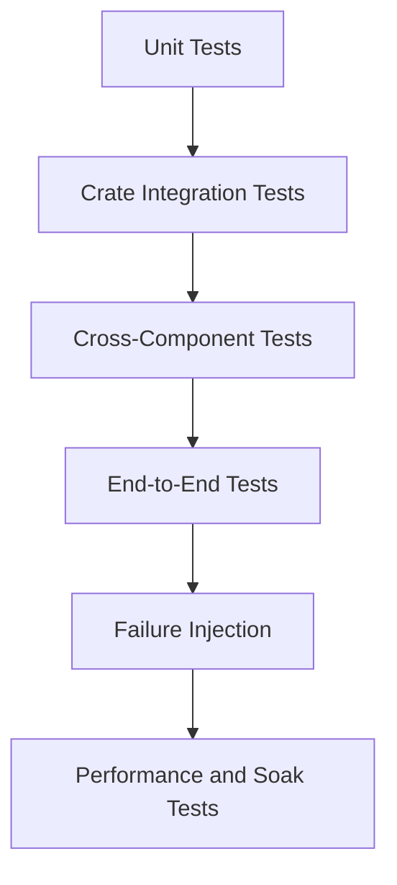
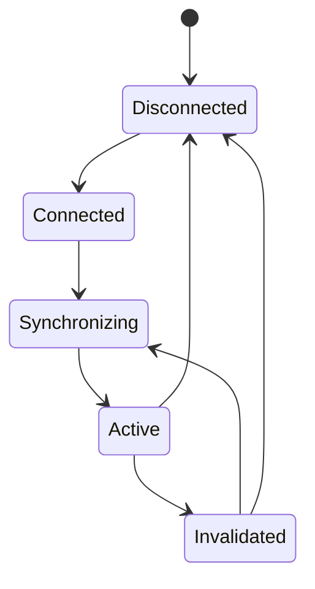
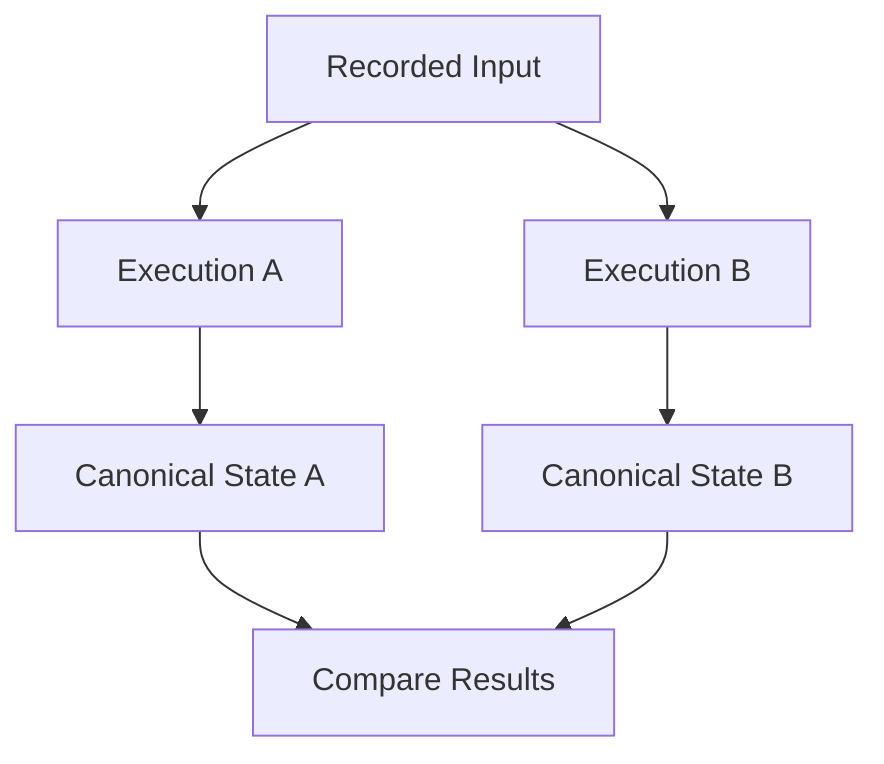

# Maxwell Testing and Validation

## 1. Purpose

This document defines Maxwell's testing strategy and
engineering validation requirements.

The testing objective is to establish confidence in
financial correctness, binary interoperability,
deterministic processing, concurrency behavior, recovery,
and bounded resource consumption.

Tests should verify observable contracts rather than
unnecessarily depend on private implementation details.

## 2. Testing Layers



Each layer addresses different failure classes.

Passing unit tests does not establish system-level
correctness.

## 3. Repository Test Organization

The preferred crate structure is:

```text
crates/component/
├── Cargo.toml
├── src/
│   ├── lib.rs
│   └── implementation.rs
└── tests/
    ├── integration.rs
    ├── determinism.rs
    └── failure_cases.rs
```

Unit tests generally reside beside their implementation.

Integration tests exercise public crate interfaces.

Actual test file names may vary by component.

## 4. Validation Commands

### 4.1 Workspace

```bash
cargo check --workspace

cargo test --workspace

cargo test --workspace --release
```

### 4.2 Individual Crate

```bash
cargo test -p maxwell-recovery
```

### 4.3 Specific Integration Target

```bash
cargo test -p maxwell-metrics --test determinism
```

### 4.4 Documentation Tests

```bash
cargo test --workspace --doc
```

### 4.5 Formatting and Static Analysis

```bash
cargo fmt --all -- --check

cargo clippy --workspace --all-targets -- -D warnings
```

## 5. Unit Testing

Unit tests should verify:

- Valid inputs.
- Invalid inputs.
- Boundary values.
- Empty state.
- Capacity limits.
- Arithmetic overflow.
- State transitions.
- Error reporting.
- Reset behavior.
- Invariant preservation.

Example using the metrics counter:

```rust
use maxwell_metrics::Counter;

#[test]
fn counter_saturates() {
    let mut counter =
        Counter::with_value(u64::MAX - 1);

    counter.add(10);

    assert_eq!(counter.value(), u64::MAX);
}
```

Test names should communicate the expected behavior.

Prefer:

```text
rejects_snapshot_with_invalid_watermark
```

Over:

```text
test_snapshot_2
```

## 6. Component Validation Matrix

| Crate | Required Test Areas |
|-------|---------------------|
| Core | Range, scale, arithmetic, conversions |
| Protocol | Encoding, decoding, malformed input |
| Sequencer | Continuity, duplicates, gaps, exhaustion |
| Book | Mutation, ordering, quantities, snapshots |
| Transport | Framing, partial I/O, capacity, errors |
| Recovery | Retransmission, snapshots, replay, exhaustion |
| Publisher | Filtering, ordering, activation, backpressure |
| Gateway | Session lifecycle, delivery, invalidation |
| Client | Initialization, updates, reconnect, synchronization |
| Metrics | Saturation, histograms, aggregation, concurrency |

## 7. Financial Arithmetic Testing

Fixed-point tests should include:

- Minimum valid value.
- Maximum valid value.
- Zero where permitted.
- Invalid negative values where applicable.
- Checked addition.
- Checked subtraction.
- Multiplication overflow.
- Conversion overflow.
- Scale conversion.
- Rounding boundaries.

Financial arithmetic tests should not use approximate
floating-point equality when the underlying representation
requires exact integer equality.

## 8. Protocol Testing

### 8.1 Round-Trip Tests

For valid messages:

```text
decode(encode(message)) == message
```

Round-trip tests are necessary but insufficient.

An encoder and decoder can contain the same mistake.

### 8.2 Golden Vectors

Golden vectors independently define expected bytes.

They should verify:

- Message identifiers.
- Header layout.
- Field widths.
- Byte ordering.
- Financial representation.
- Sequence values.
- Timestamp representation.

### 8.3 Malformed Input

Required cases include:

- Empty buffer.
- Truncated header.
- Truncated payload.
- Invalid message length.
- Unsupported message type.
- Invalid domain values.
- Unsupported version.
- Oversized message.
- Invalid reserved fields where applicable.

A malformed message must not panic or cause unrestricted
allocation.

### 8.4 Cross-Language Validation

Planck and Maxwell should share protocol fixtures.

Both implementations must encode and decode the same
golden vectors.

Cross-language interoperability tests remain a required
application integration milestone.

## 9. Sequencing Tests

Example sequence scenarios:

| Input | Expected Logical Outcome |
|-------|--------------------------|
| 1, 2, 3 | Continuous processing |
| 1, 2, 2, 3 | Duplicate detected |
| 1, 2, 4 | Missing sequence detected |
| 1, 3, 2 | Out-of-order or recovery handling |
| Maximum sequence | Explicit exhaustion behavior |

These examples assume a sequence starting at one.

Actual tests must follow the implemented initialization
and sequence contract.

Verify that rejected or duplicate events do not advance
state incorrectly.

## 10. Order Book Testing

### 10.1 Basic Operations

Test:

- Empty book.
- Initial bid.
- Initial ask.
- Existing price-level update.
- Price-level removal.
- Best-price changes.
- Multiple price levels.
- Multiple instruments.
- Invalid quantity.
- Capacity exhaustion where applicable.

### 10.2 Invariants

After each relevant mutation, verify:

- Price ordering.
- Quantity validity.
- Best-price correctness.
- Instrument isolation.
- Consistent snapshot representation.

### 10.3 Reference Model

A simple reference implementation can provide an
independent correctness oracle.

The reference model may favor readability over speed.

Apply identical event sequences to the reference model
and optimized implementation, then compare canonical
state representations.

## 11. Recovery Testing

Recovery tests should exercise both successful and
unsuccessful synchronization.

### 11.1 Retransmission Recovery

```text
Initial state:
    Events 1, 2 applied.

Incoming event:
    Event 4 arrives.

Expected:
    Gap at event 3 detected.
    Event 4 retained if policy permits.
    Recovery requested.

Recovery response:
    Event 3 arrives.

Expected:
    Event 3 applied.
    Event 4 replayed.
    Synchronization restored.
```

### 11.2 Snapshot Recovery

```text
Initial state:
    Synchronization lost.

Recovery:
    Snapshot representing sequence 100 received.

Buffered events:
    99, 100, 101, 102.

Expected:
    Snapshot validated.
    Events already represented by snapshot excluded.
    Eligible events 101 and 102 applied in order.
    Synchronization restored only after validation.
```

This example assumes a last-included-event watermark.

Tests must use the actual watermark convention.

### 11.3 Failure Cases

Test:

- Invalid snapshot.
- Incorrect recovery scope.
- Missing retransmission response.
- Duplicate recovered event.
- Incorrect recovery watermark.
- Recovery buffer exhaustion.
- Failed replay callback.
- Repeated sequence gaps.
- Recovery cancellation.
- Recovery restart.

### 11.4 Transactional Replay

A failed event application must not advance replay
progress incorrectly.

Retrying a failed application must not duplicate a
previously successful state mutation.

## 12. Publisher Testing

### 12.1 Filtering

Test:

- Wildcard subscription.
- Empty instrument selection.
- Selected instruments.
- Selected event types.
- Global events.
- Multiple overlapping subscriptions.

### 12.2 Ordering

Verify:

- FIFO subscriber delivery.
- Deterministic subscriber traversal.
- Monotonic accepted publication sequence.
- Valid filtered sequence gaps.
- Rejected publication sequence behavior.

### 12.3 Activation

Test:

- Pending subscriber receives no ordinary increments.
- Valid watermark activation.
- Invalid watermark rejection.
- Resynchronization activation.
- Unsubscribe and re-register behavior.

### 12.4 Backpressure

Under RejectPublication:

- Fill a matching subscriber queue.
- Attempt another matching publication.
- Verify rejection.
- Verify no partial fan-out.
- Verify publication sequence does not advance.
- Free capacity.
- Retry successfully.

Under RequireResync:

- Fill one subscriber queue.
- Continue publishing to multiple subscribers.
- Verify overloaded subscriber invalidation.
- Verify healthy subscriber continuity.
- Verify discarded queue accounting.
- Verify invalidated subscriber receives no ordinary
  increments until activation.

### 12.5 Sink Failure

Verify that failed sink acceptance retains the pending
publication.

Successful retry must remove the publication exactly once
from the publisher queue.

Transport-level partial writes require additional
integration tests.

## 13. Gateway and Client Testing

Test the complete session lifecycle:



This is a conceptual lifecycle, not an enumeration of
exact implementation variants.

Required scenarios include:

- Session establishment.
- Duplicate session registration.
- Subscription acceptance.
- Subscription rejection.
- Snapshot delivery.
- Incremental delivery.
- Slow consumer.
- Transport failure.
- Session invalidation.
- Reconnection.
- Resource cleanup.

Verify that client state cannot become synchronized
without satisfying the initialization contract.

## 14. Deterministic Testing

Identical logical inputs and initial state should produce
identical logical results.

A deterministic test should record:

- Input seed.
- Event sequence.
- Initial configuration.
- Initial market state.
- Final market state.
- Publication sequence.
- Relevant logical error outcomes.

### 14.1 Reproducible Randomness

Use a fixed random seed for generated workloads.

When a randomized test fails, report the seed and enough
input information to reproduce the failure.

### 14.2 Canonical State Comparison

State comparison must not depend on:

- Pointer addresses.
- Hash table iteration order.
- Uninitialized padding.
- Wall-clock timestamps.
- Nondeterministic diagnostic ordering.

Use a canonical logical representation.

### 14.3 Replay Validation



Compare final state and relevant publication results.

Intermediate state checkpoints can help locate the first
divergence.

## 15. Concurrency Testing

Concurrency tests should verify:

- No lost updates.
- No duplicate ownership transfer.
- Queue ordering.
- Queue capacity.
- Shutdown completion.
- Correct atomic counter behavior.
- Correct snapshot transfer.
- Correct concurrent telemetry collection.

### 15.1 Atomic Counter Example

```rust
use std::thread;
use maxwell_metrics::AtomicCounter;

#[test]
fn concurrent_updates_are_preserved() {
    let counter = AtomicCounter::new();

    thread::scope(|scope| {
        for _ in 0..4 {
            let counter = &counter;

            scope.spawn(move || {
                for _ in 0..10_000 {
                    counter.increment();
                }
            });
        }
    });

    assert_eq!(counter.value(), 40_000);
}
```

Repeated successful stress tests do not constitute a
formal proof of concurrency correctness.

### 15.2 Scheduling

Avoid tests that depend solely on arbitrary sleeps.

Prefer explicit synchronization using:

- Barriers.
- Channels.
- Thread joins.
- Defined test hooks.
- Controlled clocks.

### 15.3 Advanced Tools

Potential future validation tools include:

- Loom for modeled concurrent execution.
- Miri for supported Rust execution checks.
- ThreadSanitizer where supported.
- AddressSanitizer where supported.

These tools require appropriate toolchain and platform
configuration.

They are not currently assumed to be integrated into
Maxwell's validation pipeline.

## 16. Metrics Testing

Verify:

- Counter saturation.
- Gauge saturation.
- Atomic counter concurrency.
- Histogram boundary behavior.
- Overflow bucket behavior.
- Exact accepted observation count.
- Exact observation sum.
- Percentile monotonicity.
- Compatible histogram aggregation.
- Incompatible histogram rejection.
- Registry capacity.
- Metric name validation.
- Stable snapshot ordering.
- Prometheus text formatting.

Histogram aggregation should match equivalent serial
recording when bounds and accepted observations match.

## 17. Resource Exhaustion Testing

Every bounded component should be tested at:

- Zero capacity configuration where invalid.
- Capacity minus one.
- Exact capacity.
- Capacity plus one.
- Repeated fill and drain cycles.
- Repeated reset cycles.

Verify that failure does not cause unrestricted fallback
allocation.

Storage-capacity assertions alone do not prove that no
other allocation occurred.

Allocation-free claims require additional instrumentation
or profiling.

## 18. Failure Injection

The simulator should eventually support controlled
injection of:

- Missing messages.
- Duplicate messages.
- Out-of-order messages.
- Malformed frames.
- Truncated stream writes.
- Transport disconnects.
- Recovery delays.
- Recovery rejection.
- Snapshot corruption.
- Subscriber slowdown.
- Queue saturation.
- Session reconnect storms.

Every failure scenario should define:

- Initial state.
- Injected failure.
- Expected transition.
- Expected error.
- Expected final state.
- Recovery requirements.
- Resource bounds.

## 19. End-to-End Testing

The integrated server must be tested with:

- Simulator-generated input.
- Actual Planck input.
- One downstream client.
- Multiple downstream clients.
- Filtered subscriptions.
- Upstream recovery.
- Downstream resynchronization.
- Graceful shutdown.

A successful end-to-end test should reconcile client
market state with the authoritative expected state.

## 20. Soak Testing

Soak tests exercise sustained workloads over extended
periods.

Monitor:

- Memory growth.
- Queue occupancy.
- Throughput.
- Tail latency.
- Connection count.
- Recovery frequency.
- Error accumulation.
- CPU utilization.
- Resource cleanup.

Soak testing should include periodic failure injection
and reconnect activity.

Test duration and workload must be documented.

## 21. Proposed Continuous Integration

The following GitHub Actions workflow is a starting
point for automated validation.

Suggested location:

```text
.github/workflows/ci.yml
```

```yaml
name: Maxwell CI

on:
  push:
  pull_request:

jobs:
  validate:
    runs-on: ubuntu-latest

    steps:
      - name: Checkout
        uses: actions/checkout@v4

      - name: Install Rust
        run: |
          rustup toolchain install stable
          rustup component add rustfmt clippy

      - name: Formatting
        run: cargo fmt --all -- --check

      - name: Type checking
        run: cargo check --workspace

      - name: Clippy
        run: cargo clippy --workspace --all-targets -- -D warnings

      - name: Development tests
        run: cargo test --workspace

      - name: Release tests
        run: cargo test --workspace --release

      - name: Documentation
        run: cargo doc --workspace --no-deps
```

Review toolchain pinning, action version pinning, caching,
permissions, and platform coverage before adopting this
workflow.

This is a proposed workflow, not an assertion that CI
has already been configured.

## 22. Regression Policy

Every confirmed correctness defect should receive a
regression test where practical.

The test should:

1. Reproduce the original defect.
2. Fail before the correction.
3. Pass after the correction.
4. Remain part of routine validation.

Avoid removing failing tests merely to restore a green
build.

## 23. Definition of Done

A change is ready for review when:

- [ ] Formatting passes.
- [ ] Compilation passes.
- [ ] Clippy passes.
- [ ] Relevant unit tests pass.
- [ ] Relevant integration tests pass.
- [ ] Workspace tests pass.
- [ ] Release-mode tests pass.
- [ ] New failure cases are tested.
- [ ] Resource limits are preserved.
- [ ] Determinism requirements are preserved.
- [ ] Documentation is updated.
- [ ] Performance impact is measured when relevant.
